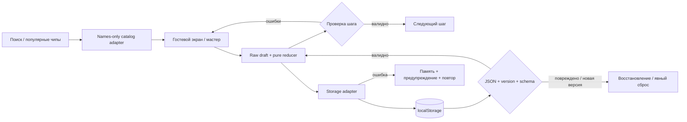

# Phase 01: Гостевой старт и сохраняемые настройки — Research
**Дата:** 2026-10-26 · **Домен:** гостевая React SPA, мастер, локальный черновик · **Confidence:** MEDIUM

<user_constraints>
## User Constraints (from CONTEXT.md)
Источник следующей дословной выдержки: [VERIFIED: .planning/phases/01-gostevoy-start-i-sohranyaemye-nastroyki/01-CONTEXT.md:18-54,105-110].
<!-- DATA_M7P2R4K9_START -->
### Locked Decisions
### 1. Гостевой путь и навигация

- **D-01 — перенесено из требований:** русский гостевой интерфейс, ₽ и единицы г/кг/мл/л/шт; имя/логотип из конфигурации. Приветствие содержит объяснение «Настройки → Меню → Покупки», основное действие открывает мастер. При наличии валидного существующего плана `/` ведёт на `/menu`; сейчас плана в проекте нет.
- **D-02 — auto, C-06:** сохранить четыре позиции навигации, включая «Профиль», но до P1 открывать по ней пояснение о гостевом режиме и будущем профиле с возвратом к меню. Не показывать форму профиля/входа и не создавать тупиковую ссылку. Такое пояснение — состояние каркаса, а не досрочная реализация P1. Форма открытия (небольшой экран или доступный диалог) остаётся обратимой UI-деталью.
- **D-03 — перенесено + auto:** на телефоне нижняя навигация, от 1200 px боковая, отдельное «Новое меню». В мастере нижней навигации нет. У `/menu`, `/shopping`, `/pantry` до появления соответствующего содержимого — честные пустые состояния и безопасный путь к настройкам; у неизвестного рецепта — «Такого рецепта нет» и возврат. Фаза 1 не должна сообщать об успешной генерации.

### 2. Шаги, дефолты, дни и бюджет

- **D-04 — перенесено:** шаг 1 — люди 1–10, цель, дни 1–7; шаг 2 — бюджет, время, разнообразие; шаг 3 — ограничения/исключения; шаг 4 — домашние продукты. Дни остаются на шаге 1 по основному F §12.1, несмотря на V. Прогресс «Шаг N из 4», доступный возврат, закреплённое действие. Назад/вперёд не очищают ввод.
- **D-05 — auto, UI-часть Q-01:** предложенная семантика — введённая сумма является бюджетом выбранного периода; подпись явно «Бюджет на неделю» для 7 дней и «Бюджет на N дней» для другого периода. Подсказка равна `budget / people / days`, с «≈» и обычным русским форматированием. Смена дней не изменяет введённую сумму скрытым пересчётом. Это решение обсуждения, а не найденный ответ исходника. **База финансового лимита (все ингредиенты или дополнительные покупки), стартовая дата и обязательность слотов Q-01/Q-04 остаются для Phase 2.** Маппинг старого имени weeklyBudget в контракт согласуется до генерации.
- **D-06 — перенесено + auto, Q-02:** подтверждённые начальные значения: 2 человека, 7 дней, 3 000 ₽, поддержание веса, до 30 минут, пустые ограничения для нового гостя. Новые выбранные дефолты: `variety=medium`; чип «4+» устанавливает 4, далее доступны «+» до 10. Никакие дефолты не заменяют восстановленные значения пользователя.
- **D-07 — auto, Q-02:** числовой бюджет — целые рубли от 500, только конечное безопасное целое; дробные, отрицательные, пустые и некорректные значения дают ошибку у поля. Максимум ручного ввода в ТЗ не задан — не объявлять 15 000 ₽ жёстким максимумом поля. Слайдер сохраняет диапазон 1 000–15 000 с шагом 100. В представимом диапазоне и на сетке синхронизация точная; для точного ручного значения вне диапазона/сетки поле сохраняет приоритет, положение ползунка лишь граничное/ближайшее, рядом явно указано «Точная сумма введена вручную». Сдвиг ползунка выбирает его сумму и снимает эту пометку. Не обрезать 500 ₽ до 1 000 или 20 000 ₽ до 15 000 молча. Это **явно выбранное уточнение** противоречивой синхронизации, не новая версия диапазонов ТЗ; доступное имя/значение ползунка не должны сообщать ложное точное значение поля.
- **D-08 — auto:** «Далее» проверяет текущий шаг; ошибка рядом с полем, фокус на первом невалидном поле. Переход не очищает частичный ввод. Выход из изменённого мастера с первого шага требует подтверждения; отмена выхода оставляет всё на месте. Подтверждение выхода само по себе не означает удаление сохранённого черновика.

### 3. КБЖУ: ручная норма и неизвестный калькулятор

- **D-09 — auto, безопасная часть WIZ-09:** ручная норма имеет явную базу «на человека в день»: ккал, Б/Ж/У в граммах. Полный набор введённых пользователем конечных неотрицательных значений с положительной калорийностью сохраняется с происхождением «Введено вручную». Пустой набор — отсутствие нормы; частичный набор не превращается в нули или рассчитанную норму. Медицинские диапазоны и рекомендации не выдумываются. В интерфейсе указывать, что планирование не является медицинской рекомендацией.
- **D-10 — открытые ворота C-04/Q-03:** автообсуждение не изобретает медицинскую формулу, коэффициенты активности, поправку цели, универсальную «среднюю норму» и примеры-ответы. `2100/105/70/260` — пример исходника, не дефолт. Мини-форма расчёта присутствует в подробном P0-мастере, но приоритет расчёта противоречит сводке P1. **Нельзя считать ручной ввод полным закрытием C-04 или молча удалить мини-форму.** До реализации её вычисления требуется отдельно обоснованное решение приоритета и формулы/контракта. Планировщик должен отделить безопасную ручную часть от заблокированной, а не записывать ложную готовность WIZ-09/всей фазы. При отсутствии нормы не показывать сравнение с нулём и не выводить медицинскую оценку.

### 4. Домашние продукты, ограничения и черновик

- **D-11 — перенесено:** пять чипов ограничений из ТЗ, теги «Не люблю» с автоподсказкой, Enter/запятая добавляют, крестик удаляет. Совпадение и исключение привязаны к продуктам, а не только похожим названиям. Сохранённые аллергии/исключения нельзя терять по навигации.
- **D-12 — auto, Q-07:** продукт разрешено добавить без количества. Хранить этот случай отдельно от известного нуля; отображать «Количество не указано». Такая запись сообщает о наличии, но не даёт основания вычитать произвольный объём из покупок. В Phase 1 только сохраняется состояние; точная политика предпочтения/вычета и справочник конверсий нужны Phase 2. Известное количество должно быть конечным положительным числом с совместимой единицей; г↔мл↔шт не конвертируются без проверенной базы. Для повторного добавления того же productId фокусировать существующую строку, не удваивать количество без действия пользователя.
- **D-13 — auto, Q-11:** рабочий черновик мастера отделён от последних подтверждённых настроек и глобальных запасов. Черновик сохраняет шаг и частичные значения, включая невалидные строки для исправления. Пропуск не используется как скрытая очистка аллергий и не удаляет глобальные запасы. Само редактирование шага 4 не считается расходованием или безусловным изменением глобального pantry. Семантика кнопки «Пропустить» при запуске и атомарное применение к настройкам/запасам остаются Phase 2/5; в Phase 1 не имитировать это применение.
- **D-14 — auto, P0-часть Q-15:** выбрать версионированное локальное гостевое хранение через заменяемый адаптер. Прочитанный снимок валидировать. При повреждении не перезаписывать исходную запись молча: показать понятное состояние с безопасным возвратом и явным сбросом. При недоступном хранилище/ошибке записи продолжать редактирование в памяти с предупреждением «Не удалось сохранить на этом устройстве» и повтором, не сообщать об успешном сохранении. Выбор localStorage либо другого бесплатного локального механизма, ключей и миграции — ответственность исследования/плана. Аккаунты и синхронизация не входят в фазу.

### 5. Визуальный стиль, состояния и доступность

- **D-15 — перенесено + auto, Q-17:** основа — светлые зелёные PDF-макеты: спокойный фон, белые мягкие карточки, зелёные основные действия, выраженная сумма бюджета. Единство обеспечивается общими токенами/компонентами. Финальное название, логотип и точный шрифт не утверждены; использовать заменяемые ресурсы с кириллицей, без новых брендовых обещаний. Персонаж остаётся P2.
- **D-16 — перенесено:** mobile-first 360/390/430, далее 768/1280 px; никакого горизонтального скролла страницы. Подписи полей постоянные, ошибки текстом, доступная клавиатура и видимый фокус; цвет не единственный сигнал; цели ≥44×44 px, главные мобильные кнопки ≥48 px. Закреплённое действие не закрывает поле, ошибку или сфокусированный элемент. Существующие общие критерии QA не переносятся исключительно в Phase 7.
- **D-17 — auto:** поиск продукта показывает загрузку/пустую выдачу/ошибку с повтором, не создаёт неизвестный продукт автоматически. Популярные чипы соответствуют каталожным ID; до подтверждения базового справочника можно планировать интерфейс, но не выдумывать КБЖУ/цены и соответствие пищевым ограничениям. UI-шаблон и формат данных не подтверждают наличие достоверной базы Q-14.

### Agent's Discretion

Обратимые детали доступных компонентов, точные токены по макету, формат сохранённого черновика, схема модулей, технический выбор адаптера и приёмочные тесты. Не делегированы выдумывание пищевых фактов, платные зависимости, изменение P0/P1/P2 или молчаливое закрытие C-04. Все auto-решения пересматриваются при прямой коррекции пользователя; это не новые утверждения об исходных документах.

### Deferred Ideas (OUT OF SCOPE)
Генерация и применение сохранённых/пропущенных настроек, финансовая база лимита/даты/слоты — Phase 2. Политика вариантов — Phase 3; автоматическое изменение/списание запасов не добавляется. Профиль и вычисление нормы имеют P1/спорную границу C-04; формула, средние нормы и medical-input валидация остаются открыты. Талисман, семейная синхронизация, штрихкоды и P2 не планируются.

Не закрыты: C-04/Q-03; вычислительные части Q-01/04/05/06/07/11/14/16; серверные/аккаунтные части Q-15; условия измерения LCP/исторического Safari из Q-17. Их существование не делает готовыми WIZ-09 или всю фазу. Автоматический переход к коду остановлен прежним ограничением пользователя, а не отсутствием доступа или платного сервиса.
<!-- DATA_M7P2R4K9_END -->
</user_constraints>

## Summary
Рекомендуется небольшая клиентская SPA: React + Router, чистые функции проверки и reducer, заменяемые storage/catalog adapters. Расчёт подсказки, отображаемое положение слайдера и ошибки выводить из исходного черновика; React рекомендует не дублировать вычисляемое состояние. [CITED: https://react.dev/learn/choosing-the-state-structure]
Безопасная часть фазы — каркас, четыре шага, ручная норма с происхождением, каталог только названий/ID и устойчивое сохранение. **Отдельный план-checkpoint C-04/Q-03 обязателен до реализации вычисления нормы; ручной ввод не завершает WIZ-09 или фазу.** Основание — дословный D-10 выше. Генерацию и применение настроек не имитировать; прежний запрет исполнения сохраняется. [VERIFIED: .planning/phases/01-gostevoy-start-i-sohranyaemye-nastroyki/01-CONTEXT.md:10-14,36-37]
**Primary recommendation:** сначала спланировать исполнимый безопасный срез, затем обязательные ворота калькулятора и зависимую реализацию; при неразрешённом checkpoint оставить фазу незавершённой.

## Project Constraints (from AGENTS.md)
- Первичен подробный frontend-источник; изучать reference, фиксировать конфликты; русский UI/общение, RUB, mobile-first, общие токены и PDF-ориентиры. [VERIFIED: AGENTS.md:14-24,295-325]
- GSD — единственный workflow; применять доменные правила, UI UX Pro Max, React Best Practices, Superpowers для TDD/debug/review/verification, Context7 для API, Playwright для реальных браузерных проверок. [VERIFIED: AGENTS.md:56-137; .agents/skills/mealplan-domain/SKILL.md:215-227]
- React/strict TypeScript/Vite/Tailwind/Router; необязательные state/query библиотеки только по потребности; mock adapters, логика вне UI, стабильные ID, валидировать данные, обрабатывать ошибки. [VERIFIED: AGENTS.md:141-168,329-342; .agents/skills/mealplan-domain/SKILL.md:15-33]
- P0 прежде P1, P2 только по запросу; не выдумывать питание/цены, не ослаблять ограничения, не смешивать несовместимые единицы, не вычитать запас повторно. [VERIFIED: AGENTS.md:172-291]
- Бесплатные локальные инструменты; никаких платных API/LLM/облаков без разрешения. Работать в проекте; сохранять изменения/документы, не коммитить секреты, не использовать разрушительные Git-команды. [VERIFIED: AGENTS.md:401-474]
- Тестировать соответствующую бизнес-логику и браузерные сценарии; размеры «360», «768», «1280» обязательны, дополнительно «390», «430»; typecheck, ESLint, production build, документация и работающий flow нужны для DoD. Не заявлять непроведённые проверки. [VERIFIED: AGENTS.md:299-306,346-377,478-490]

## Architectural Responsibility Map
Предлагаемое распределение (проектная рекомендация по границам D-13/D-14, не существующий код):
| Capability | Primary Tier | Secondary Tier | Rationale |
|---|---|---|---|
| Маршруты, навигация, адаптивность | Browser / Client | — | Гостевая SPA без аккаунта |
| Черновик и ошибки шагов | Client reducer + pure domain | UI | Сырые строки сохраняются отдельно от валидных параметров |
| Восстановление/запись | Storage adapter | Browser storage | UI получает явный результат операции |
| Поиск продуктов | Catalog adapter | Локальные names/IDs | Не создавать факты питания и неизвестные продукты |
| Калькулятор нормы | Не назначать до C-04/Q-03 | UI после решения | Медицинский контракт не утверждён |
| Генерация/покупки/pantry commit | Следующие фазы | — | Не побочные эффекты редактирования |

## Standard Stack
Версии ниже — **опубликованные npm metadata**, прочитанные через registry.npmjs.org 26.10.2026; не значения package.json из main. Это кандидаты для preflight, не готовый совместимый lockfile. Для SUS действует предупреждение: **[WARNING: flagged as suspicious — verify before using.]**
| Компонент | Published version / дата | Назначение и решение |
|---|---|---|
| react + react-dom | 19.3.1 / 2026-10-14, SUS | UI; официальный React, reducer/context без дополнительного store [CITED: https://react.dev/learn/scaling-up-with-reducer-and-context] |
| react-router | 8.5.0 / 2026-10-19, SUS | Declarative BrowserRouter/Routes/NavLink [CITED: https://reactrouter.com/start/declarative/installation] |
| vite + @vitejs/plugin-react | 8.3.5 / 2026-10-21; 6.1.2 / 2026-10-05, SUS | Сборка и официальный React plugin [CITED: https://vite.dev/plugins/] |
| tailwindcss | 3.4.19 / 2025-12-10, OK | **Использовать 3.4**, поскольку v4 требует Safari 16.4+ [VERIFIED: npm registry]; [CITED: https://tailwindcss.com/docs/upgrade-guide] |
| postcss + autoprefixer | 8.5.31 / 2026-10-18, SUS; 10.6.1 / 2026-09-15, OK | Интеграция Tailwind 3 с Vite [CITED: https://v3.tailwindcss.com/docs/guides/vite] |
| typescript | latest 7.0.2 / 2026-07-08, OK | **Не брать latest вслепую:** typescript-eslint 8.72.0 объявляет peer «>=4.8.4 <6.1.0»; preflight должен выбрать опубликованный совместимый TS pin [VERIFIED: npm registry] |
| vitest; @playwright/test | 5.0.5 / 2026-10-15; 1.64.1 / 2026-10-14, SUS | Node unit + browser e2e [CITED: https://vitest.dev/guide/]; [CITED: https://playwright.dev/docs/intro] |
| eslint; typescript-eslint; @eslint/js | 10.13.0 / 2026-10-16, SUS; 8.72.0 / 2026-10-19, SUS; 10.0.1 / 2026-02-06, OK | Flat config, TS lint; проверить peers до установки [CITED: https://typescript-eslint.io/getting-started/] |
| @types/react + @types/react-dom | 19.3.0 / 2026-09-09, OK | React TS declarations [VERIFIED: npm registry]; [CITED: https://www.typescriptlang.org/docs/handbook/react.html] |
Рекомендация: пока без Zustand, Query, form framework, сервера, Firebase, LLM и платных сервисов; текущий объём обходится reducer/context и двумя адаптерами. Валидация компактной схемы — чистые явные type guards, отдельно от проверок бизнес-значений. Это обратимый технический выбор, не новый продуктовый scope.
**Safari 15:** явный build.target с Safari 15; Vite преобразует синтаксис, но не добавляет polyfills API. CSS также проверять отдельно; не полагаться на default baseline. [CITED: https://vite.dev/guide/build]

## Package Legitimacy Audit
GSD seam выполнен для всех перечисленных пакетов, а опубликованные версии/даты/peers/postinstall прочитаны из npm. «too-new» относится к свежему релизу и не доказывает подмену официального проекта. У всех проверенных прямых пакетов postinstall отсутствовал; транзитивные зависимости этим не проверены. [VERIFIED: npm registry; query package-legitimacy check]
| Пакеты | npm: недельные загрузки, округлённо | Source repo | Verdict / disposition |
|---|---|---|---|
| react; react-dom | 123.7M; 116.4M | react/react | SUS, too-new / install checkpoint |
| react-router | 35.6M | remix-run/react-router | SUS, too-new / install checkpoint |
| vite; @vitejs/plugin-react | 127.2M; 63.3M | vitejs/vite; vitejs/vite-plugin-react | SUS, too-new / install checkpoint |
| typescript; tailwindcss; autoprefixer | 196.2M; 88.7M; 38.2M | microsoft/TypeScript; tailwindlabs/tailwindcss; postcss/autoprefixer | OK / совместимость TS ещё проверить |
| postcss; vitest; @playwright/test; eslint | 199.8M; 83.7M; 49.8M; 102.2M | postcss/postcss; vitest-dev/vitest; microsoft/playwright; eslint/eslint | SUS, too-new / install checkpoint |
| typescript-eslint; @eslint/js | 58.9M; 90.2M | typescript-eslint/typescript-eslint; eslint/eslint | SUS / checkpoint; OK |
| @types/react; @types/react-dom | 112.7M; 97.0M | DefinitelyTyped/DefinitelyTyped | OK |
Дополнительно проверены опциональные scaffold-пакеты: globals 17.13.0 (01.10.2026) SUS; eslint-plugin-react-hooks 7.1.1 (17.04.2026) OK; eslint-plugin-react-refresh 0.5.7 (14.09.2026) OK. Их добавление не обязательно; preflight сверяет источник и peers. [VERIFIED: npm registry; query package-legitimacy check]
**SLOP removed:** none. **Install preflight:** отдельный checkpoint:human-verify для SUS до установки; выбрать совместимые опубликованные pins, сверить engines/peers/официальные repo и scripts, записать lockfile. Не применять --force/--legacy-peer-deps для сокрытия конфликта. В этой задаче установка запрещена; команд установки здесь нет.

## Architecture Patterns
Предлагаемая схема данных; все имена модулей/полей ниже — проектные предложения, а не существующие определения:

- Предлагаемые модули: app (routes/providers), features/wizard (steps/reducer), domain/settings (guards/validation/selectors), adapters/storage, adapters/catalog, shared/ui и shared/format. Не строить generic repository framework.
- Сохранять сырые строки чисел, шаг, выбранные ID, редактируемые количества и manual nutrition; семантический парсер отдельно возвращает валидный результат или ошибки. Draft ≠ confirmed settings ≠ global pantry. Структурная валидность снимка не означает, что все поля уже готовы к «Далее». Основание: дословные D-08/D-09/D-12/D-13 выше.
- Предлагаемое хранение: один ключ mealplan:guest:draft:v1 и envelope с schemaVersion=1 + draft. Читать один раз до включения autosave; проверять JSON, размер/форму, версию, шаг, допустимые значения и IDs. Неизвестную версию/битый JSON не мигрировать угадыванием. Не перезаписывать исходник до явного сброса; сохранить raw в памяти recovery. Не делать blanket localStorage.clear().
- Любой доступ к storage внутри try/catch: policy может запретить доступ. Запись при каждом небольшом изменении, без отложенной потери последних символов; read/write failures отображать, retry пишет текущий draft. Успех обозначать только после успешного setItem; persistence не выполнять внутри reducer. [CITED: https://developer.mozilla.org/en-US/docs/Web/API/Window/localStorage]; [CITED: https://react.dev/reference/react/useReducer]
- Для 500, 1050 и 20000 бюджет остаётся точным; слайдер только проецирует его на диапазон/сетку. После движения слайдера каноническая сумма становится его значением. Пометка и доступное описание различают обе величины. Основание: дословный D-07 выше. Проверять Number.isSafeInteger; не превращать пустую строку через Number в известный ноль.
- Каталог — небольшой явно локальный список ID/названий/синонимов, включая популярные чипы «яйца, курица, помидоры, творог, рис, картофель». Никаких nutrient/price/safety полей без Q-14. Это UI-справочник, не доказательство достоверной продовольственной базы. [VERIFIED: reference/PRD.md:123-125] Поиск через adapter с детерминированными test doubles для loading/empty/error; Enter/запятая добавляют только распознанный ID. Повтор ID фокусирует строку, не суммирует скрыто.
- Предпочесть native input/range/checkbox/button; searchable combobox соблюдать APG: aria-expanded/controls/activedescendant, стрелки/Enter/Escape, именованная кнопка удаления тега. Не создавать продукт из свободного текста. [CITED: https://www.w3.org/WAI/ARIA/apg/patterns/combobox/]
- Routes из источника дословно: «/», «/plan/new», «/plan/generating», «/menu», «/recipe/:id», «/shopping», «/pantry». [VERIFIED: reference/PRD.md:88-94] /plan/generating при прямом открытии без операции показывает честное отсутствие генерации с возвратом. Валидный existing-plan redirect проверяется через injectible plan-presence port/fixture; не объявлять произвольный объект валидным MenuPlan до контракта Phase 2.
- UI: config brand + ru formatter; токены фона/поверхности/зелёного/ошибки/spacing, системный кириллический font stack. Боковая навигация от «1200 px», мастер без нижней панели. [VERIFIED: reference/PRD.md:102,324-331] Для Safari 15 использовать 100vh fallback и safe-area inset; не требовать нового dialog/inert без fallback. Sticky action получает отступ контента; клавиатура не закрывает поля.

## Don't Hand-Roll
| Задача | Использовать | Избегать |
|---|---|---|
| SPA navigation / active state | Router NavLink/Routes [CITED: https://reactrouter.com/start/declarative/routing] | Собственный history router |
| Вычисляемые значения | Чистые selectors [CITED: https://react.dev/learn/choosing-the-state-structure] | Effect-цепочки бюджет↔slider↔hint |
| Денежный/числовой вывод | Intl.NumberFormat [CITED: https://developer.mozilla.org/en-US/docs/Web/JavaScript/Reference/Global_Objects/Intl/NumberFormat] | Несколько несовпадающих formatter |
| Норма КБЖУ | Только ручная часть D-09 до gate | Придуманная формула/среднее/пример как дефолт |

## Common Pitfalls
- Autosave раньше hydrate стирает восстановленный draft; recovery автоматически затирает raw. Проверить порядок bootstrap и запрет записи при повреждении. Основание D-14.
- Одна числовая модель теряет частичные строки, а null/0 смешивают неизвестное и известное. Развести raw/parsed; проверить reload на незавершённом числе. Основание D-09/D-12/D-13.
- «Шаг 4 завершён» случайно запускает fake generation или применяет pantry. Пока доступна только подготовка; WIZ-08 и commit в следующих фазах. Основание D-13 и Phase Boundary.
- Tailwind v4 fallback улучшает старые браузеры, но не меняет официальную целевую поддержку: не считать его гарантией Safari 15. [CITED: https://tailwindcss.com/blog/tailwindcss-v4-1]
- Router declarative mode сам по себе не доказывает правильное подтверждение выхода: тестировать «Назад» шага 1, отмену/подтверждение и сохранённый draft; расширенную блокировку browser history не подменять очисткой. Основание D-08.

## Code Examples
Официальный проверенный способ отделить reducer от компонентов; имена draftReducer/initialDraft — предлагаемые:
```tsx
// https://react.dev/learn/scaling-up-with-reducer-and-context
const [draft, dispatch] = useReducer(draftReducer, initialDraft);
// Вычисляемое значение не сохраняется отдельным state:
const perPersonPerDay = validBudget / validPeople / validDays;
```
Последняя формула — дословное правило «budget / people / days» [VERIFIED: .planning/phases/01-gostevoy-start-i-sohranyaemye-nastroyki/01-CONTEXT.md:29]; вычислять только при валидных аргументах. Это не финансовый лимит генератора.

<phase_requirements>
## Phase Requirements / Validation Architecture
Описание исходных требований — [VERIFIED: .planning/REQUIREMENTS.md:12-27,102]. Ниже точные ID и предлагаемая карта проверок. Все test paths/config/scripts **новые**, их должен создать Wave 0; эти команды сейчас не запущены.
**Framework:** Vitest 5.0.5 node + Playwright 1.64.1 (SUS, preflight выше). Config: предложенные vitest.config.ts, playwright.config.ts. Quick: `npm run test:unit -- --run` (<30 s — целевой бюджет, измерить). Full: `npm run test:unit -- --run`, `npm run test:e2e`, `npm run typecheck`, `npm run lint`, `npm run build`. Предложенный test:unit=vitest, test:e2e=playwright test. [CITED: https://vitest.dev/guide/]; [CITED: https://playwright.dev/docs/test-cli]
| ID | Поведение / Research support | Тип / предложенная команда | Exists |
|---|---|---|---|
| APP-01 | Гостевой доступ, все P0 routes, deep-link/reload, unknown recipe | e2e: npm run test:e2e -- guest.spec.ts | No, Wave 0 |
| APP-02 | Низ/бок 1200, отдельное новое меню, fullscreen wizard/generating, profile explanation/back | e2e: npm run test:e2e -- navigation.spec.ts | No |
| APP-03 | Welcome → wizard; injected valid-plan fixture → /menu; invalid snapshot не redirect | unit + e2e: npm run test:e2e -- guest.spec.ts | No |
| WIZ-01 | 4 шага, прогресс/назад, текущая validation, first error focus; confirm exit cancel/accept | e2e: npm run test:e2e -- wizard.spec.ts | No |
| WIZ-02 | reload шага 3 с тегами/сырыми полями; corrupted/unknown version; read/write throw; retry; raw не overwritten | unit: npm run test:unit -- --run storage.test.ts; e2e wizard.spec.ts | No |
| WIZ-03 | Люди границы 1/10, «4+»→4, дни 1/7/default7, goal; restore приоритетнее default | unit: npm run test:unit -- --run settings.test.ts | No |
| WIZ-04 | 500/1000/1050/15000/20000; unsafe integer/decimal/empty/NaN; slider+aria; дни меняют hint, не budget | unit: npm run test:unit -- --run budget.test.ts; e2e wizard.spec.ts | No |
| WIZ-05 | 15/30/60/любое; same/medium/max/default medium; round-trip | unit: npm run test:unit -- --run settings.test.ts | No |
| WIZ-06 | Пять ограничений; product-ID tags, Enter/comma/remove; unknown search; no lost exclusions | e2e: npm run test:e2e -- products.spec.ts | No |
| WIZ-07 | Search/chips, missing amount≠0; positive amount/unit; expiresSoon; duplicate focus; no global pantry write | unit + e2e: npm run test:e2e -- products.spec.ts | No |
| WIZ-09 | Все пустые / partial / complete / negative / nonfinite; origin manual; no default 2100; отсутствие не 0 | unit: npm run test:unit -- --run nutrition-target.test.ts; calculator cases BLOCKED C-04/Q-03 | No |
| UX-01 | Русский UI, ₽, г/кг/мл/л/шт; formatter/config brand сменяются согласованно | unit + e2e: npm run test:e2e -- presentation.spec.ts | No |
**Wave 0:** package/lock + engines/peer preflight; scripts/strict TS/ESLint, Vitest include только unit (исключить e2e), Playwright testDir/webServer и проекты Chromium/Firefox/WebKit; isolated storage fixtures, rejected catalog/search doubles, валидный plan-presence fixture без fake UI. Node environment достаточно чистым функциям; DOM проверяет Playwright, дополнительный jsdom не требуется по предлагаемой архитектуре. [CITED: https://vitest.dev/guide/features]; [CITED: https://playwright.dev/docs/test-configuration]
**Sampling:** быстрые unit после каждого business task; релевантный e2e при UI/storage изменениях; полный набор перед wave/phase gate. На 360/390/430/768/1280 проверить overflow, focus, target sizes и скриншоты; отдельно 1199/1200 nav boundary. Все размеры из источника выше; граница добавлена как проверка.
**Manual limits:** ручной keyboard/screen-reader/contrast и PDF-reference visual inspection; реальная виртуальная клавиатура/safe areas на iOS. Playwright WebKit основан на свежем upstream и не запускает branded Safari, поэтому не доказывает Safari 15; исторический iOS доступ не подтверждён. LCP methodology Q-17 и calculator acceptance остаются открытыми. [CITED: https://playwright.dev/docs/browsers]
</phase_requirements>

## Security Domain
security_enforcement включён: «true», уровень «1». [VERIFIED: .planning/config.json:46-48] Актуальная ASVS — 5.0.0; старые номера V2/V3/V4/V5 из шаблона нельзя выдавать за её структуру. [CITED: https://asvs.owasp.org/]
Применимость: input validation и безопасный browser output/storage — да; authentication/session/access control/crypto — не вводить в гостевую фазу без сервера/аккаунта. Конкретный выбор контролей — scoped engineering recommendation, не сертификация ASVS. React text rendering вместо HTML injection, local snapshot как недоверенный input, исключить credentials/PII калькулятора до gate, reset только своего draft key. Угрозы: Tampering (подмена snapshot → guards), XSS (product labels → text), disclosure (минимизация локальных данных), data loss (ошибки storage → memory/recovery); никаких самодельных crypto/auth.

## Environment Availability
Наблюдения read-only probes 26.10: Node v24.12.0, npm 11.6.2; cached Chromium/Firefox/WebKit directories существуют, запуск не проверен. Исходная точка — «Кода приложения, package.json, src/app, компонентов, hooks и codebase-карт нет». [VERIFIED: .planning/phases/01-gostevoy-start-i-sohranyaemye-nastroyki/01-CONTEXT.md:86-90] Framework/config/tests создаются будущим исполнением. Registry/Context7 доступны; backend/API не нужны. Safari 15 device и performance profile не установлены этим исследованием. Missing with fallback: storage → memory + warning; browser cache mismatch → установка согласованных Playwright browsers в будущем. Missing blocking for acceptance: решение calculator C-04/Q-03; доказательство именно Safari 15 остаётся QA gap, не подменяется современным WebKit.

## State of the Art / Assumptions Log / Open Questions
- Текущий Router имеет declarative SPA API; framework/SSR не требуется. Старый import из react-router-dom не копировать без сверки версии. [CITED: https://reactrouter.com/start/declarative/installation]
- Tailwind 3.4 — осознанный compatibility pin; Vite explicit target не обеспечивает API polyfills. [CITED: https://tailwindcss.com/docs/upgrade-guide]; [CITED: https://vite.dev/guide/build]
- **C-04/Q-03 gate:** подтвердить приоритет мини-калькулятора, источник/формулу/коэффициенты/диапазоны/контракт результата и ошибок либо явно согласованное изменение scope. До этого зависимый план не исполняется и WIZ-09/Phase 1 не помечаются complete.
- **Install gate:** SUS/peer mismatch выше. Исторический Safari15 и LCP — явные непроверенные условия Q-17. Q-14 не закрыт names-only справочником; финансовые/генерационные решения следующих фаз не принимаются здесь.
**Assumptions:** новых фактических claims из памяти нет; предлагаемые имена/структура/тесты помечены как проектные рекомендации, доступные discretion. Непроверенные runtime/browser outcomes не заявляются.

## Sources / Metadata
Primary: прочитанные AGENTS.md, PROJECT/REQUIREMENTS/STATE/CONTEXT/config, PRD §4–5.2/12–14, OPEN_QUESTIONS, mealplan-domain и UI/React skills; опубликованный npm registry + GSD legitimacy output. External documentation: React /reactjs/react.dev, Vite /vitejs/vite, Tailwind /tailwindlabs/tailwindcss.com, Router /websites/reactrouter, Playwright /microsoft/playwright через Context7; официальные URL приведены рядом с claims.
**Confidence:** repo decisions HIGH (дословные значения с line refs); stack/architecture/pitfalls MEDIUM (официальные docs и release metadata, совместимый lockfile ещё не испытан). classify-confidence seam для context7, включая --verified, вернул MEDIUM. Shared research cache по заданию не менялся; direct Context7 → official docs использованы без cache writes. **Valid until:** 2026-11-02 для package pins; locked context действует до явной коррекции. Приложение, зависимости и исходные документы не изменялись; тесты приложения не выполнялись.

