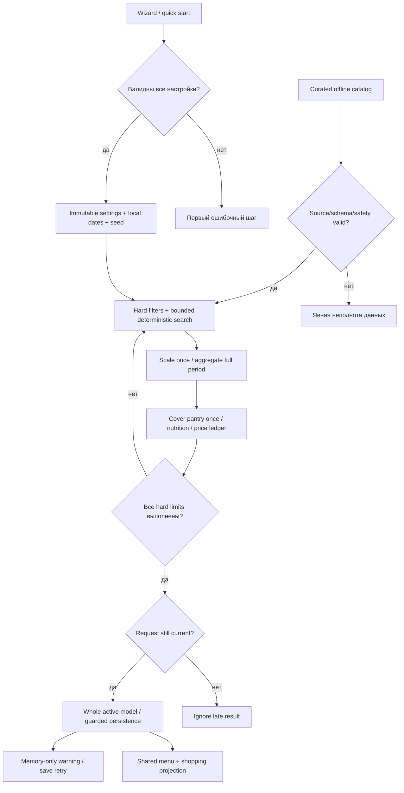

# Phase 02: Первый допустимый план и рассчитанные покупки — Research

**Researched:** 2026-10-27
**Domain:** offline food provenance, exact meal calculations, deterministic search and active-plan lifecycle
**Confidence:** MEDIUM

<user_constraints>
## User Constraints (from CONTEXT.md)

### Locked Decisions
Ниже — **рекомендованные решения, автоматически выбранные агентом**, а не вымышленные ответы человека или факты исходников. Они уточняют поведение в разрешённом `--auto`; фактические цены, пищевые значения, сертификаты и медицинские нормы этим не утверждаются. История C/Q сохраняется; фактическая закрытость источников устанавливается research/validation.

### Запуск и применение настроек
- **D-01:** Генерация использует неизменяемый applied snapshot валидных четырёх шагов. Editable draft, applied settings, активный план и глобальный pantry — разные сущности. Финальное действие становится настоящим запуском, а прежняя честная заглушка удаляется только при подключённой операции.
- **D-02:** «Меню за 1 клик» повторно использует последние валидные applied settings; при их отсутствии применяет валидный текущий draft/согласованные defaults Phase 1. Невалидный draft открывает первый ошибочный шаг, а не молча исправляется. Отсутствующая норма остаётся отсутствующей. При повторной генерации старый активный план сохраняется до полного успеха.
- **D-03:** «Пропустить» шаг 3/4 означает продолжить, сохранив имеющиеся ограничения/домашние строки; это явно объясняется. Удаление — отдельное действие. Пропуск не снимает аллергию/исключение и не меняет глобальный pantry. Новые значения не становятся applied при простом редактировании.

### Период, бюджет и отображение питания
- **D-04:** Лимит относится к **оценке дополнительных покупок всей семьи за выбранные дни**, а не к полной цене ингредиентов. Это выбранная auto-политика Q-04, не цитата из F. Три суммы обязательны: ингредиенты, покрытие запасами, покупки; остаток = лимит − покупки. База лимита написана рядом с суммой; цены ориентировочные, без обещания суммы чека/учёта упаковок.
- **D-05:** Даты начинаются с локального календарного «сегодня» в момент запуска, всего 1–7 дней, четыре слота ежедневно: завтрак/обед/ужин/перекус. Сохраняются календарные даты и basis, без сдвига дня из-за UTC. КБЖУ дня/среднего и сравнение с manual target — **на одного человека в день**; семейные totals отдельно и явно подписаны. Стоимость дня — полная стоимость ингредиентов семьи, не произвольное распределение общей закупки между днями.
- **D-06:** Необязательная ручная норма — **мягкая цель подбора и сравнения**, не медицинская граница допустимости. Никаких средних норм по цели, новых клинических диапазонов или формулы. При отсутствии цели не считать её нулём; при наличии показывать отклонение и предусмотренное F текстовое предупреждение строго свыше +10%. Это auto-решение оставшейся части Q-03; пищевые запреты и бюджет всегда жёсткие.

### Данные и происхождение
- **D-07:** Рабочий каталог офлайн, версионирован и проверяется на границе адаптера. Нутриенты имеют явную reference quantity/unit, источник и идентификатор записи; цена — reference quantity/unit, валюту RUB, источник, регион/период наблюдения и статус оценки. Нет цены/нутриента/подтверждения ограничения — нет подстановки 0/true. Вариант с неполными обязательными данными не становится допустимым.
- **D-08:** Research должен самостоятельно найти бесплатные первичные источники и проверить условия использования. Направления исследования, **не утверждённые источники**: официальные общедоступные таблицы состава продуктов, включая USDA SR Legacy/FoodData Central bulk; открытая статистика/официальные публикации цен РФ; допускаются проверенные публичные retailer данные с датой и областью применимости. Никакого обязательного API key, платного API или обхода доступа. Если точные данные нельзя получить/сопоставить, зафиксировать конкретный блокер с найденными материалами, не изобретать значения.
- **D-09:** Рецепты имеют устойчивый ID, исходное число порций, ингредиенты в явных количествах/единицах и допустимые типы слотов. Масштабирование от baseServings применяется один раз до вычислений. Выход в порциях обязателен; приготовленную массу/плотность/граммы одной штуки не угадывать. Собственные рецептуры допустимы как авторский контент с прозрачным происхождением; пищевые числа всё равно рассчитываются из проверенных продуктов. Условия фото/текстов и достаточность целевого каталога 50+ проверяются Q-14; 10–15 fixtures не доказывают этот каталог или разнообразие.

### Жёсткие ограничения и запасы
- **D-10:** Все действующие пять ограничений, явные исключённые IDs и аллергии — жёсткие; неизвестная применимость не равна безопасности. «Без рыбы» консервативно исключает также морепродукты, с явным описанием. Не определять халяль только по отсутствию свинины, gluten/lactose — только по названию. Нужна прослеживаемая ingredient/safety metadata для выбранного ограничения; непроверенное исключается/даёт объяснимую неполноту данных.
- **D-11:** Выбранное время — верхний предел cooking time одного рецепта; «любое» его снимает. Не нарушать предел ради бюджета/нормы/запасов. Приоритет скоро портящихся продуктов — мягкий, по возможности первые 1–2 дня; он не ослабляет жёсткие условия.
- **D-12:** Сначала агрегировать потребности **всего плана** по productId и совместимому measurement basis; затем вычесть известный запас ровно один раз, без отрицательных покупок. g↔kg и ml↔l совместимы; масса↔объём/шт — только с проверенной продуктовой конверсией. Unknown quantity даёт лишь предпочтение, не бесконечный запас/скидку. Несовместимый запас не покрывает потребность; UI объясняет, почему. Генерация ничего физически не списывает.

### Воспроизводимость и отказы
- **D-13:** Одни applied settings + catalog version + seed дают те же рецепты/количества/totals. Жёсткие фильтры проверяются до ранжирования. Мягкие предпочтения: использование expiresSoon, близость к заданной норме, выбранное разнообразие, стоимость; порядок/тай-брейк фиксирован и тестируем, без выдуманных медицинских весов.
- **D-14:** `same` допускает повторы и предпочитает компактный набор рецептов; `medium` предпочитает не повторять тот же рецепт в соседних днях одного слота; `max` предпочитает больше различных recipeIds за период. Это мягкие предпочтения, не причина нарушать бюджет/ограничения. Модель результата сразу допускает массив вариантов и active ID; в Phase 2 достаточно одного настоящего допустимого плана, Phase 3 реализует требуемые 3–4 уникальных варианта без фиктивных дублей.
- **D-15:** Проверка бюджета учитывает итоговую закупку после общего pantry-покрытия, а не сумму независимых цен рецептов. `BUDGET_TOO_LOW`/минимум X требуют обоснования: доказанный расчёт/нижняя граница должны быть различены с ценой просто найденного кандидата. Неполный/ограниченный поиск не доказывает отсутствие решения и не называется глобальным минимумом. При исчерпании ограниченного поиска — отдельное честное объяснение, без ложного успеха/ложного «рецептов нет». Исследователь/планировщик задают проверяемый bounded алгоритм и критерии доказуемых отказов.
- **D-16:** Реальная асинхронная операция, request ID, отмена и 30s timeout; поздний ответ/запись не применяются. Строки F меняются примерно раз в 2s только пока pending; быстрый успех не задерживается ради анимации. «Отмена» возвращает к исходному экрану/сохранённым настройкам. Error/retry не теряют draft/старый план; budget error ведёт на шаг 2. Deep reload без активной операции честно сообщает, что генерация прервана/не запущена.

### Точность, сохранение и базовые экраны
- **D-17:** Полная точность количеств и исходных пищевых/ценовых значений сохраняется при вычислениях; промежуточное округление не должно менять жёсткий budget decision. Представление: деньги — копейки с округлением half-up, ккал — целые, Б/Ж/У — один знак, quantity — без скрытого обрезания значащих данных. Денежный итог складывается из канонических округлённых product rows; покрытие выводится как согласованная разность ingredient/purchase values, три суммы обязаны сходиться. Выбор точного численного представления — техническая задача research, не повод добавлять платную/лишнюю библиотеку.
- **D-18:** Версионированный активный план сохраняет applied settings, даты, seed/catalog version, recipe instances и pantry snapshot. Успех заменяет активный план целиком; повреждение/сбой storage не изображаются успешным сохранением. Memory-only состояние и retry явны. PlanPresencePort получает реального валидируемого producer; noPlan не подменяется truthy object. Защита CR-01 и разделение dirty draft/loaded snapshot сохраняются.
- **D-19:** `/menu` и `/shopping` используют одну активную модель и общие derived calculations. В Phase 2 — настоящий базовый обзор дней/блюд, даты, питание, manual comparison, три суммы/остаток и покупки по категориям с источниками конкретных day/slot instances и «Уже есть дома». N товаров — число ненулевых shopping rows. Полный recipe navigation/варианты и ручное редактирование покупок не имитируются; позже подключаются через устойчивые IDs. Календарь не выдумывает сохранённую историю/P1.
- **D-20:** Приёмка требует Vitest с независимыми численными ожиданиями и реального браузерного пути wizard/quick-start → pending/cancel/error/retry → menu → shopping → reload. Проверить неизвестные данные, ограничения, budget bounds, совместимость units, однократное pantry-покрытие, scaling и precision, сохранность Phase 1. Её существующие тесты не ослаблять ради нового UI; изменившиеся намеренно Phase 2 состояния обновляются адресно. Платные услуги, новые direct packages и публикация не требуются по умолчанию.

### Agent's Discretion
Организация файлов/чистых функций, простая модель точных чисел, безопасное разбиение вычислений, async local ports и стратегия поиска — у исследователя/планировщика. Изменения чужих источников/системных настроек, платные сервисы и необоснованные пищевые/ценовые факты не разрешены auto-режимом.

### Deferred Ideas (OUT OF SCOPE)
- Точные источники/лицензии/сопоставление цен и нутриентов, конверсии штук/плотности и достаточность 50+ рецептов — **не подтверждены** этим discuss; Phase 2 research обязан принести evidence. При невозможности бесплатного решения автоцепочка останавливается с конкретным блокером.
- Коэффициенты персонального калькулятора/средние нормы — NEXT-10 P1, не решаются здесь.
- 3–4 варианта/полные рецепты, замены/порции, pantry CRUD, ручные покупки и PDF остаются назначенным фазам.
- Одноразовые auto-политики Q-03/04/05/06/07/08/11/16 записаны как решения агента; это не заявление, что исходники содержали отсутствующие значения или человек отвечал на эти вопросы.
</user_constraints>

## Summary

**Рекомендация:** оставить установленный стек, реализовать один чистый расчётный конвейер и один versioned active-plan adapter; импорт пищевых/ценовых данных сделать отдельными проверяемыми задачами перед приёмкой DATA-01/02. Это проектное решение в области D-01–20, а не утверждение о готовом коде. [CITED: 02-CONTEXT.md, D-01–20]

USDA SR Legacy доступен бесплатно без API key: архив реально скачан, CSV разобраны, core продукты и четыре нутриента найдены. Права CC0 подтверждены официально. Однако generic US food нельзя автоматически объявлять российским творогом/сертифицированным продуктом. Росстат даёт подходящие официальные цены, но в этой среде исходные файлы не получены из-за TLS; доступные поисковые выдержки не закрывают проверку исходных bytes. Q-14 **частично разрешён**, окончательный food/price/safety catalog ещё не готов. [CITED: https://fdc.nal.usda.gov/api-guide/; https://fdc.nal.usda.gov/download-datasets/] [VERIFIED: .tmp/phase2-source-final-proof.json:1-24 — наблюдения URL/error/no_observation]

Confidence MEDIUM: seam `classify-confidence --provider websearch --verified` вернул `"confidence": "MEDIUM"`; использование дополнительных official sources не повышается вручную. `webfetch --verified` вернул LOW; его не использовали как основание уверенности. Research не устанавливал пакеты, не выполнял application tests и не менял приложение. [VERIFIED: выполненные команды research-plan/classify-confidence, 2026-10-27]

## Project Constraints (from AGENTS.md)

Следующие обязательные директивы учесть в каждом плане. [CITED: AGENTS.md §§1–16; .agents/skills/mealplan-domain/SKILL.md]

- Первичен подробный frontend PDF; исходные документы сохранять, конфликты документировать. GSD — единственная система планирования, прогресс обновлять.
- Общение/UI по-русски, RUB; mobile-first, 360/390/430/768/1280 px, без горизонтального overflow; единые tokens/контролы, доступность и loading/empty/error.
- Автономно выполнять routine решения, не требовать от пользователя кода; вопросы только о действительном критическом блокере, credentials, расходах или необратимых действиях.
- P0 раньше P1/P2; автоматический nutrition calculator, auth, history, cooking/PNG сюда не входят. Фазы рецептов/редактирования/pantry CRUD/PDF не имитировать.
- Strict TypeScript, без ненужного any/абстракций; чистые deterministic domain functions отдельно от React; структурированные валидируемые данные и async mock ports; backend/Firebase только при конфигурации.
- Не придумывать цены/нутриенты/безопасность; hard dietary filters не ослаблять. Stable IDs, явные measurement bases, совместимые conversions, pantry один раз за весь период. Три суммы обязательны.
- Vitest для арифметики/ограничений, Playwright для browser flow/адаптивности; typecheck, lint, production build перед завершением. Не объявлять непроведённые проверки успешными. При ошибке root cause/regression verification.
- Использовать domain skill, Superpowers для TDD/debug/review/verification, UI UX Pro Max для UI, Vercel React patterns для интеграции, Web Design Guidelines для review; Context7 для version-sensitive API.
- Без ненужных direct dependencies, платных сервисов/API, secrets, публикации, destructive Git и системных изменений. Работать внутри проекта; внешние данные считать untrusted.
- Коммиты focused; сохранять чужие изменения/оригиналы. Definition of Done включает реальный flow и актуальную документацию.

## Architectural Responsibility Map

Это назначение ответственности по D-01/07/12/18/19. [CITED: 02-CONTEXT.md]

| Capability | Primary Tier | Secondary Tier | Rationale |
|---|---|---|---|
| Проверка/import каталога | build-time/offline data adapter | pure domain validator | В runtime нет сети/секретов; импорт сохраняет provenance |
| Quantities, scaling, КБЖУ, pantry, цены | чистый domain | — | Одинаковая формула для solver/menu/shopping |
| Детерминированный поиск | local asynchronous adapter | pure domain evaluator | Бounded вычисления, отмена и порционная отдача управления |
| Draft → applied settings | browser coordinator | pure validation | Draft редактируется отдельно; snapshot неизменяем |
| Active plan/presence | browser storage adapter | memory session | Версия и валидация одного persisted envelope |
| Menu/shopping projection | browser components | shared selectors | UI не хранит независимые totals |
| Реальный backend | будущий API tier | существующие ports | В этой фазе отсутствует эксплуатационная зависимость |

<phase_requirements>
## Phase Requirements

Описания ниже сокращены для test mapping; канонические формулировки — REQUIREMENTS.md. [CITED: .planning/REQUIREMENTS.md §§Старт, Мастер, Данные, Количества, Генерация, Меню, Покупки]

| ID | Description | Research Support |
|---|---|---|
| APP-04 | Быстрый запуск с last applied/defaults | Один snapshot builder для wizard/quick-start |
| WIZ-08 | Пропуск шагов 3/4 и запуск | Сохранить restrictions/home; review всех шагов |
| DATA-01 | ID, нутриентная/ценовая база, baseServings | Source manifest, USDA proof, price/safety gates |
| DATA-02 | Неизвестное не превращается в 0/true | Полная boundary validation + incomplete diagnostics |
| DATA-03 | Бесплатные локальные adapters | Только curated bundled data, без runtime fetch |
| CALC-01 | Совместимые количества | Exact dimension-aware arithmetic |
| CALC-03 | КБЖУ порции/блюда/дня/периода | Один scale factor и person/family selectors |
| CALC-04 | Три стоимости | product-row ledger; pantry value = difference |
| CALC-05 | Остаток/жёсткий лимит | exact purchase predicate + согласованный display |
| CALC-06 | Pantry после общей агрегации | aggregate → cover → price |
| CALC-07 | Единое округление | Один half-up formatter и канонические product rows |
| GEN-01 | Воспроизводимый подбор | stable ordering + seed + bounded deterministic work |
| GEN-02 | Жёсткая безопасность | Per-ingredient evidence, unknown excluded |
| GEN-03 | Pending/отмена | Request/revision guards; cooperative yielding |
| GEN-04 | Timeout/retry 30s | injectable clock/ports; late result ignored |
| GEN-05 | Честные budget/no-candidate failures | admissible lower bound/exhaustive proof; separate exhaustion |
| MENU-01 | Даты/лимит/среднее/estimate | persisted local dates + shared projection |
| MENU-04 | КБЖУ дня и >10% предупреждение | person-day basis, exact threshold |
| SHOP-01 | Базовая агрегированная закупка | nonzero rows, categories, meal-instance sources |
| SHOP-04 | «Уже есть дома» и покрытие | same product ledger, partial coverage split |
</phase_requirements>

## Standard Stack

Установленные pins, а не предложение обновить пакеты. Значения прочитаны из source of truth: `"react": "19.3.1"`, `"react-dom": "19.3.1"`, `"react-router": "8.5.0"`; `"vite": "8.3.5"`, `"vitest": "5.0.5"`, `"@playwright/test": "1.64.1"`, `"typescript": "6.0.3"`, `"tailwindcss": "3.4.19"`. [VERIFIED: package.json:14-32]

| Library/runtime | Version | Use |
|---|---|---|
| React / React DOM | 19.3.1 | существующий UI/coordinator |
| React Router | 8.5.0 | существующие маршруты |
| TypeScript | 6.0.3 | exact types + boundary guards |
| Vite / Tailwind | 8.3.5 / 3.4.19 | существующая сборка/стили |
| Vitest / Playwright | 5.0.5 / 1.64.1 | domain/adapter tests и реальные browser flows |
| JavaScript BigInt | ES2020 target | предлагаемый точный рациональный расчёт без библиотеки |

Таблица packages основана на приведённой цитате; ES target прочитан как `"target": "ES2020"`. [VERIFIED: package.json:14-32; tsconfig.json:3-4]

**Installation / Package Legitimacy Audit:** новых packages нет. Повторный registry audit существующих согласованных 16 pins и их reinstall не требуются. Не добавлять solver, decimal library, Zustand или Query ради этой фазы; использовать уже существующие React state/ports. Это рекомендация минимальной реализации в пределах D-20, а не новая package approval. [CITED: 02-CONTEXT.md D-20]

## Q-14: Sources, Actual Proof and Data Gates

### USDA: бесплатный источник состава подтверждён

Официальные ссылки: [download](https://fdc.nal.usda.gov/download-datasets/), [ZIP](https://fdc.nal.usda.gov/fdc-datasets/FoodData_Central_sr_legacy_food_csv_2018-04.zip), [лицензия](https://fdc.nal.usda.gov/api-guide/#bkmk-6), [SR guide](https://www.ars.usda.gov/ARSUserFiles/80400525/Data/SR-Legacy/SR-Legacy_Doc.pdf). Release April 2018 final, FDC row publication 2019-04-01. ZIP bytes = 6,074,592; SHA256 `b80817294b8850530aaedf2e515c02593b1824f763a0ff356e5c2081643e6fd0`; разбор дал 7,793 food rows. Выполнены обычный TLS GET и Python stdlib zip/csv; API key не использован. [CITED: https://fdc.nal.usda.gov/download-datasets/] [VERIFIED: .tmp/phase2-extract-usda.py:1-19, фактический stdout; .tmp/phase2-usda-proof.json:1-4]

Для join использовать FDC food ID, а не старый NDB number. В выгрузке прочитаны колонки `fdc_id`, `description`, `publication_date`; food_nutrient: `nutrient_id`, `amount`, `derivation_id`; food_portion: `amount`, `modifier`, `gram_weight`. Прочитанные nutrient definitions: `1003 Protein G`, `1004 Total lipid (fat) G`, `1005 Carbohydrate, by difference G`, `1008 Energy KCAL`. Это FDC IDs, не nutrient_nbr 203/204/205/208. [VERIFIED: .tmp/phase2-usda-proof.json:5-75; CSV original via .tmp/phase2-extract-usda.py]

| Прочитанная запись | fdc_id | Ккал / Б / Ж / У на 100 g edible |
|---|---|---|
| Egg, whole, raw, fresh | 171287 | 143 / 12.56 / 9.51 / 0.72 |
| Tomatoes, red, ripe, raw, year round average | 170457 | 18 / 0.88 / 0.2 / 3.89 |
| Potatoes, flesh and skin, raw | 170026 | 77 / 2.05 / 0.09 / 17.49 |
| Rice, white, long-grain, regular, raw, unenriched | 169756 | 365 / 7.13 / 0.66 / 79.95 |

Это **реальные строки источника**, не synthetic fixtures. Таблица основана на extracted food/value rows и официальной базе 100 g edible; файлы proof содержат исходные строки с ID и numeric strings. [VERIFIED: .tmp/phase2-usda-proof.json — food/value rows; .tmp/phase2-source-final-proof.json — additionalFoods/additionalNutrients] [CITED: https://www.ars.usda.gov/ARSUserFiles/80400525/Data/SR-Legacy/SR-Legacy_Doc.pdf, §4.5]

Порция egg `modifier=large, amount=1, gram_weight=50` существует; medium =44, extra large =56. **50 g нельзя присвоить любому egg/российскому С1**. Recipe может использовать явно заданное «крупное яйцо USDA, edible 50 g», иначе pcs→mass неизвестно. USDA cottage cheese и generic chicken обнаружены, но matching российского творога/филе/целой тушки не утверждён. [VERIFIED: .tmp/phase2-usda-proof.json — portions for 171287; .tmp/phase2-source-final-proof.json — additionalFoods]

SR nutrient reference — съедобная часть; пустое значение не ноль. Рассчитывать рецепт как сумму input ingredients с явной моделью edible/as-purchased; не обещать точный состав готовых 100 g, не выдумывать water absorption/retention/отходы. Raw↔cooked замена записи без смены recipe quantity недопустима. Эти ограничения следуют из reference basis источника. [CITED: https://www.ars.usda.gov/ARSUserFiles/80400525/Data/SR-Legacy/SR-Legacy_Doc.pdf, §§1.1,4.5,4.9]

### Росстат: первичный источник найден, исходные bytes не получены

Основной [weekly XLSX](https://rosstat.gov.ru/storage/mediabank/nedel_sred_cen.xlsx), [каталог цен](https://www.rosstat.gov.ru/statistics/price), [правила открытых данных](https://rosstat.gov.ru/opendata). Правила требуют законного использования, сохранения ссылки и отсутствия искажения. Это источник **средних цен**, не retail checkout guarantee; индекс 100.xx процентов не является RUB ценой. [CITED: https://rosstat.gov.ru/opendata?page=786; https://rosstat.gov.ru/folder/165737]

Контрольные публикации:
- [Кировская область, 19.10.2026](https://43.rosstat.gov.ru/storage/mediabank/Ned_19.10.26.htm): поисковая primary-source выдержка показывает куры 263.77 RUB/kg, sunflower oil 157.77 RUB/l.
- [Ярославская область, 28.09.2026](https://76.rosstat.gov.ru/storage/mediabank/o_srednikh_potrebitelskikh_tsenakh_na_prodovolstvennye_tovary_s_22_po_28_sentyabrya_2026_goda.html): rice 104.70 RUB/kg, potato 43.65 RUB/kg, tomato 196.18 RUB/kg, apple 156.10 RUB/kg. Эти значения **CITED only**, не готовый import snapshot: исходная таблица в этой сессии не скачана. [CITED: перечисленные официальные публикации]

Положительная попытка загрузки сохранена: `[SSL: CERTIFICATE_VERIFY_FAILED] certificate verify failed: unable to get local issuer certificate`. Schannel curl: `SEC_E_UNTRUSTED_ROOT`; Node, включая system CA: `UNABLE_TO_VERIFY_LEAF_SIGNATURE`; Invoke-WebRequest: `The SSL connection could not be established`. Это наблюдение **о данной среде**, не доказательство недоступности сервиса вообще. Сертификаты/verification не отключались. [VERIFIED: .tmp/phase2-source-final-proof.json:2-15 и фактические команды curl/Node/Invoke-WebRequest, 2026-10-27]

**Обязательная задача данных до приёмки:** получить официальный XLSX/HTML с обычной успешной TLS-проверкой, сохранить hash + raw columns/units/date/region, проверить хотя бы базовые продукты и curated mappings. Выбрать один наблюдаемый регион/дату для snapshot и явно показывать их. Не смешивать регионы без row-level metadata. Whole-chicken price нельзя умножать на edible breast grams без documented cut/yield; sunflower RUB/l нельзя применять к USDA grams без проверенной density. На первом наборе выбирать совпадающие mass bases, рис/овощи/фрукты; неподходящие конверсии исключать.

### Retail fallback и safety

[ВкусВилл товар 51256](https://vkusvill.ru/goods/tvorog-5-200-g-51256/) реально прочитан web tool: 200 g за 142 RUB; 100 g: 117 kcal, P16.5/F5/C1.5, молоко/закваска и указание milk/lactose. Но регион страницы не выбран, прямой GET вернул 403; правила/полная reuse permission не установлены. Это хороший точечный primary label reference, **не готовая региональная price база и не лицензия на фото/тексты**. Не обходить 403 и не копировать retailer recipes/photos. [CITED: https://vkusvill.ru/goods/tvorog-5-200-g-51256/] [VERIFIED: .tmp/phase2-source-final-proof.json:13-16]

Пять стабильных restriction IDs прочитаны буквально: `'no-fish'`, `'gluten-free'`, `'lactose-free'`, `'vegetarian'`, `'halal'`. [VERIFIED: src/domain/settings.ts:99-102]

| Ограничение | Evidence для разрешения | Не разрешать |
|---|---|---|
| Без рыбы | traceable ingredient identity, отсутствие fish/seafood по D-10 | ambiguous sauce/stock/processed derivatives |
| Vegetarian | полная ingredient composition/origin, включая gelatin/stock/rennet | вывод только по названию |
| Gluten-free | documented naturally gluten-free exact food или label/certification нужного packaged product; cross-contact отдельно | oats/grains с неподтверждённым cross-contact |
| Lactose-free | known composition/label; milk products отдельная проверка | lactose-reduced == lactose-free; milk allergy == lactose intolerance |
| Halal | source-specific certificate/authority evidence и scope либо подтверждённая полная классификация/процесс | blanket true на plant-only/no-pork recipes |

FDA подтверждает naturally gluten-free fruits/vegetables/eggs, но отдельно риск cross-contact grains; NIDDK различает lactose от protein allergy; Codex halal включает убой, оборудование/processing/storage. Это справочная база классификации, **не перенос американских label laws в российские требования**. Классификация каждой используемой строки и полнота allergen mapping ещё требуют curated manifest; unknown не проходит выбранный hard restriction. [CITED: https://www.fda.gov/food/nutrition-education-resources-materials/gluten-and-food-labeling; https://www.fda.gov/food/nutrition-food-labeling-and-critical-foods/questions-and-answers-gluten-free-food-labeling-final-rule; https://www.nichd.nih.gov/sites/default/files/publications/pubs/documents/NICHD_MM_Lactose_FS_rev.pdf; https://www.fao.org/4/Y2770E/y2770e08.htm]

### Авторские 50+ рецептов: осуществимый процесс, пока не готовый каталог

D-09 разрешает собственные рецептуры. Предлагается: импорт curated ingredients с source rows → написать оригинальные titles/ingredients/steps/baseServings/cookTime/slot eligibility → source-derived nutrient sums → independent review identity/yields/safety → catalog gate. Не копировать внешние рецепты/фото; использовать свои UI illustrations с прозрачной пометкой до отдельно разрешённых фото. Уникальность определять ingredient ratios/method, не 50 titles одного блюда; CI должен проверять минимум 50 реально различных, полных рецептов и распределение по четырём слотам. Небольшие numerical fixtures отдельно. Это предложенная authoring/QA стратегия по D-09, не утверждение кулинарного тестирования или достаточности уже существующих данных. [CITED: 02-CONTEXT.md D-09, D-14; reference/PRD.md §7.4]

## Architecture Patterns

### System Architecture Diagram

Проектируемый поток по D-01/07/12/18/19:



### Recommended boundaries / existing seams

Это рекомендации расширения существующих layers, не перечень уже созданных файлов. Pure domain: quantities/rational, source validation, recipe scaling, nutrition, shopping ledger, generation evaluator. Adapters: local catalog, cancellable generation port, active plan persistence. Feature coordinator отвечает за lifecycle; menu/shopping — читатели projection. Не переносить вычисления в JSX. [CITED: .agents/skills/mealplan-domain/SKILL.md §§1,11]

Существующие названия/контракты подтверждены: `ProductCatalogPort { search(query: string): Promise<readonly ProductName[]> }`; каталог содержит только `'egg'`, `'chicken'`, `'tomato'`, `'cottage-cheese'`, `'rice'`, `'potato'`. Это names/allowedUnits, не nutrient/price producer. Не переименовывать IDs; новый food profile должен уточнять identity/size/cut, сохраняя migration для прежнего draft при необходимости. [VERIFIED: src/adapters/products.ts:3-13]

`Unit = 'g' | 'kg' | 'ml' | 'l' | 'pcs'`; `cookingTime: '15' | '30' | '60' | 'any'`; `variety: 'same' | 'medium' | 'max'`. Defaults буквально: `people: '2', days: '7', goal: 'maintain', budget: '3000'`, `cookingTime: '30', variety: 'medium'`. Переиспользовать createDraft/validateStep и manual-target parser; не иметь второй preset таблицы. [VERIFIED: src/domain/settings.ts:7,27-28,36-42]

Существующий presence union: `{ status: 'absent' } | { status: 'valid'; planId: string } | { status: 'pending' } | { status: 'error' }`. Подключить producer, который валидирует полный active envelope; наличие JSON объекта не доказывает valid plan. [VERIFIED: src/app/App.tsx:12-21]

### Exact arithmetic and one ledger

Рекомендуемое численное представление: нормализованные rational BigInt numerator/positive denominator; source decimals читать как строки без промежуточного Number, reduce gcd после операций. На JSON boundary сериализовать числитель/знаменатель decimal strings и валидировать длину/размер. UI получает только ограниченную decimal presentation; не кастовать arbitrary BigInt в Number. Это технический выбор по D-17.

Конвейер: ingredient quantity × selectedServings/baseServings → dimension-normalized total by product/profile+basis → known compatible pantry coverage once → positive purchase → price at matching source basis. Nutrition складывается до pantry (имеющийся дома продукт всё равно съедается). Не использовать draft home в обход frozen pantry snapshot; unknown qty не делает покупку бесплатной.

Сохранять exact raw row costs. Display product rows округлять half-up до cents; sum этих rows — canonical displayed ingredient/purchase totals; covered = ingredient − purchase. Exact hard budget predicate проверять до rounding. Чтобы canonical sum нескольких rounded rows не оказалась выше лимита на копейки, дополнительно проверять отображаемую purchase sum ≤ budget; такой conservative rejection не даёт права объявлять задачу невозможной. Document/test этот редкий boundary case. Дневная цена — ingredient family cost; не дробить общую закупку произвольно между днями. Решение следует D-04/05/17.

### Bounded deterministic search, truthful failures

Предлагаемый алгоритм без solver dependency:
1. Stable sort IDs, validate catalog; hard-filter по слотам/time/restrictions/exclusions. Различать unknown-data rejection и достоверно несовместимые ingredients.
2. Precompute per-serving ingredient vectors/nutrients/costs. Создать последовательность day/slot instances; recipe selection scales только один раз.
3. Рассчитать cheap admissible exact lower bound: сумма минимальных ingredient costs независимых slot candidates минус максимум стоимости всего совместимого known pantry, clamp at zero. Такая bound может быть слабой; это нижняя граница, **не attainable minimum**.
4. Если bound > budget, дать доказанный budget refusal с явной подписью нижней границы; точный «минимум X» показывать лишь после exhaustive proof. Если candidates отсутствуют — объяснить фильтр/данные; не выдавать generic budget error.
5. Найти feasible incumbent стабильным cheapest baseline и bounded beam/local substitutions. Предлагаемые начальные deterministic limits: beam 32, 20,000 evaluated candidates, yield каждые 128 transitions. Это engineering defaults, не измеренная performance гарантия; проверить и подобрать benchmark.
6. Каждый полный candidate оценивать тем же full-period ledger с pantry, что UI. Partial costs без pantry не являются допустимым purchase pruning.
7. Выбирать только feasible; score lexicographic: expiresSoon early usage → manual-target deviation (если есть) → выбранная variety → purchase cost → seeded stable tie. Для manual zero macro сравнивать absolute deviation, не делить на ноль.
8. При исчерпании work budget без доказательства — отдельный typed search-exhausted result; не `BUDGET_TOO_LOW`/«рецептов нет». Это проектируемый новый контракт, его literal name planner определяет и тестирует. Без exhaustive search не заявлять global optimum.

Seed не создаётся через random внутри domain. Clock/date/id generator инъецируются; search work limit фиксирован, wall-clock timeout — отдельная lifecycle причина. Cooperative macrotask yielding даёт cancel/input и 30s timer возможность исполниться. Async Promise, который сначала блокирует main thread весь поиск, не удовлетворяет D-16.

### Apply/save transaction

Draft editable, last applied settings, active bundle и pantry snapshot хранить раздельно. Request получает monotonically increasing revision + abort signal; новая операция/cancel/timeout/unmount делает прежнюю неактуальной. Проверка current request требуется **перед каждым memory apply и storage write**. Все pending save операции сериализовать; late save не должен перезаписать новый envelope. Ошибка save оставляет valid memory-only plan и старый persisted snapshot, понятный retry. Corrupt/unknown version не перезаписывать автоматически. После reload pending operation не возобновлять фиктивно. Это расширение проверенного Phase 1 recovery pattern по D-18; модель операции проектируется, ещё не реализована. [CITED: 02-CONTEXT.md D-01/02/16/18; src/adapters/guestDraft.ts]

Сохранять catalog version и нужный immutable source/recipe snapshot либо удерживать загружаемый exact version; новый каталог не должен молча менять старые totals при reload. Derived totals при load пересчитывать и сравнивать, не доверять persisted nutrition/cost. Persisted inputs и source versions — авторитетный слой для reproduction; totals — проекция.

## Don't Hand-Roll

| Problem | Don't Build | Use Instead |
|---|---|---|
| Food facts/цены | правдоподобные AI числа | официальный curated snapshot с hashes/record IDs |
| Safety | regex по recipe title / отсутствие pork | traceable ingredient/label evidence, unknown blocked |
| Nutrition/norm | новая медицинская formula | structured sum; существующая optional manual target |
| State/recovery | второй draft owner / truthy presence | текущие ports/guards + новый полный active envelope |
| Optimization | собственный general-purpose LP solver | ограниченный pure search + честный exhaustion |
| Formatting | копии округления в UI | общий exact ledger и presentation selectors |

Предписания следуют D-01–20 и domain skill; это рекомендации, не перечень существующих готовых библиотек. [CITED: 02-CONTEXT.md; .agents/skills/mealplan-domain/SKILL.md]

## Common Pitfalls

- **Food identity mismatch:** USDA cottage cheese ≠ автоматически российский творог, bone-in chicken ≠ boneless breast, raw ≠ cooked. Требовать reviewed mapping; reject incompatible price/nutrient reference.
- **Inventory double spend:** вычет внутри каждого рецепта расходует один запас повторно. Aggregate full period before coverage.
- **Floating point budget:** rounded kcal/ingredient rows не должны менять exact accept/reject; canonical totals/remaining проверять вместе.
- **False impossibility:** beam/exhaustion — недостаточная полнота поиска, а не доказательство global minimum.
- **Cancel illusion:** unawaited result/storage write после cancel может заменить активный план; regression deferred promises обязателен.
- **Source/data drift:** bundled recipe/source update при сохранённом version должен дать точное восстановление или явную incompatibility.
- **False allergy guarantee:** общий нутриентный справочник не содержит label/cross-contact/certification всех SKU; safe=true по умолчанию запрещён.

Это проверочные риски, выведенные из D-07/10/12/15/16/17/18 и процитированных USDA/FDA/Codex ограничений, не утверждения о найденных багax Phase 1. [CITED: 02-CONTEXT.md; official sources выше]

## Code Examples

Ниже **проектный skeleton**, не существующая repo API; names и synthetic values специально локальные, пищевых фактов здесь нет. Точный cross multiplication — рекомендуемая реализация D-17.

```typescript
type Ratio = Readonly<{ n: bigint; d: bigint }>; // validated: d > 0
const lessOrEqual = (a: Ratio, b: Ratio): boolean =>
  a.n * b.d <= b.n * a.d;

// positive monetary values, convert RUB rational to kopecks, half-up
const halfUpKopecks = (rub: Ratio): bigint =>
  (2n * rub.n * 100n + rub.d) / (2n * rub.d);

// Synthetic arithmetic fixture only: not a price or food-data assertion.
const twoThirds: Ratio = { n: 2n, d: 3n };
const threeHalves: Ratio = { n: 3n, d: 2n };
lessOrEqual(twoThirds, threeHalves); // true
```

Сериализатор обязан преобразовать BigInt в strings; встроенный JSON storage pattern нужно расширить валидируемым codec, а не передавать BigInt напрямую. [CITED: https://developer.mozilla.org/en-US/docs/Web/JavaScript/Reference/Global_Objects/BigInt]

## State of the Art

| Предыдущий подход в проекте | Требуемый Phase 2 подход | Основание |
|---|---|---|
| Names-only products | source/profile-aware offline food data | products.ts names-only contract + D-07 |
| Editable settings draft | отдельный immutable applied snapshot | D-01 |
| Placeholder generation/menu/shopping | actual async producer + shared projection | D-16/19 |
| Presence absent default | validated active-plan producer | App presence contract + D-18 |

Это эволюция текущего проекта, не заявление о депрецированных внешних API. [CITED: 02-CONTEXT.md Existing Code Insights/D-01/07/16/18/19]

## Assumptions Log

| # | Claim | Section | Risk if Wrong |
|---|---|---|---|
| A1 | [ASSUMED] Получится получить исходный price snapshot со штатной TLS-проверкой в следующем окружении/через доступную официальную публикацию | Q-14 | Реальный каталог/достоверная приёмка задержатся |
| A2 | [ASSUMED] Curated ingredients + авторские рецептуры обеспечат минимум 50 различных полных recipe records с достаточным slot coverage | Q-14 | Не доказано разнообразие; заменить фиктивное обещание catalog gate |
| A3 | [ASSUMED] Начальные beam/work/yield limits уложатся в responsive budget на target devices | Architecture | Нужны benchmark и изменение engineering limits |

A2 — не блокирует создание authoring pipeline, но требует фактического corpus review до утверждения каталога. A3 — routine tuning в Agent's Discretion, не вопрос к пользователю. Нельзя переводить A1/A2 в «verified» по passing synthetic tests. [CITED: 02-CONTEXT.md D-08/09/20]

## Open Questions / Material Gates

1. **Price source file:** bytes/schema/units/source hash региона всё ещё отсутствуют для original download; primary indexed official price rows выше доступны как CITED evidence. Concrete options: доступный официальный XLSX/HTML с trusted TLS; копия официального файла от пользователя только если бесплатные штатные способы исчерпаны; регионально привязанный retailer snapshot с разрешённым доступом/понятными условиями. Не выбирать обход TLS/403 или случайный агрегатор.
2. **Food mapping/safety:** real nutrient source получен; reviewed mapping для milk/eggs/chicken, аллергенов, gluten/lactose/halal не закончено. Generic data не даёт batch certification. Unsupported evidence → explicit incomplete-data outcome, не relaxation.
3. **50+ corpus:** source-backed ingredient curation и оригинальные recipe records требуют отдельной implementation/QA задачи; сейчас 52 extracted USDA food matches — **не 52 recipes**.
4. **Q-14 disposition:** можно планировать и выполнять чистую арифметику, boundary adapters и lifecycle с явно synthetic tests. Финальный successful default generation/catalog acceptance не отмечать выполненным до source gates. Продолжить бесплатный import: web-readable official HTML/PDF таблица с датой/регионом/единицами допустима как первичный snapshot даже без XLSX; извлечённые значения хранить с URL, датой доступа и явным видом evidence. Публичная retailer-витрина без выбранного адреса может быть только явно подписанным ориентиром «вебвитрина, адрес/регион не выбран», без выдуманного города; сначала согласовать такую область применимости с D-07 в data task. При невозможности бесплатного source-ready решения вернуть пользователю конкретный материал/варианты; не повторять routine discuss.

## Environment Availability

| Dependency | Available | Version / observation | Fallback |
|---|---|---|---|
| Node / npm | да | v24.12.0 / 11.6.2 | установленный runtime |
| Python | да | 3.12.10; stdlib ZIP/CSV работает | одноразовый offline importer, не runtime dependency |
| USDA HTTPS ZIP | да | 6,074,592 bytes; hash выше | bundled curated extract |
| Росстат XLSX/HTML original | нет в сессии | TLS validation failed в четырёх штатных clients | другой доступный official source/предоставленный original |
| Retailer direct GET | не получен | HTTP 403; web-readable single page | не обходить, использовать другой authorised source |
| Test tools | pins/config обнаружены | framework execution в research не проводился | existing scripts в execution |
| Runtime backend/API | не нужен | design local/free | offline ports |

Версии измерены командами node/npm/python; сетевые наблюдения сохранены в proof. Browser binaries в research отдельно не проверялись; parent уже располагает Phase 1 evidence, но executors должны исполнить новые browser tests. [VERIFIED: выполненные environment probes, 2026-10-27; .tmp/phase2-source-final-proof.json]

## Validation Architecture

### Test Framework

Pins и команды буквально: `"test:unit": "vitest"`, `"test:e2e": "playwright test"`, `"typecheck": "tsc -p tsconfig.json"`, `"lint": "eslint ."`, `"build": "vite build --target safari15"`. [VERIFIED: package.json:6-12]
Существующий unit include: `['src/**/*.test.ts']`, environment `'node'`; browser projects `'chromium'`, `'firefox'`, `'webkit'`. [VERIFIED: vite.config.ts:31; playwright.config.ts:18-20]

| Property | Value |
|---|---|
| Framework | Vitest 5.0.5 / Playwright 1.64.1 |
| Config | текущие Vite/Playwright configs; не создавать второй test runner |
| Quick | `npm run test:unit -- --run` |
| Full gate | `npm run test:unit -- --run`; `npm run typecheck`; `npm run lint`; `npm run build`; `npm run test:e2e` |

### Phase Requirements → Test Map

Proposed files below — **new targets**, не существующие paths. Команды требуют создания этих test files; quick domain subset должен быть <30s по фактическому измерению, не утверждается заранее.

| Req IDs | Behavior | Test type | Proposed command | Exists? |
|---|---|---|---|---|
| DATA-01/02/03 | source/schema IDs, refs, unknown, food identity | unit + source audit | `npm run test:unit -- --run src/domain/catalog.test.ts` | Wave 0 |
| CALC-01/07 | exact parse/unit dimensions/half-up | unit independent expected table | `npm run test:unit -- --run src/domain/quantities.test.ts` | Wave 0 |
| CALC-03/04/05/06; SHOP-01/04 | scaling/nutrition/pantry/budget ledger | unit | `npm run test:unit -- --run src/domain/planProjection.test.ts` | Wave 0 |
| GEN-01/02/05 | filters, seed, time, proof vs exhaustion | unit/integration | `npm run test:unit -- --run src/domain/generation.test.ts` | Wave 0 |
| GEN-03/04; DATA-03 | abort/timeout/retry/late result/save | adapter unit + browser | `npm run test:unit -- --run src/adapters/activePlan.test.ts` | Wave 0 |
| APP-04/WIZ-08; GEN-03/04/05 | common wizard/quick-start flow | browser | `npm run test:e2e -- e2e/generation.spec.ts --project=chromium` | Wave 0 |
| MENU-01/04; SHOP-01/04 | date/person-family/display/reload | browser | `npm run test:e2e -- e2e/plan-shopping.spec.ts --project=chromium` | Wave 0 |
| Все | Phase 1 regression, storage corrupt/read/write/reset/retry | existing + additions | full gate выше, затем три browser engines | existing foundation |

### Independent expected cases

Это **synthetic numeric fixtures**, не факты каталога; source-backed USDA cases проверять отдельно.

| Fixture | Exact expected |
|---|---|
| 1 kg + 500 g | 1500 g; 1 l + 250 ml =1250 ml; g+ml mismatch |
| baseServings 2, selected 3, input 200 g | 300 g; никакого второго ×people |
| fake 100g = 120kcal/P10/F4/C11, recipe 300g, 3 portions | total 360/30/12/33; portion 120/10/4/11 |
| needs 200+300g, pantry 200g | need500, covered200, purchase300 once |
| synthetic 200 RUB/kg, previous case | ingredient100, purchase60, covered40 RUB |
| pantry absent/unknown/incompatible | no coverage; surplus never negative |
| target1000, result1100 / 1100.01 | warning false / true; absent target no division |
| rational RUB 1.005 / 1.004 | 101 /100 kopecks half-up |
| budget500, exact purchase500 /500.0001 | pass /fail despite display rounding |
| two product rows 0.005 RUB each | row totals 0.01+0.01=0.02; compare UI sum, not rounded grand raw sum |
| reproducibility | identical settings/catalog/seed → identical canonical plan |
| bounded search | feasible candidate accepted; exhausted search never mislabeled impossible |
| cancellation | resolve old request/save after cancel/new success → no late apply/write |
| date boundary | local run near UTC midnight persists same local calendar date on reload |

### Source provenance gates

Before DATA-01/02 completion: every used food has exact identity/state, required nutrient rows + units/reference, price row + region/date/basis/status, reviewed conversion if needed, and explicit safety evidence/status. Every recipe has unique ID/baseServings/original content origin/ingredients/slots/time; 50+ corpus gate cannot be satisfied by fixtures. Source record values compare independently against archived extract, not against the same production selector under test.

### Sampling / Wave 0

Per task: targeted Vitest + typecheck; per wave: all unit/lint/build + relevant browser specs; phase gate: complete browser flows and Phase 1 regressions. Inject deferred ports/fake timers for error/30s timeout/cancel rather than waiting 30 real seconds per unit test. Browser test должен реально нажать wizard/quick-start → pending/cancel/error/retry → menu → shopping → reload; offline mode проверяет отсутствие runtime provider dependence. Размеры 360/768/1280 обязательны, 390/430 дополнительно.

Wave 0: добавить перечисленные domain/adapter/browser tests и reusable source/synthetic fixtures; воспользоваться существующими frameworks, новых installs нет. Прежние тесты storage/retry не ослаблять. Source audit — реальная проверка данных, manual-only вкус/готовность author recipes не объявлять автоматическим успехом.

## Security Domain

security_enforcement включён; ASVS L1 задан конфигурацией. Literal config: `"security_enforcement": true`, `"security_asvs_level": 1`. [VERIFIED: .planning/config.json:48-49]

**ASVS 5.0.0 опубликован 30.05.2025**; в нём V2 = Validation and Business Logic. Не копировать старую нумерацию V2-auth/V5-validation из общего research шаблона. [CITED: https://asvs.owasp.org/; https://github.com/OWASP/ASVS/blob/master/5.0/en/0x11-V2-Validation-and-Business-Logic.md]

| ASVS 5 category | Applies | Control recommendation |
|---|---|---|
| V1 Encoding/Sanitization | да | React text rendering, никакого raw HTML из catalog/storage |
| V2 Validation/Business Logic | да | unknown boundary validation, bounded arrays/strings/rational sizes, cross-field invariants |
| V3 Web Frontend Security | да | local persisted data untrusted; no secrets; no eval/dynamic source execution |
| V6 Authentication / V7 Session / V8 Authorization | будущий backend, текущий guest без login | не добавлять auth; client validation не называть серверной security границей |
| V11 Cryptography | нет custom crypto | checksum source для reproducibility, не integrity/authentication hostile runtime |
| V14 Data Protection | локальные preferences | не логировать персональные restrictions/home, targeted storage keys, no blanket localStorage.clear |

Category names beyond V2 сверить с ASVS 5.0 при security review; scope recommendations привязаны к guest architecture D-18, а не обещанию compliance certification. [CITED: https://raw.githubusercontent.com/OWASP/ASVS/v5.0.0/5.0/OWASP_Application_Security_Verification_Standard_5.0.0_en.pdf; 02-CONTEXT.md D-18]

| Threat | STRIDE | Mitigation |
|---|---|---|
| manipulated local JSON/cost/safety | Tampering | validate source inputs; recompute; never default missing to safe |
| giant arrays/numeric strings/search work | Denial of service | validation resource bounds, deterministic work cap, cooperative cancel |
| old async request/save replaces new plan | Tampering | request/revision transaction guards + serialized writes |
| injected recipe HTML/source instructions | Tampering | data-only curation, React escaping, no execution |
| preferences leaking into debug/network | Information disclosure | offline/local processing, no secrets/telemetry payload |

## Sources

### Primary
- USDA download/API license/data-type guide/SR PDF, URLs above — actual ZIP + columns/IDs/portion proof, 2026-10-27.
- Росстат price catalog/open-data FAQ/official regional publications — indexed official content; original download failed, explicit limitation.
- ВкусВилл own product page — single primary label/price observation; region/reuse incomplete.
- FDA/NIDDK/NICHD/Codex — safety distinctions, not product-specific certification.
- OWASP ASVS 5 official release/chapters — security scope.
- Local files opened this session: AGENTS, config, context/discussion, PROJECT/ROADMAP/REQUIREMENTS, PRD/OPEN_QUESTIONS, domain skill, settings/budget/nutritionTarget/products/guestDraft/App, tests/config/package/tsconfig.

### Secondary / Tertiary
Поисковый сторонний price aggregator использован только для обнаружения official XLSX URL; его числа не рекомендованы к импорту. Training-data food numbers не использованы.

## Supplemental price discovery — 2026-10-27

Open Prices read API was actually available without a key over verified TLS. Stable `order_by=id` pagination captured 566 unique RUB records with RU locations. Evidence and 26 file hashes: `.tmp/phase2-price-discovery.json`; detailed audit: `.tmp/phase2-price-discovery.md`. Official API/data references: https://openfoodfacts.github.io/open-prices/guides/api/ and https://openfoodfacts.github.io/open-prices/guides/data/. This is a collection of observations, not representative Russian or user-region prices. [VERIFIED: independent source probe and saved capture audit]

Photo review exposed material differences: egg API70 versus receipt69.99/10pcs; curd API95 versus receipt94.99 with200g only in product metadata; chicken API294 for a named818g pack versus receipt293.99 RUB/kg. Rice99.99/500g is visible on the proof photo; potato34 RUB/kg appears on an oats receipt rather than a separate price row. Do not auto-import the mistaken chicken denominator or silently overwrite raw records. Dates, cities, food identities and edible-mass mappings remain distinct. [VERIFIED: saved selectedApiRecords/photoReviews]

Dataset ODbL and proof-photo CC-BY-SA4.0 were confirmed from official source/licence files; preserve attribution and appropriate notices, and do not ship receipt images by default. Source photographs may contain personal data. This is provenance evidence, not legal clearance for a combined redistributed database. [VERIFIED: licence source bytes/hashes in manifest]

**API_AVAILABLE=true; PRODUCTION_CATALOG_READY=false.** Fresh tomato and complete matching/safety/50+recipe coverage are not established. Q-14/02-06 stays open. A further targeted official price-table search is permitted within existing D-07–D-10; no locked decision or source gate is relaxed. [VERIFIED: probe final INSUFFICIENT]

### Official regional price tables — 2026-10-28

An additional primary source was actually downloaded over verified TLS: https://monitorcen.admin-smolensk.ru/, linked by the official Smolensk administration. Six binary XLS workbooks were read with free xlrd2.0.2 installed only in `.tmp/document-tools`. All date/territory/price cells were inspected; ten raw hashes and twenty observations are recorded in `.tmp/phase2-official-price-table.json` and explained in `.tmp/phase2-official-price-table.md`. This resolves a source-access problem, not the complete catalog gate. [VERIFIED: source probe final AVAILABLE and hash assertions]

Smolensk21.10.2026 observations include carrot51.7533333333333 RUB/kg, onion51.44 RUB/kg, salt25.8177777777778 RUB/kg, potato40.64 RUB/kg, polished rice69.7493827160494 RUB/kg, chicken carcasses269.138571428571 RUB/kg and category1 eggs114.319444444444 RUB/10pcs. Original source decimals and cell coordinates are retained in the manifest; no automatic nutrient-profile mapping is established. Carcasses are not boneless breast, and a dozen eggs supplies no edible mass conversion. All2367 nonempty cells across the six books were searched: fresh tomato is not present. [VERIFIED: cell dump and extraction assertions]

An Irkutsk official XLSX was also downloaded/read: its current sheet is dated01.10.2026, while the first sheet is2023. It separates average minimum/maximum network/non-network observations and also lacks tomato. Do not silently choose the first sheet or mix these observations as one current national average. Explicit dataset redistribution licence was not established in this probe. **OFFICIAL_PRICE_SOURCE_AVAILABLE=true; COMPLETE_ALIGNED_CORE_BASKET=false; PRODUCTION_CATALOG_READY=false.** Q-14/02-06 remains open; future targeted tomato/food-basis work is still within the locked decisions. [VERIFIED: saved official-source manifest]

### Fresh tomato price observation — 2026-10-28

Targeted primary-source GET https://vkusvill.ru/goods/tomaty-krasnye-15456/ returned HTTP200 over verified TLS: SKU15456, fresh red tomatoes,270 RUB/kg, public anonymous web scope with no selected address/store. HTTPDate2026-10-28T08:40:17Z; HTML675709bytes/SHA256d95e3f45069a91682bbcc87491b71a624ae4893c3afe375337ad6dce4b7ecf82. Actual page/JSON-LD/main product unit agree; a stale230 search snippet was rejected. Evidence and four verified raw hashes: `.tmp/phase2-tomato-price.json`, details `.tmp/phase2-tomato-price.md`. Photo was inspected as fresh whole/cut tomatoes, retained only locally as evidence. No redistribution permission for photos/database was established; public price observation and attribution/reuse disposition must be reviewed separately. [VERIFIED: independent targeted source probe]

**FRESH_TOMATO_PRICE_AVAILABLE=true; EXACT_LOCAL_PRICE_CONFIRMED=false; PRODUCTION_CATALOG_READY=false.** This supplies the missing observed price, not a Smolensk/user-region quote or nutrient/safety mapping. Different explicit source scopes may not be presented as a single local basket. Source facts still require curated compatible profiles and the complete recipe gate. [VERIFIED: actual scope and probe limitations]

## Metadata

**Confidence:** MEDIUM по seam websearch verified; concrete downloaded USDA observations проверены дополнительно, но policy confidence не повышался вручную.
**Standard stack:** pinned in repo; новые versions/dependencies не рекомендованы.
**Architecture/pitfalls:** прескриптивные решения из locked D-01–20; performance limits требуют измерения.
**Date:** 2026-10-27. **Recheck:** цены перед import/release; food reference/version при изменении curated profile; confidence/source availability при повторном запуске.
**Commit:** не выполнен по ownership instructions orchestrator; parent коммитит канонический research вместе с phase docs. Application source/STATE/ROADMAP не изменялись.

