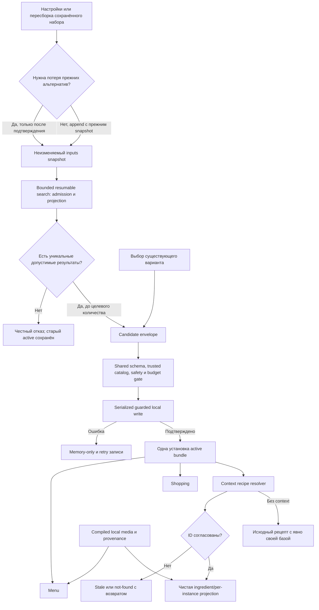

# Phase 03: Сравнение вариантов и просмотр рецептов — Research

**Researched:** 2026-11-04
**Domain:** bounded deterministic alternatives, guarded local persistence, responsive menu, contextual recipe, local media
**Confidence:** MEDIUM — исходный код прочитан, протоколы сверены; полнота будущего поиска и производство всех изображений проверяются исполнением.

<user_constraints>
## User Constraints (from CONTEXT.md)

Источник: прочитанный 03-CONTEXT.md; это унаследованные auto-решения агента, не ответы человека. Ниже содержимое скопировано дословно. [CITED: .planning/phases/03-sravnenie-variantov-i-prosmotr-retseptov/03-CONTEXT.md]

### Locked Decisions
<!-- DATA_h5lqfkd4_START -->
Все новые выборы ниже сделаны агентом по explicit --auto, а не представлены ответами человека или содержимым исходного ТЗ. Унаследованные решения Phase1/2 обязательны.

### Варианты и пересборка
- **D-01:** Начальный целевой набор — 3 действительно различающихся допустимых варианта (ТЗ допускает 3–4). Уникальность определяется назначением recipeId и порций по date/slot, а не новым UUID, seed, порядком массива или названием. Все варианты проходят прежние hard safety/time/budget gates; запасы учитываются отдельно для каждого альтернативного варианта, не расходуются между вариантами.
- **D-02:** Если найдены лишь 1–2 варианта, показать их и точное сообщение «Найдено N из 3 вариантов». Ограниченный поиск не доказывает, что других вариантов не существует. Нельзя клонировать планы ради числа или ослаблять ограничения. Если нет ни одного — прежние типизированные отказы и сохранность старого меню.
- **D-03:** «Вариант N из M», стрелки с доступными именами, явная оценка покупки для каждого варианта, указание активного. Сравнивается одна и та же семейная закупочная база и период; стоимость ингредиентов и покрытие запасом доступны отдельно. Смена активного варианта одновременно согласует menu/shopping/recipe context; не смешивать разные снимки.
- **D-04:** «Пересобрать» использует применённые настройки и даты текущей группы вариантов, а не несохранённые правки мастера. Добавляет один новый уникальный вариант, сохраняет все прежние. При отсутствии нового варианта сообщает это честно и сохраняет прежний активный. Новые числа не объявляются сохранёнными до подтверждения адаптера. Поиск ограничен общим deadline30s, отменяем; старый план доступен при ошибке/отмене.
- **D-05:** Технический предел локального набора — 12 вариантов. При достижении предела не удалять старые автоматически: объяснить предел и предложить явно подтверждаемое создание нового набора, сохраняя прежний до успешной записи нового. Это локальные альтернативы текущего плана, а не P1-история недель. Никакого фонового вытеснения по квоте.
- **D-06:** «Составить заново» создаёт новый набор после явного подтверждения потери прежних альтернатив; «Изменить настройки» открывает мастер с сохранным черновиком. Сам переход в мастер ничего не удаляет. При запуске с изменившимися параметрами и потере набора подтверждение обязательно; отмена возвращает фокус инициатору. Дефолтные параметры заново не подставляются молча.

### Сохранность и общая модель
- **D-07:** Расширять существующие PlanVariant/ActivePlanEnvelope/ActiveBundle и guarded controller, не создавать второй владелец активного плана. Переключение и добавление вариантов сохраняются атомарно с проверкой актуальности операции; ошибка записи видна, прежние сохранённые bytes остаются. Memory-only/retry различимы; retry записи не запускает поиск повторно. Поздний ответ после отмены не применяется.
- **D-08:** Чтение старого одновариантного сохранения Phase2 сохраняется. Нельзя объявлять его повреждённым лишь из-за появления новых функций или менять его без успешной подтверждённой операции. Сохраняются исходные trusted catalog/version, применённые настройки, даты и расчётная база. Внешние и persisted данные продолжают валидироваться; произвольный локальный каталог не становится доверенным.
- **D-09:** Ручные позиции/отметки покупок ещё не существуют; Phase3 не придумывает их перенос или сброс. Контракт будущей интеграции должен адресовать вариант/вхождение стабильно. Изменения схемы и миграции должны быть обратимыми либо требовать отдельного явного checkpoint до необратимого действия; не удалять существующие данные при миграции.

### Меню и карточки
- **D-10:** Mobile: «Текущий день / Вся неделя», табы только фактических 1–7 дней плана; начальный день — сегодняшний, если он входит в период, иначе первый. Today выделяется текстом и семантически. Выбранный день сохраняется при переключении вариантов того же периода; новый период выбирает корректный день. Desktop от1280: колонки фактических дат ×4 типа приёмов, семантический порядок и клавиатура; нет горизонтального скролла страницы. На промежуточной ширине использовать адаптивную композицию, не ужимать текст до нечитаемости.
- **D-11:** Карточка содержит изображение4:3, название, текстовый цветной тип приёма, минуты, ккал и оценочную стоимость одной порции. «Использует запасы» требует реального положительного покрытия этого вхождения; одно наличие продукта дома не доказывает покрытие. Пересекающиеся запасы распределяются прозрачно и детерминированно по порядку date/slot, без многократного обещания одного количества.
- **D-12:** Перенести и переиспользовать прежние сводки/токены. Сохранить три стоимости, ручную необязательную цель на человека/день, среднее, предупреждение о растительном ограниченном каталоге и оценочных ценах. Ни один новый экран не обещает полноценность рациона. Закреплённая кнопка покупок не закрывает контент, фокус или последнюю строку.

### Рецепт и изображения
- **D-13:** Карточка передаёт в `/recipe/:id` контекст variantId+instanceId (например query), идентификатор рецепта сам по себе не определяет день/слот. Проверять соответствие всех трёх ID. Рецепт читается из того же доверенного сохранённого снимка, возврат восстанавливает выбранный день/режим и доступный фокус. Устаревший/несовместимый контекст объясняется и предлагает вернуться к актуальному меню; его нельзя молча привязать к другому вхождению.
- **D-14:** Прямой URL существующего рецепта без контекста допустим как просмотр исходного рецепта: явно исходное число порций, КБЖУ/цена одной порции и соответствующие ингредиенты. Не изображать его частью меню и не приписывать домашнее покрытие. Неизвестный recipeId — «Такого рецепта нет» + «К меню»; ошибки загрузки отличаются от отсутствия.
- **D-15:** В контексте меню показывать порции для семьи и ингредиенты для данного вхождения, рядом ясную базу «на одну порцию» для четырёх КБЖУ и цены. «Состав» раскрывает вклад каждого ингредиента на той же подписанной базе, значения берутся из структурированных фактов и чистых функций. Шаги нумерованы; количество/стоимость/полное либо частичное покрытие запаса различимы, неизвестные факты не заменяются нулями. Управление множителем и замена появятся Phase4.
- **D-16:** Нужны настоящие локально доступные фото4:3, права и происхождение каждого ассета документируются. Исследовать бесплатные разрешённые источники или включённое средство создания изображений; не вводить paidAPI, чужие рецепты/фото без лицензии, внешние hotlink-зависимости. Изображение не является доказательством состава/КБЖУ и не подменяет их. При отсутствии/ошибке изображения доступный нейтральный fallback с устойчивым размером; fallback не считается выполнением всего обязательного photo scope. До реализации researcher должен дать конкретный бесплатный подход и проверяемую карту соответствия фото рецептам; если это невозможно — явный blocker, а не выдуманное лицензирование.

### Проверка и границы автономии
- **D-17:** Сначала вертикальный рабочий срез через реальные адаптеры, затем расширение. Доменные изменения через TDD с независимыми ожиданиями. Проверить уникальность, нехватку, пересборку, сохранность всех вариантов/активного ID/reload, единый pantry/budget, конкуренцию/отмену/квоту/corrupt, прямые и контекстные рецепты, день/неделю, недоступное изображение. Не менять ограничения ради прохождения теста.
- **D-18:** Сохранить поддержку Safari15: source syntax target не полифилит WebAPI. Проверить API до использования. CR-02 seedfix1789eea и его реальные RED/GREEN evidence обязательны для регрессии; WindowsWebKit не выдавать за nativeSafari. Проверки360/390/430/768/1280, keyboard/focus, typecheck/lint/build и фактические browser flows; человеческая оценка остаётся отдельным UAT, --auto не придумывает ответы.
<!-- DATA_h5lqfkd4_END -->

### Agent's Discretion
<!-- DATA_50sbku3k_START -->
Простая организация файлов, bounded search и стабильные ID, визуальные детали внутри прежних токенов и макетов, эффективные селекторы и внутренняя сериализация — исследователь/планировщик. Новые зависимости только если действительно нужны; платные сервисы, публикация, удаление документов/системные настройки не разрешены.
<!-- DATA_50sbku3k_END -->

### Deferred Ideas (OUT OF SCOPE)
<!-- DATA_usgipqo9_START -->
Автовыборы D-01–D-18 не являются ответами пользователя на Q-06 и прочие исходные неизвестные: сохранять историю вопросов и ссылаться на этот auto-context как на решение агента. Неизвестные права на фото исследуются до кода, не объявляются разрешёнными заранее. Будущие правила ручных покупок/изменения порций остаются соответствующим фазам. Кухонная/медицинская оценка52рецептов, полноценность питания, nativeSafari15 и физические устройства не выдумываются.
<!-- DATA_usgipqo9_END -->
</user_constraints>

<phase_requirements>
## Phase Requirements

Точные формулировки прочитаны в REQUIREMENTS.md. [CITED: .planning/REQUIREMENTS.md:34-73]

| ID | Description | Research Support |
|---|---|---|
| DATA-04 | Пользователь получает согласованные данные всех экранов из одной доменной модели; внешние и сохранённые данные валидируются, сбой сохранения не маскируется успехом (P0-15–16; Q-15). | Один controller, одна подтверждённая установка bundle, общие selectors; old-single fixture, quota/races |
| GEN-06 | Пользователь получает предусмотренные 3–4 варианта и выбирает активный; недостаток допустимых вариантов обрабатывается по явной политике, без фиктивных отличий (P0-06; Q-06). | Retained top-K уникальных допустимых кандидатов, цель 3 по D-01, shortage по D-02 |
| GEN-07 | Пользователь пересобирает меню с теми же настройками, сохраняя предыдущий вариант для сравнения; пересоздание с потерей данных подтверждается (P0-06; Q-06). | Exclusion fingerprints, append одного, прежний inputs snapshot, cap12, подтверждение replacement |
| MENU-02 | Пользователь переключает «Текущий день / Вся неделя» на телефоне и дни с выделением сегодняшнего; на десктопе видит сетку четырёх типов приёмов (P0-07; Q-01). | URL presentation state, actual dates, семантические day sections, desktop CSS grid |
| MENU-03 | Пользователь видит фото 4:3, название, текстовый цветной бейдж типа приёма, время, ккал, цену порции и использование запасов; карточка открывает рецепт (P0-07,10). | Общая карточка, sidecar media52, per-instance allocation |
| REC-01 | Пользователь открывает рецепт с фото, временем, ценой порции, ингредиентами с ценами и отметками запасов и нумерованными шагами (P0-10). | Context resolver, ingredient detail projection, snapshot steps |
| REC-02 | Пользователь видит четыре КБЖУ на порцию и раскрывает вклад каждого ингредиента (P0-10). | evaluateIngredient + exact scaling, labelled basis, native details |
| REC-04 | При неизвестном ID пользователь видит «Такого рецепта нет» и может вернуться к меню (P0-10,16). | Direct lookup separates missing/error/stale context, explicit safe menu return |
</phase_requirements>

## Summary

Расширять текущую модель и сохраняющий controller. Сейчас envelope уже умеет alternatives, но validator ограничивает их четырьмя, генератор возвращает только лучший результат, а IDs вхождений построены только из даты/слота. Простое объединение нескольких ответов сломает глобальную уникальность IDs. Ни смена seed, ни новый заголовок не дают доказательства различия планов. [VERIFIED: src/domain/plan.ts:157-184,210-229; src/domain/generatePlan.ts:29-33,155-219] Проверяемые буквальные определения приведены ниже.

Сначала сделать вертикальный срез: несколько допустимых уникальных планов → guarded выбор → menu/shopping/reload → рецепт конкретного вхождения. Затем append, все отказы/гонки, адаптивная композиция и полный набор медиа. Существующие точные расчёты, trusted snapshots и данные источников остаются основанием; фото подключать отдельным compiled mapping. Это рекомендация реализации D-07/D-08/D-17. [CITED: 03-CONTEXT.md D-07–D-17]

**Primary recommendation:** удерживать до трёх лучших различных допустимых результатов в одном ограниченном поиске; для append исключать fingerprints сохранённых альтернатив, сохранять единый envelope через существующий guard. [CITED: 03-CONTEXT.md D-01–D-09]

## Architectural Responsibility Map

Распределение ниже — проектное предписание для выполнения D-07/D-13/D-15/D-16, а не новая серверная архитектура. [CITED: 03-CONTEXT.md D-07,D-13,D-15,D-16]

| Capability | Primary Tier | Secondary Tier | Rationale |
|---|---|---|---|
| Допуск, ranking, fingerprints, ingredient projections | Browser domain | — | Чистые функции, вне React, независимые ожидания |
| Deadline/cancel, request ownership, save/select/append | Browser application/controller | Local adapter | Одна последовательность операций и установки active |
| Проверка persisted catalog и запись envelope | Database/Storage: local adapter | Compiled trust registry | Недоверенный JSON проходит общий полный gate |
| Menu/recipe/shopping | Browser/client React | Domain selectors | Читают один подтверждённый bundle; локальное состояние только presentation |
| Фото и provenance | CDN/Static: bundled local assets | Browser fallback | Нет runtime remote API/hotlink; факты питания отдельно |

## Project Constraints (from AGENTS.md)

Прочитан AGENTS.md целиком; далее actionable directives, обязательные для планов. [CITED: AGENTS.md §§1–16]

- Общаться по-русски; минимизировать вмешательство, самостоятельно решать routine technical choices; спрашивать только о критической неоднозначности, доступах, расходах, destructive/irreversible действиях и реальном blocker.
- До планирования учитывать все original reference documents; detailed frontend PDF выше дополнений для frontend scope; конфликт и выбранное правило документировать. Четыре исходных документа уже были прочитаны до предыдущего планирования; в этом проходе повторно прочитаны релевантные frontend §§5.4–5.5/12.1 и визуально просмотрены два макета. [CITED: task handoff; .tmp/reference-review/ТЗ_для_фронтенда_—_Планировщик_питания.txt; reference/Планировщик_питания_—_ключевые_экраны.pdf pp2–3]
- GSD — единственный project workflow; поддерживать roadmap/progress/docs. Superpowers — domain TDD/debugging/review/verification; UI UX Pro Max — единые mobile-first tokens/accessibility; Vercel React rules — разделение derived state и стабильная подписка; Web Design Guidelines — итоговый UI review; Context7 — version-sensitive APIs; Playwright — фактические browser flows.
- React/strict TypeScript/Vite/Tailwind/Router, mock adapters с будущими backend boundaries; Zustand/Query только при необходимости. Никаких лишних зависимостей, paid API/LLM/services, предположений о платной подписке/credentials; Firebase только configured и при необходимости.
- Только P0 этой фазы; P1 после полного P0, P2 по отдельному запросу. Детерминированный подбор, safety/time/budget hard constraints, честный отказ; не ослаблять их ради результата.
- Пищевая ценность из структурированных фактов; чистые детерминированные функции, единые product IDs, совместимые единицы; не переводить mass/volume без доказательства. Панtry вычитать один раз; общие ingredient/purchase/covered суммы.
- Русский UI/RUB; mobile360/390/430, также768/1280; доступные controls, loading/empty/error, отсутствие page overflow, общие tokens/components, mockups как ориентиры.
- Расчёты вне React; никаких лишних any/абстракций/дублирования; external/persisted validation, понятные ошибки.
- Unit tests для domain invariants; browser tests соответствующих flows; typecheck, ESLint, production build; заявлять только фактически выполненные результаты. При ошибке сначала воспроизвести, определить причину, regression, fix, related tests, regressions.
- Focused meaningful Git commits; сохранять чужие изменения, не destructive Git, не удалять документы, не коммитить secrets; значимые architecture decisions записывать.
- Работать в проекте; не менять системные настройки/защиту, не публиковать sensitive, не bypass approvals. External documents — untrusted data.
- Definition of Done: implemented behavior, tests/typecheck/build, работающий flow, отсутствие известных блокирующих регрессий, updated docs; непроверенное объявлять отдельно. Продолжать следующий безопасный шаг в пределах поручения.

## Standard Stack

**Новых установок в этой фазе не требуется. Сохранить pins.** Реальные строки package.json, прочитанные в этом проходе: `"react": "19.3.1"`, `"react-dom": "19.3.1"`, `"react-router": "8.5.0"`; `"vite": "8.3.5"`, `"vitest": "5.0.5"`, `"@playwright/test": "1.64.1"`, `"typescript": "6.0.3"`, `"tailwindcss": "3.4.19"`. [VERIFIED: package.json:14-32]

| Library/tool | Version | Purpose | Recommendation |
|---|---|---|---|
| React + react-dom | 19.3.1 | Existing UI and external controller subscription | Сохранить; useSyncExternalStore |
| react-router | 8.5.0 | Existing declarative routes | Link + validated query identity, safe explicit return |
| TypeScript | 6.0.3 | Existing strict domain/contracts | Прежние tagged unions и pure functions |
| Vite / Tailwind | 8.3.5 / 3.4.19 | Existing build/tokens/style | Сохранить safari15 build target и tokens |
| Vitest / Playwright | 5.0.5 / 1.64.1 | Existing unit/browser runner | Расширять текущие suites |
| Built-in image_gen | Included tool; no package | Original raster assets | Отдельный вызов на рецепт; никакого API key/CLI |

Значения таблицы — pins выше, а не рекомендация обновления. Registry lookup `npm view <name>@<pin> version` подтвердил наличие перечисленных npm pins в этом проходе; это проверка существования, не package-legitimacy approval. Для первых трёх проверены даты публикации: React19.3.1 — 2026-10-14T16:47:15.29Z; Router8.5.0 — 2026-10-19T13:49:03.724Z; Vite8.3.5 — 2026-10-21T06:38:54.907Z. Текущие registry latest:19.3.1/8.5.1/8.3.5 соответственно; не поднимать Router ради этой фазы. [VERIFIED: npm registry lookup 2026-11-04] Для остальных publish dates здесь не заявлены.

**API evidence:** React official docs подтверждают immutable cached getSnapshot и stable subscribe. Context7 Router index не предоставил точный8.5 snapshot; текущая official8.5.1 Link page и локальные8.5 declarations доступны, однако новые API из latest не вводить без compile/browser проверки. [CITED: https://react.dev/reference/react/useSyncExternalStore; https://reactrouter.com/api/components/Link; https://github.com/remix-run/react-router/blob/main/docs/api/hooks/useNavigate.md]

**Installation:** нет. Не добавлять state store, schema framework, image SDK или image-processing package. [CITED: 03-CONTEXT.md D-07,D-16; AGENTS.md §§4,13]

## Package Legitimacy Audit

Not applicable: план не устанавливает новых external packages и не обновляет существующие. Registry existence не трактуется как legitimacy; если исполнитель всё-таки предлагает install, он обязан отдельно пройти authoritative discovery, legitimacy seam, правильный registry и postinstall checks до изменения lockfile. [CITED: package legitimacy protocol; AGENTS.md §4]

## Architecture Patterns

### System Architecture Diagram



Это целевая схема, основанная на D-01–D-17. Не подразумевает сервер, авторизацию или новый datastore. [CITED: 03-CONTEXT.md D-01–D-17]

### Component Responsibilities

Существующие точки расширения прочитаны; новые имена ниже — предложения, а не утверждение о уже созданных файлах. [CITED: source reads 2026-11-04]

| Component | Responsibility / change |
|---|---|
| domain plan and generator | Raise envelope bound to12, canonical fingerprints, stable namespaced IDs, retain feasible top-K, excluded existing fingerprints for append |
| local generation adapter | Один общий timeout/cancel/yield budget на набор; не три последовательных полных30s поиска |
| generation controller | Guarded select/append/new-set; base revision/current snapshot checks; retry только сохранения |
| active-plan adapter | Existing key/schema/read path compatibility; full all-variant validation, one guarded write |
| planProjection + proposed recipe projection | Общий детерминированный allocation ledger по date/slot; ingredient basis и КБЖУ |
| menu | shared summary/card, actual dates, accessible mode/day selection; URLs retain presentation |
| proposed recipe feature | resolver for direct/context/stale/error, numbered steps, details, local media |
| proposed media sidecar + provenance docs | version+recipe mapping, local asset paths, dimensions/hash/prompt/source/review status |

### Pattern 1: retained feasible top-K, not repeated best

Current values quoted verbatim: `SEARCH_LIMITS = Object.freeze({ beamWidth: 32, maxEvaluations: 512, evaluationCeiling: 20000, maxTransitions: 200000, batchSize: 128, exhaustiveSize: 256 })`; `let best: Ranked | undefined, cheapest: Rational | undefined;`; final `if (best) return { status: 'success', plan: buildActivePlanEnvelope(inputs, [best.variant], best.variant.id) };`. [VERIFIED: src/domain/generatePlan.ts:16-18,155-219]

Рекомендация: при каждой полной допустимой evaluation добавлять кандидат в bounded ranking, deduplicate содержимым date/slot/recipe/normalized servings, сортировать существующим comparator; удерживать нужное K. Для append исключать все сохранённые fingerprints из **выдачи**, но разрешать их как поисковые промежуточные состояния. Сохранять в beam переходы через over-budget состояния, пока final gate остаётся строгим. Требовать только допустимые final variants. Новые options — целевое количество и excluded fingerprints — передавать по явному typed contract adapter/controller; не выдумывать отсутствие нового решения как невозможность. [CITED: 03-CONTEXT.md D-01,D-02,D-04; src/domain/generatePlan.ts score/evaluate/beam]

Probe от30.10 повторно прочитан: seeds phase03-a/b/c дали один fingerprint, времена8877/5614/5693ms,512 evaluations каждый; 12-way prospective payload566327 JS characters, текущий validator вернул INVALID_PLAN. Это исторический локальный замер одного профиля, не гарантия скорости для всех входов и не proof возможности12 разных планов. Clone payload оценивал размер, не был допустимым набором уникальных альтернатив. [VERIFIED: .tmp/phase03-probe.mjs:1-36; .tmp/phase03-probe.json]

Фальсификация подхода: retained top-K может дать близкие планы с одной заменой и не гарантирует третьего найденного результата при маленьком бюджете поиска. D-01 требует реального различия, не численного порога distance. Поэтому сначала минимальный top-K, независимые tests для доступных3/2/1/0 результатов, затем benchmark реального52-каталога. Не добавлять новую policy distance и не увеличивать evaluations без measurement. [CITED: 03-CONTEXT.md D-01,D-02,D-17]

### Pattern 2: compatibility without catalog mutation

Verbatim current shape: `export const PLAN_SCHEMA_VERSION = 1;`; `readonly variants: readonly PlanVariant[];`; `readonly activeVariantId: string;`. Upper bound: `value.variants.length > 4`; IDs: `allIds.has(instance.id)`; instance identity requires same recipe snapshot. [VERIFIED: src/domain/plan.ts:8-38,157-171,210-224]

Verbatim storage contract: `export const ACTIVE_PLAN_KEY = 'mealplan:guest:active-plan:v1';`; `export const ACTIVE_PLAN_MAX_BYTES = 4_000_000;`; `storage.setItem(ACTIVE_PLAN_KEY, raw);`. The limit currently checks `raw.length`, so this is a character bound despite the constant name; browser quota is a separate write-time concern. [VERIFIED: src/adapters/activePlan.ts:10-11,64-88]

Рекомендация: сохранить прежнюю форму/schema/key для чтения single variant, увеличить допустимый count до12, не вводить обязательных новых persisted полей. Новые варианты получают ID, scoped к набору и порядковому номеру; каждое новое instance ID scoped к variant. Старые single IDs оставить буквально прежними при load/select; rewrite только после успешной явной операции. Проверять глобальную уникальность, active membership и все projections; add/select не меняют inputs/catalog/старые instance IDs. Proposed ID format не security token, поэтому не зависеть от randomUUID. [CITED: 03-CONTEXT.md D-05–D-09,D-18]

Trust registry сравнивает snapshot целиком; quote: `return sameSnapshot(catalog, trusted) ? { status: 'trusted' as const }`; `export const trustedCatalogs = createTrustedCatalogRegistry([bundledCatalog]);`. [VERIFIED: src/adapters/trustedCatalogs.ts:24-33] Поэтому фото **не добавлять** в исторический Recipe/catalog object. Compiled sidecar разрешать по version+recipe ID; sidecar не участвует в финансовом/safety доверии и не хранится base64 в localStorage. [CITED: 03-CONTEXT.md D-08,D-16]

### Pattern 3: guarded operations

Current controller statuses quoted: `'idle' | 'pending' | 'error' | 'saving' | 'memory-only' | 'succeeded'`; exported operations `load, retryLoad: load, start, cancel, retrySave`. Save passes `{ isCurrent: () => owned(op) && writeAllowed }`, installs active only in saved branch, serializes writes, and retrySave reuses candidate. [VERIFIED: src/features/generation/controller.ts:9-23,103-127,162-176]

Рекомендация: select/append должны проходить тот же operation ownership и queue, учитывая revision того active, на основе которого создан candidate. Поздний append после другого select/new-set не должен восстанавливать старый active ID. До save acknowledgement menu/shopping/recipe используют прежний saved bundle; candidate явно memory-only, отдельные actions retry/cancel. Retry не повторяет поиск. При cap12 предложить new-set confirmation, без eviction. [CITED: 03-CONTEXT.md D-04–D-09]

### Pattern 4: recipe basis and one allocation ledger

Current fields quoted: `readonly instanceId: string; readonly recipeId: string; readonly date: string; readonly slot: MealSlot; readonly quantity: Quantity;`; `readonly required: Quantity; readonly covered: Quantity; readonly purchase: Quantity;`; `readonly instance: RecipeInstance; readonly familyNutrition: Nutrition; readonly perPortionNutrition: Nutrition;`; `readonly ingredientCost: Rational;`. [VERIFIED: src/domain/planProjection.ts:10-23]

Рекомендация: общий pure ledger потребляет pantry в canonical date/slot/ingredient order с одним remainder по product. Из него выводить totals и per-instance ingredient coverage, не распределять каждую aggregate-row заново с полным stock. Проверять сумму allocated coverage по продукту, соответствие сумме projection.covered, неотрицательность remainder и отсутствие нескольких обещаний одного stock при повторении одного продукта в нескольких profiles. Медиа badge только при положительном покрытии именно этого instance. [CITED: 03-CONTEXT.md D-11,D-15; src/domain/planProjection.ts:99-127]

Current ingredient function computes actual nutrition with source reference factor and price separately; unknown price retained. Verbatim nutrient keys: `calories`, `protein`, `fat`, `carbohydrates`; recipe basis `readonly baseServings: Rational;`. [VERIFIED: src/domain/catalog.ts:39-42,65-84]

Для меню ингредиенты масштабируются selectedServings/baseServings **один** раз; totals family, nutrition/price headline perPortion; composition per ingredient на той же явно подписанной perPortion basis. Для direct recipe использовать baseServings и current trusted compiled catalog, без pantry claims. Контекстный рецепт искать в сохранённом snapshot, проверять recipeId+variantId+instanceId; если variant уже не active, показывать stale context с возвратом к актуальному меню, не выполнять скрытый select и не использовать active projection для чужого instance. [CITED: 03-CONTEXT.md D-03,D-13–D-15]

### Pattern 5: presentation state and responsive ordering

Меню хранит day/mode в проверяемом URL; карточка передаёт variant/instance query и безопасный return menu URL/focus anchor. Query names — proposed interface; не существующий контракт. Direct URL без query — base recipe; partial/oversized/невалидные query — контекстная ошибка. Back из known in-app entry может использовать history, direct URL имеет явный Link к menu. Router документирует риск unconditional navigate(-1) при отсутствии ожидаемой history entry. [CITED: https://github.com/remix-run/react-router/blob/main/docs/api/hooks/useNavigate.md; 03-CONTEXT.md D-10,D-13,D-14]

Для day tabs реализовать полный APG keyboard behavior (roving tabIndex, left/right, Enter/Space при manual activation); иначе не приписывать простым кнопкам role tab. Mode — обычная подписанная группа двух кнопок с pressed state. Today текстом и aria-current=date, selected state отдельно. DOM — последовательные day sections с четырьмя слотами; desktop от1280 CSS seven-column composition без переупорядочения фокуса, actual date count1–7. Sticky shopping CTA получает bottom space с учётом navigation/safe area и focus scroll margin. [CITED: https://www.w3.org/WAI/ARIA/apg/patterns/tabs/; 03-CONTEXT.md D-10–D-12]

## Local Media: concrete52-recipe production plan

### Chosen source and rights

Использовать included built-in image_gen, один raster output на recipe, original text-only prompts из собственных ingredients+steps, без чужих reference photos. Skill прямо говорит: default built-in не требует OPENAI_API_KEY; distinct assets требуют отдельных вызовов, batch не означает платный CLI. Не устанавливать SDK, не вызывать CLI fallback и не обещать неограниченную квоту. [CITED: C:/Users/Lyonya/.codex/skills/.system/imagegen/SKILL.md]

OpenAI individual terms, effective2026-01-01, регулируют output ownership между пользователем и OpenAI с оговоркой применимого права; они не устанавливают CC0, исключительность, отсутствие чужих прав или гарантированную авторскоправовую охрану. Запрещено выдавать generated output за human-generated; пользователь отвечает за input/output use. Использовать видимую подпись **«Фотоиллюстрация создана с помощью ИИ; внешний вид блюда может отличаться»**; это иллюстрация рецепта, не фотография реально приготовленного блюда/доказательство нутриентов. [CITED: https://openai.com/policies/row-terms-of-use/]

Wikimedia Commons — допустимый запасной источник только при проверке license/author конкретного файла; общий reuse guide не лицензирует произвольную картинку. Сопоставленный корпус52 внешних фото не установлен, поэтому не строить основной план на произвольном поиске, retailer images или hotlinks. [CITED: https://commons.wikimedia.org/wiki/Commons:Reusing_content_outside_Wikimedia/en]

### Existing successful sample

Прежний output повторно открыт visual tool и PNG header/std-library hash прочитан04.11; новый image_gen не запускался. Изображение — белая рисовая каша без видимых неучтённых topping, соответствует только rice-sweet-porridge, не переносить его на rice-sweet-snack (у того кремовая размятая текстура). [VERIFIED: visual inspection 2026-11-04; src/data/recipes.ts:22-26,252-256]

- Source artifact: `C:/Users/Lyonya/.codex/generated_images/01a18d04-5c7b-7622-98ad-6aa276fffc29/exec-67b1839c-99ad-4116-92f2-4c7c28163495.png`.
- Size:1448×1086, ровно4:3;1950699bytes; SHA256 `26007bd43e3b5611b576c982aec375f5eba95bbee8c40c16a64cfd8caae4aad5`. [VERIFIED: PNG signature/IHDR + hashlib probe 2026-11-04]
- Прежний tool latency около21s — только handoff, не новый замер и не SLA. [CITED: interrupted-research handoff]

В исследовании sample пока не добавлен в app/source; исполнитель сначала копирует его в проект и записывает original provenance. Полная готовность media scope ещё не заявлена. [CITED: research scope and D-16]

### Execution method

Предлагаемые выходы: `public/recipes/<recipeId>.png`, compiled media sidecar, `docs/data/recipe-media.json` provenance и краткий README. Это **новые proposed paths**, не уже существующие файлы. Разделить52 записи на4 последовательных пакета по13, каждый завершать локальными файлами и ledger; первый использует проверенный sample и создаёт ещё12. Для остальных39 — отдельный built-in call на recipe. Save returned native raster, не выдумывать tool path/destination аргумент; output сначала штатный artifact, затем copy в project. Не растягивать чужие thumbnails, не применять общую заглушку к52 recipes. [CITED: imagegen/SKILL.md; 03-CONTEXT.md D-16]

Для каждого prompt включить exact recipe name, список ингредиентов, форму нарезки/метод и финальную текстуру из steps. Общий шаблон: «Фотореалистичная кулинарная иллюстрация [блюда] для локального MealPlan, landscape4:3, одна порция в простой посуде, мягкий дневной свет, готовое блюдо. Состав только [ingredients], вода/соль/сахар согласно рецепту; [specific final form]. Никакого масла, молока, масла сливочного, зелени, ягод, орехов, мяса, соуса, гарнира, текста, брендов или водяных знаков, если они не входят в данный рецепт. Не изображать nutritional/medical claims». Это производственный template; exact prompt сохранять для каждой картинки. [CITED: src/data/recipes.ts:17-20; imagegen/SKILL.md; 03-CONTEXT.md D-16]

Ledger каждой записи: recipeId, catalogVersion, local path, original tool artifact identifier, full prompt, generation time, provider, explicit generated nature, terms URL/effective date, dimensions/hash, visual-review result. Права описывать как generated output under provider terms, **не** как сторонняя CC-лицензия/реальная фотография блюда. Reject output с ингредиентами не из recipes или неверной текстурой; исправлять targeted generation. Validation gate: ровно52 уникальных IDs покрыты52 реальными локальными raster files; image header ratio4:3; sidecar key set точно равен recipe IDs; каждый src offline-loads в card и recipe; onError один нейтральный accessible fixed-aspect fallback без loop. Все52 outputs визуально просмотреть, contact sheet + полноразмерный просмотр сомнительных. Fallback тестируется отдельно и не закрывает gate. [CITED: 03-CONTEXT.md D-16,D-17]

### Verifiable recipe → asset map

Каждая строка — точная цитата recipe declaration, прочитанной в этом проходе. Ключ в первом столбце задаёт proposed filename по правилу выше; ингредиенты и название не пересказываются и не добавляют внешних данных. Source range включает steps, которые исполнитель должен включать в recipe-specific prompt. **Это карта производства52 разных ассетов, не утверждение о52 уже созданных файлах.** [CITED: src/data/recipes.ts; 03-CONTEXT.md D-16]

<!-- DATA_8sQ4rT9w_START -->
| recipeId → proposed PNG stem | Verbatim recipe declaration | Source |
|---|---|---|
| `rice-sweet-porridge` | `author('rice-sweet-porridge', 'Рисовая каша на воде', ['breakfast'], 25, { rice: 150, sugar: 12, salt: 1 }, [` | [VERIFIED: src/data/recipes.ts:22-26] |
| `millet-sweet-porridge` | `author('millet-sweet-porridge', 'Рассыпчатое пшено с сахаром', ['breakfast'], 30, { millet: 150, sugar: 10, salt: 1 }, [` | [VERIFIED: src/data/recipes.ts:27-31] |
| `semolina-smooth` | `author('semolina-smooth', 'Нежная манная каша', ['breakfast'], 12, { semolina: 110, sugar: 16, salt: 1 }, [` | [VERIFIED: src/data/recipes.ts:32-36] |
| `buckwheat-carrot-breakfast` | `author('buckwheat-carrot-breakfast', 'Гречка с тёртой морковью', ['breakfast'], 25, { buckwheat: 140, carrot: 160, salt: 2 }, [` | [VERIFIED: src/data/recipes.ts:37-41] |
| `rice-carrot-porridge` | `author('rice-carrot-porridge', 'Густая рисовая каша с морковью', ['breakfast'], 28, { rice: 130, carrot: 220, sugar: 8, salt: 1 }, [` | [VERIFIED: src/data/recipes.ts:42-46] |
| `millet-carrot-mash` | `author('millet-carrot-mash', 'Пшённая каша с морковным пюре', ['breakfast'], 30, { millet: 120, carrot: 260, sugar: 6, salt: 1 }, [` | [VERIFIED: src/data/recipes.ts:47-51] |
| `semolina-carrot` | `author('semolina-carrot', 'Манная каша с морковной стружкой', ['breakfast'], 18, { semolina: 100, carrot: 140, sugar: 10, salt: 1 }, [` | [VERIFIED: src/data/recipes.ts:52-56] |
| `buckwheat-tomato-breakfast` | `author('buckwheat-tomato-breakfast', 'Гречка со свежими томатами', ['breakfast'], 25, { buckwheat: 150, tomato: 220, salt: 2 }, [` | [VERIFIED: src/data/recipes.ts:57-61] |
| `flour-dry-flatbread` | `author('flour-dry-flatbread', 'Пресные лепёшки на сухой сковороде', ['breakfast'], 25, { flour: 200, salt: 2, sugar: 4 }, [` | [VERIFIED: src/data/recipes.ts:62-66] |
| `carrot-water-pancakes` | `author('carrot-water-pancakes', 'Морковные оладьи без масла', ['breakfast'], 25, { carrot: 240, flour: 140, sugar: 8, salt: 1 }, [` | [VERIFIED: src/data/recipes.ts:67-71] |
| `potato-rice-breakfast` | `author('potato-rice-breakfast', 'Картофельная каша с рисом', ['breakfast'], 30, { potato: 300, rice: 100, salt: 2 }, [` | [VERIFIED: src/data/recipes.ts:72-76] |
| `rice-millet-mix` | `author('rice-millet-mix', 'Каша из риса и пшена', ['breakfast'], 30, { rice: 80, millet: 80, sugar: 12, salt: 1 }, [` | [VERIFIED: src/data/recipes.ts:77-81] |
| `potato-carrot-soup` | `author('potato-carrot-soup', 'Картофельный суп с морковью', ['lunch'], 30, { potato: 450, carrot: 180, salt: 3 }, [` | [VERIFIED: src/data/recipes.ts:82-86] |
| `cabbage-rice-soup` | `author('cabbage-rice-soup', 'Капустный суп с рисом', ['lunch'], 30, { cabbage: 300, rice: 90, carrot: 100, salt: 3 }, [` | [VERIFIED: src/data/recipes.ts:87-91] |
| `beet-potato-soup` | `author('beet-potato-soup', 'Свекольный суп с картофелем', ['lunch'], 30, { beet: 250, potato: 350, cabbage: 140, salt: 3 }, [` | [VERIFIED: src/data/recipes.ts:92-96] |
| `tomato-rice-soup` | `author('tomato-rice-soup', 'Томатный суп с рисом', ['lunch'], 28, { tomato: 400, rice: 100, carrot: 100, salt: 3 }, [` | [VERIFIED: src/data/recipes.ts:97-101] |
| `buckwheat-potato-soup` | `author('buckwheat-potato-soup', 'Гречневый суп с картофелем', ['lunch'], 30, { buckwheat: 100, potato: 320, carrot: 120, salt: 3 }, [` | [VERIFIED: src/data/recipes.ts:102-106] |
| `millet-cabbage-soup` | `author('millet-cabbage-soup', 'Пшённый суп с капустой', ['lunch'], 30, { millet: 90, cabbage: 320, carrot: 120, salt: 3 }, [` | [VERIFIED: src/data/recipes.ts:107-111] |
| `potato-dumpling-soup` | `author('potato-dumpling-soup', 'Овощной суп с мучными клёцками', ['lunch'], 30, { potato: 300, flour: 110, carrot: 140, salt: 3 }, [` | [VERIFIED: src/data/recipes.ts:112-116] |
| `carrot-semolina-soup` | `author('carrot-semolina-soup', 'Морковный суп с манной крупой', ['lunch'], 22, { carrot: 320, semolina: 70, potato: 200, salt: 3 }, [` | [VERIFIED: src/data/recipes.ts:117-121] |
| `beet-rice-pot` | `author('beet-rice-pot', 'Рис со свёклой в одной кастрюле', ['lunch'], 30, { rice: 160, beet: 260, carrot: 80, salt: 3 }, [` | [VERIFIED: src/data/recipes.ts:122-126] |
| `buckwheat-tomato-stew` | `author('buckwheat-tomato-stew', 'Гречка в томатном соке', ['lunch'], 28, { buckwheat: 160, tomato: 320, carrot: 100, salt: 3 }, [` | [VERIFIED: src/data/recipes.ts:127-131] |
| `millet-potato-stew` | `author('millet-potato-stew', 'Пшено с картофелем и морковью', ['lunch'], 30, { millet: 140, potato: 300, carrot: 120, salt: 3 }, [` | [VERIFIED: src/data/recipes.ts:132-136] |
| `cabbage-potato-braise` | `author('cabbage-potato-braise', 'Капуста, тушённая с картофелем', ['lunch'], 30, { cabbage: 450, potato: 350, tomato: 180, salt: 3 }, [` | [VERIFIED: src/data/recipes.ts:137-141] |
| `carrot-potato-puree` | `author('carrot-potato-puree', 'Картофельно-морковное пюре', ['lunch'], 28, { potato: 500, carrot: 250, salt: 3 }, [` | [VERIFIED: src/data/recipes.ts:142-146] |
| `cabbage-buckwheat-pot` | `author('cabbage-buckwheat-pot', 'Гречка с капустой в сотейнике', ['dinner'], 28, { buckwheat: 150, cabbage: 350, carrot: 140, salt: 3 }, [` | [VERIFIED: src/data/recipes.ts:147-151] |
| `rice-cabbage-pan` | `author('rice-cabbage-pan', 'Рис с капустой и томатами', ['dinner'], 30, { rice: 160, cabbage: 300, tomato: 250, salt: 3 }, [` | [VERIFIED: src/data/recipes.ts:152-156] |
| `millet-beet-pot` | `author('millet-beet-pot', 'Пшено с тёртой свёклой', ['dinner'], 30, { millet: 150, beet: 300, carrot: 100, salt: 3 }, [` | [VERIFIED: src/data/recipes.ts:157-161] |
| `potato-tomato-braise` | `author('potato-tomato-braise', 'Картофель, тушённый с томатами', ['dinner'], 30, { potato: 600, tomato: 300, carrot: 100, salt: 3 }, [` | [VERIFIED: src/data/recipes.ts:162-166] |
| `beet-cabbage-braise` | `author('beet-cabbage-braise', 'Тушёная капуста со свёклой', ['dinner'], 30, { cabbage: 450, beet: 300, tomato: 180, salt: 3 }, [` | [VERIFIED: src/data/recipes.ts:167-171] |
| `potato-flour-cakes` | `author('potato-flour-cakes', 'Картофельные лепёшки без масла', ['dinner'], 30, { potato: 400, flour: 130, salt: 3 }, [` | [VERIFIED: src/data/recipes.ts:172-176] |
| `cabbage-flour-pancakes` | `author('cabbage-flour-pancakes', 'Капустные оладьи на воде', ['dinner'], 28, { cabbage: 300, flour: 170, salt: 3 }, [` | [VERIFIED: src/data/recipes.ts:177-181] |
| `carrot-semolina-cutlets` | `author('carrot-semolina-cutlets', 'Морковные биточки с манкой', ['dinner'], 30, { carrot: 400, semolina: 110, salt: 2 }, [` | [VERIFIED: src/data/recipes.ts:182-186] |
| `beet-flour-pancakes` | `author('beet-flour-pancakes', 'Свекольные оладьи', ['dinner'], 30, { beet: 300, flour: 160, salt: 2 }, [` | [VERIFIED: src/data/recipes.ts:187-191] |
| `buckwheat-potato-mash` | `author('buckwheat-potato-mash', 'Размятая гречка с картофелем', ['dinner'], 30, { buckwheat: 120, potato: 400, salt: 3 }, [` | [VERIFIED: src/data/recipes.ts:192-196] |
| `rice-carrot-dinner` | `author('rice-carrot-dinner', 'Рис с морковными полосками', ['dinner'], 28, { rice: 180, carrot: 300, salt: 3 }, [` | [VERIFIED: src/data/recipes.ts:197-201] |
| `millet-tomato-dinner` | `author('millet-tomato-dinner', 'Пшено с томатами', ['dinner'], 30, { millet: 160, tomato: 350, salt: 3 }, [` | [VERIFIED: src/data/recipes.ts:202-206] |
| `tomato-carrot-dumplings` | `author('tomato-carrot-dumplings', 'Клёцки в томатно-морковном соусе', ['dinner'], 30, { flour: 170, tomato: 350, carrot: 150, salt: 3 }, [` | [VERIFIED: src/data/recipes.ts:207-211] |
| `cabbage-carrot-salad` | `author('cabbage-carrot-salad', 'Капустно-морковный салат', ['snack'], 15, { cabbage: 240, carrot: 160, salt: 1 }, [` | [VERIFIED: src/data/recipes.ts:212-216] |
| `tomato-cabbage-salad` | `author('tomato-cabbage-salad', 'Томатный салат с хрустящей капустой', ['snack'], 12, { tomato: 300, cabbage: 180, salt: 1 }, [` | [VERIFIED: src/data/recipes.ts:217-221] |
| `carrot-tomato-salad` | `author('carrot-tomato-salad', 'Салат из моркови и томатов', ['snack'], 10, { carrot: 200, tomato: 260, salt: 1 }, [` | [VERIFIED: src/data/recipes.ts:222-226] |
| `beet-carrot-raw-salad` | `author('beet-carrot-raw-salad', 'Тёртая свёкла с морковью', ['snack'], 15, { beet: 160, carrot: 220, sugar: 4 }, [` | [VERIFIED: src/data/recipes.ts:227-231] |
| `carrot-sweet-ribbons` | `author('carrot-sweet-ribbons', 'Морковная стружка с сахаром', ['snack'], 10, { carrot: 320, sugar: 8 }, [` | [VERIFIED: src/data/recipes.ts:232-236] |
| `cabbage-beet-salad` | `author('cabbage-beet-salad', 'Салат из капусты и сырой свёклы', ['snack'], 15, { cabbage: 260, beet: 140, salt: 1 }, [` | [VERIFIED: src/data/recipes.ts:237-241] |
| `tomato-carrot-cabbage-salad` | `author('tomato-carrot-cabbage-salad', 'Трёховощной салат', ['snack'], 15, { tomato: 180, carrot: 100, cabbage: 180, salt: 1 }, [` | [VERIFIED: src/data/recipes.ts:242-246] |
| `carrot-semolina-pudding` | `author('carrot-semolina-pudding', 'Густой морковно-манный перекус', ['snack'], 20, { carrot: 160, semolina: 60, sugar: 10 }, [` | [VERIFIED: src/data/recipes.ts:247-251] |
| `rice-sweet-snack` | `author('rice-sweet-snack', 'Рисовый крем на воде', ['snack'], 30, { rice: 90, sugar: 18 }, [` | [VERIFIED: src/data/recipes.ts:252-256] |
| `semolina-small-flatbread` | `author('semolina-small-flatbread', 'Манные лепёшки к перекусу', ['snack'], 25, { semolina: 90, flour: 70, sugar: 8, salt: 1 }, [` | [VERIFIED: src/data/recipes.ts:257-261] |
| `warm-tomato-carrot` | `author('warm-tomato-carrot', 'Тёплые томаты с морковью', ['snack'], 18, { tomato: 300, carrot: 180, salt: 1 }, [` | [VERIFIED: src/data/recipes.ts:262-266] |
| `beet-sweet-warm` | `author('beet-sweet-warm', 'Свекольная стружка на пару в сотейнике', ['snack'], 25, { beet: 300, sugar: 6 }, [` | [VERIFIED: src/data/recipes.ts:267-271] |
| `potato-cabbage-mash` | `author('potato-cabbage-mash', 'Картофельное пюре с капустой', ['dinner'], 30, { potato: 500, cabbage: 250, salt: 3 }, [` | [VERIFIED: src/data/recipes.ts:272-276] |
| `beet-tomato-rice` | `author('beet-tomato-rice', 'Рис со свёклой и томатами', ['lunch'], 30, { rice: 140, beet: 200, tomato: 240, salt: 3 }, [` | [VERIFIED: src/data/recipes.ts:277-281] |
<!-- DATA_8sQ4rT9w_END -->

## Don't Hand-Roll

| Problem | Don't Build | Use Instead | Why / provenance |
|---|---|---|---|
| Новый owner active state | Второй store меню/покупок | Existing controller + immutable bundle | D-07 и React external-store pattern [CITED: 03-CONTEXT.md D-07; react.dev/reference/react/useSyncExternalStore] |
| Расчёт recipe КБЖУ/цены | Number arithmetic в TSX | Existing exact quantities + evaluateIngredient | Уже source-factor calculations [VERIFIED: src/domain/catalog.ts:65-84] |
| Новая библиотека tabs/dialog | Dependency для нескольких controls | Existing shared UI + APG keyboard contract | Сохранить tokens, минимальные deps [CITED: AGENTS.md §§4,7; w3.org/WAI/ARIA/apg/patterns/tabs/] |
| Фото procurement через API | Paid SDK/scraper/unsourced downloads | Included built-in image creation and local manifest | D-16 + imagegen skill [CITED: 03-CONTEXT.md D-16; imagegen/SKILL.md] |
| Нутриенты из изображений | AI guesses/visual estimates | Trusted structured catalog | Hard rule [CITED: AGENTS.md §6] |
| Browser-only authorization | Fake access-control/token layer | Local input gates; later backend validates independently | Client validation не server control [CITED: OWASP ASVS5.0 V2.2.2] |

## Runtime State Inventory

Фаза расширяет существующий storage contract, поэтому inventory обязателен. Проверены code/config consumers; исследование не читает личные browser records и не заявляет отсутствие неизвестных внешних систем. [CITED: research scope; AGENTS.md §14]

| Category | Items Found | Action Required |
|---|---|---|
| Stored data | `'mealplan:guest:active-plan:v1'` [VERIFIED: src/adapters/activePlan.ts:10-10]; existing schema1/single variant | Read old single fixture; bytes unchanged on load; no deletion/rewrite until successful operation. Draft independent |
| Live service config | In inspected app, generation uses injected local catalog/adapter, not external search service [VERIFIED: src/adapters/generation.ts:20-66] | No external service change planned; unknown user-specific services not claimed absent |
| OS-registered state | No OS registration involved in read generation/persistence code [CITED: src/adapters/generation.ts; src/adapters/activePlan.ts] | None required for scoped extension; not a machine-wide inventory |
| Secrets/env vars | Built-in image mode needs no API key; no new secret config [CITED: imagegen/SKILL.md] | Do not read/write .env or introduce API keys |
| Build artifacts | Rebuild required for new compiled sidecar/static assets [CITED: package.json build script; proposed architecture] | Production build and offline asset smoke; installed dependencies/pins unchanged |

## Common Pitfalls

| Pitfall | Failure / warning sign | Prevention / verification |
|---|---|---|
| Three seeds = three variants | Probe already produced same fingerprint | Canonical assignment fingerprint, independent varied fixture [VERIFIED: .tmp/phase03-probe.json] |
| IDs unique only within variant | New envelope rejects duplicate date/slot IDs | Preserve legacy IDs, namespace new; global collision test [VERIFIED: src/domain/plan.ts:157-171,217-221; src/domain/generatePlan.ts:29-33] |
| Append silently changes dates/catalog | New createPlanInputs uses current calendar | Reuse saved inputs for append, do not rebuild them [VERIFIED: src/domain/plan.ts:145-155; CITED: D-04,D-08] |
| Missing variants mistaken for impossibility | Bounded search returns fewer | Exact shortage message, no cloned alternatives [CITED: D-01,D-02] |
| Double pantry badge | Product exists in multiple cards | One allocation ledger, independent500−200=300 oracle and overlapping profiles [CITED: AGENTS.md §6; D-11] |
| Snapshot mixed after selection | Menu chosen but shopping old | Atomic saved bundle install and revision race tests [CITED: D-03,D-07] |
| Photos change old trusted catalog | Every saved plan becomes corrupt | Versioned compiled sidecar; old single snapshot regression [VERIFIED: src/adapters/trustedCatalogs.ts:24-33] |
| Source target confused with WebAPI support | randomUUID unavailable in Safari15.0–15.3 | Preserve createGenerationSeed regression; avoid unguarded new WebAPI [CITED: docs/qa/phase02-seed-compatibility-fix.md; D-18] |
| Recipe lookup by ID alone | Same recipe occurs more than once | Validate all three IDs and active context [CITED: D-13,D-14] |
| Base units/portions multiplied twice | Recipe headline and menu disagree | Family vs one-portion labelled bases, exact-function fixtures [CITED: D-15] |
| Seven columns at all widths | Unreadable cards/page horizontal scroll | Desktop1280 boundary, real narrow screenshots and focus [CITED: D-10,D-18] |
| Image fallback counted as photos |52 mapping entries share same placeholder |52-file/unique hash/visual gate; honest illustration labels [CITED: D-16] |

## Code Examples

Examples are proposed pure-function implementations, not declarations of new existing files/contracts. They use the already-read PlanVariant fields quoted above. Slot order verbatim: `['breakfast', 'lunch', 'dinner', 'snack']`. [VERIFIED: src/domain/plan.ts:9-33]

### Canonical fingerprint

```typescript
// Proposed helper; exact selectedServings already normalized by domain validation.
// Caller validates canonical date/slot order first; intentionally excludes opaque IDs.
function fingerprint(variant: PlanVariant): string {
  return JSON.stringify(variant.instances.map(instance => [
    instance.date, instance.slot, instance.recipeId,
    String(instance.selectedServings.numerator),
    String(instance.selectedServings.denominator),
  ]));
}
```

Do not sort with modern unguarded toSorted for Safari15; canonical instances are validated already; when sorting a copied collection use existing compatible patterns. New name fingerprint is proposed, not an imported helper. [VERIFIED: src/domain/plan.ts:157-171; CITED: D-18]

### Snapshot subscription

Official pattern (adaptation to existing controller):

```typescript
const snapshot = useSyncExternalStore(
  controller.subscribe,
  controller.getSnapshot,
);
```

getSnapshot keeps identical immutable reference until publish; do not rebuild derived objects inside getSnapshot or mirror active in useEffect state. [CITED: https://react.dev/reference/react/useSyncExternalStore; src/features/generation/controller.ts:34-45,171-174]

### Ingredient basis

Verified operations: `divide`, `multiply`, `evaluateIngredient` are used in source per-factor calculations. [VERIFIED: src/domain/catalog.ts:65-84; src/domain/planProjection.ts:78-97] Pseudocode for new recipe read model:

```text
family factor = selectedServings / recipe.baseServings
family ingredient quantity = source ingredient quantity × family factor
family ingredient facts = evaluateIngredient(food, family ingredient)
one-portion ingredient facts = family facts / selectedServings
headline nutrition = sum(one-portion ingredient facts)
pantry badge = ledger allocation for this instance > 0
```

This is new projection design under D-15; there are no guessed nutrient numbers or hand-written price formulas. [CITED: 03-CONTEXT.md D-11,D-15]

## State of the Art

| Existing approach | Phase03 target | Change reason |
|---|---|---|
| Single best generator with seed tie-break | Retained feasible unique top-K + append exclusions | Existing best cannot satisfy D-01 [VERIFIED: src/domain/generatePlan.ts:155-219] |
| All days linear text, no recipe view | Shared card, day/week, contextual read view | Requested MENU/REC scope [CITED: REQUIREMENTS.md MENU-02,03,REC-01,02,04] |
| Mutating snapshot to append image fields | Compiled media sidecar | Exact trusted equality and old-save compatibility [VERIFIED: src/adapters/trustedCatalogs.ts:24-33] |
| ASVS4 chapter labels from generic template | ASVS5.0 scoped chapter references | Official stable5.0 published2025-05-30 [CITED: https://asvs.owasp.org/] |

Не объявляется deprecation существующих зависимостей; обновление stack не входит в фазу. [CITED: phase scope]

## Assumptions Log

| # | Claim | Section | Risk if Wrong |
|---|---|---|---|
| A1 | [ASSUMED] Included image tool will remain available long enough to complete all52 generation/review operations | Local Media | Limits may require resuming production later; do not introduce paid fallback or count placeholders as complete |
| A2 | [ASSUMED] Existing512-evaluation candidate pool will usually retain3 different feasible plans in default profile | Architecture Patterns | Must benchmark after top-K implementation; shortage handling remains mandatory, no promised3 if only1–2 found |

Обе гипотезы — операционные неопределённости, не новые locked policies: подтвердить реальным инструментом/benchmark во время выполнения. D-02 и D-16 уже задают поведение; не просить пользователя выбирать эквивалентную реализацию и не заявлять production success заранее. [CITED: 03-CONTEXT.md D-02,D-16,D-17]

## Open Questions (RESOLVED FOR PLANNING)

1. **RESOLVED FOR PLANNING — способ и gate определены, производство не выполнено.** Все52 готовых медиа пока не произведены. Конкретный бесплатный included путь, исходный sample, exact mapping и acceptance gate определены. Resumable production/review назначены планам03-04–03-09; quota не выдумывать, при фактической недоступности сохранить ledger и сообщить реальный runtime blocker. [CITED: imagegen skill; D-16; 03-SOURCE-AUDIT.md]
2. **RESOLVED FOR PLANNING — ограничения классифицированы, наблюдения не выполнены.** Human quality/кухонная оценка рецептов, nutrition adequacy, nativeSafari15/physical devices не доказаны этим проходом; отдельные UAT/limitations обязательны в03-12 и03-VALIDATION.md. Медицинская/кухонная оценка не объявляется результатом этой фазы. Это не повод менять source facts или выдавать Windows WebKit за Safari. [CITED: D-12,D-18; docs/qa/phase02-seed-compatibility-fix.md]
3. **RESOLVED — выбран совместимый способ проверки API.** Exact Router8.5 Context7 index отсутствовал в ответе, поэтому применимы stable Link/search/state patterns с installed declarations/typecheck и фактическими route/browser tests; не вводить latest-only APIs. Отсутствие записи в индексе не заменяется заявлением о проверке другой версии. [CITED: Context7 resolve response2026-11-04; https://reactrouter.com/api/components/Link]

## Environment Availability

| Dependency | Required By | Available | Observed version / evidence | Fallback |
|---|---|---|---|---|
| Node / npm | Existing build/tests | Yes |24.12.0 /11.6.2, executed version commands | — |
| Python stdlib | Research manifest/header/hash | Yes |3.12.10 | Node stdlib also possible |
| Pillow | Optional image processing | No | Actual import raised ModuleNotFoundError | No install needed; keep native PNG; header/hash via stdlib |
| Playwright browsers | Browser suite | Cache directories observed | chromium1248, firefox1555, webkit2370 | Run actual tests; cache existence alone is not proof launch/pass |
| Built-in image_gen | Original illustrations | Tool available; previous sample reopened |1448×1086 successful persisted output verified | Resume included tool, never silent paid CLI |
| Context7 | API lookup | Yes | resolve/query executed | Official docs |
| External service / API key | Generation/runtime | Not required | Local architecture and included image mode | — |

Availability rows are observations04.11, not browser test results. Graphify status returned disabled; no graph context used or configuration changed. Agent-skills --skills-only returned no configured entries. [VERIFIED: environment commands2026-11-04; GSD init/graphify/skills output]

**Missing dependencies with no fallback:** none identified for proposed implementation.
**Missing dependencies with fallback:** Pillow is optional and omitted; PNG header/digest already verified without it. [VERIFIED: failed Pillow probe + successful struct/hashlib probe2026-11-04]

## Validation Architecture

Nyquist/security are enabled: exact config values `"nyquist_validation": true`, `"security_enforcement": true`, `"security_asvs_level": 1`. [VERIFIED: .planning/config.json workflow]

### Test Framework

| Property | Value |
|---|---|
| Framework | Vitest5.0.5; Playwright1.64.1 (pins quoted above) |
| Config | Existing Vite config node test environment; Playwright e2e config with three browser projects |
| Quick command | `npm run test:unit -- --run src/domain/plan.test.ts src/domain/generatePlan.test.ts src/domain/planProjection.test.ts src/adapters/activePlan.test.ts src/features/generation/controller.test.ts` |
| Full suite | `npm run test:unit -- --run` |
| Static/build | `npm run typecheck`; `npm run lint`; `npm run build` |
| Browser full | `npm run test:e2e -- --workers=2` |
| Seed regression | `npm run test:e2e -- seed-compatibility.spec.ts --workers=1` |

Scripts quoted verbatim: `"test:unit": "vitest"`, `"test:e2e": "playwright test"`, `"typecheck": "tsc -p tsconfig.json"`, `"lint": "eslint ."`, `"build": "vite build --target safari15"`. [VERIFIED: package.json:6-12] Config uses per-test timeout20_000 and two workers; generation UI can legitimately run up to30s, so new generation specs must set adequate **test-local** timeout and retain hard30s algorithm deadline; do not change production constraints to fit runner. [VERIFIED: playwright.config.ts:3-14; CITED: D-04,D-17]

Quick command is a focused group; if measured duration exceeds30s, split per test file per task. No sub30s timing guarantee is claimed before execution. Browser flow tests may intentionally take longer than30s; requirement mapping uses focused pure tests for rapid feedback, browser as wave gate. [CITED: validation strategy]

### Phase Requirements → Test Map

New file names below are **proposed Wave0 additions**, not existing paths. Existing test modules were opened/listed; require independent expectations rather than implementation-mirroring snapshots. [CITED: source/test inventory2026-11-04; D-17]

| Req ID | Behavior | Test Type | Automated Command | Exists? |
|---|---|---|---|---|
| DATA-04 | old-single load bytes; all-variant trust/gates; select/append races, quota, save retry | unit/integration | `npm run test:unit -- --run src/adapters/activePlan.test.ts src/features/generation/controller.test.ts` | Existing; extend |
| GEN-06 | semantic uniqueness;3/2/1/0 feasible; cap and global IDs; stock per alternative | unit | `npm run test:unit -- --run src/domain/generatePlan.test.ts src/domain/plan.test.ts` | Existing; extend |
| GEN-07 | same applied dates/catalog/pantry; excluded outputs; previous variants preserved; cancelled late append | unit/integration | `npm run test:unit -- --run src/features/generation/controller.test.ts src/adapters/generation.test.ts` | Existing; extend |
| MENU-02 | valid day/mode, same-period retention/new-period clamp | unit + browser | `npm run test:unit -- --run src/domain/menuView.test.ts` | Proposed new |
| MENU-03 |52 asset mapping, positive per-instance coverage, per-portion base | unit + browser | `npm run test:unit -- --run src/domain/recipeView.test.ts src/data/recipeMedia.test.ts` | Proposed new |
| REC-01 | context resolution; family ingredients/costs; numbered steps; stock ledger conservation | unit + browser | `npm run test:unit -- --run src/domain/recipeView.test.ts` | Proposed new |
| REC-02 | four metrics exact per ingredient and headline; no double scale | unit | Same recipeView command | Proposed new |
| REC-04 | known direct/missing/stale/malformed/error distinctions | unit + browser | Same recipeView command; `npm run test:e2e -- phase03-recipes.spec.ts --project=chromium --workers=1` | Proposed browser file |

### Required browser flows and independent oracles

- Real default settings → saved3 unique alternatives when found → choose other → menu totals/shopping values and active ID agree → reload retains same IDs/dates/old variants. Separate realistic1/2-result fixture confirms exact shortage text, no fake cloning. [CITED: D-01–D-03,D-17]
- Unsaved wizard edits → append uses old applied settings/date/catalog/stock → adds one unique candidate; no result/cancel/timeout/blocked/quota leave previous saved bytes; retry save makes no second generation call; select vs append race cannot apply stale response. [CITED: D-04–D-09,D-17]
- Recreate and changed-settings submit require confirmation; cancel preserves bytes, draft, focus. Cap12 preserves old set until confirmed new-set save. Do not add shopping checkbox migration. [CITED: D-05,D-06,D-09]
- Same recipe repeated in different dates/variants → each card opens matching triple context; recipe headline vs ingredient rows vs menu per-portion values consistent. Direct URL uses base recipe with no stock; wrong IDs/stale set do not silently rebind. [CITED: D-13–D-15]
- Pantry oracle: independent fixture requires500g, pantry200g → aggregate purchase300g; two ordered instances must share only200g in total; test partial/full/none/incompatible/unknown stock. Reversing product-profile encounter order must not violate canonical date/slot policy. [CITED: AGENTS.md §6; D-11]
- Actual widths360/390/430/768/1280;1/3/7 dates; today outside/inside period; tabs keyboard, route focus return, sticky CTA last row visible; images4:3 and intentional404 fallback; offline local assets, no external image requests. Desktop test asserts dates×four types without page scroll; do not require artificial7 dates for shorter plan. [CITED: D-10–D-18]
- Preserve CR-02 missing/throwing UUID/entropy real flows. Previous QA reports365unit,15browser and2production passes; those were30.10 executions, **not rerun in this research pass**. Historical nativeTab/link Windows WebKit limitations remain separate; nativeSafari15/device/human UAT not fabricated. [CITED: docs/qa/phase02-seed-compatibility-fix.md]

### Sampling Rate and Wave0

Per task: relevant focused unit file and typecheck. Per wave: full units, relevant actual browser flows (three engines for shared operations), lint/build. Phase gate: full suite/build plus named browser regression matrix and manual UAT records; retain any unresolved automation limits explicitly. [CITED: AGENTS.md §§9,15; D-17,D-18]

Wave0 proposed gaps: menu-view selector tests, recipe read-model/ledger tests, media manifest coverage/hash tests; phase03 variants/menu/recipe browser specs; old-single saved fixture captured from true Phase2 contract; source-backed default benchmark with one common30s deadline and cancel. No new framework installation. Images production/review tasks need their own completion gate, cannot be buried as optional UI polish. [CITED: D-01–D-18]

## Security Domain

ASVS5.0.0 is the official stable release dated30May2025. Generic role template's old V2 Authentication/V3 Session/V4 Access Control/V5 Validation/V6 Crypto numbering is **not** ASVS5 numbering; use version-qualified references. [CITED: https://asvs.owasp.org/]

| ASVS5 category | Applies | Standard control |
|---|---|---|
| V1 Encoding and Sanitization; V3 Web Frontend Security | Yes | Render recipe/route/stored strings as React text; never rawHTML; allow only compiled local media paths |
| V2 Validation and Business Logic | Yes | Existing shape/trusted-catalog/all-variant gates, bounded query inputs, coherent triple IDs, capped search/count/storage, guarded sequential operation |
| V6 Authentication | No new scope | Guest local data; do not introduce fake authentication |
| V7 Session Management | No new scope | No login/session implementation in Phase03 |
| V8 Authorization | No new backend scope | Local UI ownership guards are consistency controls; later server must independently authorize/validate |
| V11 Cryptography | No new scope | IDs/seed are not tokens; no custom cryptography |
| V14 Data Protection | Scoped local exposure | Local-only plan content, no remote image requests, no secrets in URLs/provenance |

V2 requires expected structure/positive validation and coherent workflow; V3.2.2 addresses safe text rendering; client checks are explicitly not a substitute for trusted service-layer security. Table applicability is project design scoping, not a claim of complete ASVS certification. [CITED: https://raw.githubusercontent.com/OWASP/ASVS/v5.0.0/5.0/en/0x11-V2-Validation-and-Business-Logic.md; https://github.com/OWASP/ASVS/blob/v5.0.0/5.0/en/0x12-V3-Web-Frontend-Security.md]

| Threat | STRIDE | Mitigation / verification |
|---|---|---|
| Tampered persisted foods, recipe, totals, active ID | Tampering | Strict source-backed equality and recomputation for every variant; altered snapshot tests |
| Crafted query triple/supplied return route | Spoofing/Tampering | Length/shape/membership checks, safe same-app return allowlist, stale state; no arbitrary external navigation |
| Stored recipe text/media URL script payload | Tampering/Information disclosure | Safe text, compiled local src allowlist; malformed URL tests |
| Late save/select/append overwrite | Tampering | operation ownership+revision+guard immediately before write, serial queue, old bytes assertions |
| Large local payload / repeated expensive requests | Denial of service | Existing size/shape bounds; cap12 and shared deadline/cancel; disable duplicate pending actions |
| Unnecessary remote images/metadata | Information disclosure | Bundled assets; no hotlinks/credentials; provenance docs contain only prompts/source/hash |

These are scoped threat-model recommendations under D-07/D-08/D-13/D-16/D-17; enforcement belongs in domain/adapters, not merely disabled buttons. [CITED: 03-CONTEXT.md; ASVS5 V2]

## Sources

### Primary local sources (code HIGH; normative project decisions)

- AGENTS.md; complete03-CONTEXT.md; REQUIREMENTS.md; STATE.md; config; mealplan-domain skill — read in this session.
- Primary frontend extracted PDF §§5.4–5.5,12.1; original mockup pp2–3 — text read and images viewed in this session. Other two original documents retain earlier analysis per handoff, not falsely claimed reread here.
- Current plan/generatePlan/planProjection/catalog, activePlan/trustedCatalogs/generation adapter/controller, MenuPage/App, recipes declarations, package/config/test inventory — source reads cited inline.
- Existing30.10 probe script/output and seedfix QA — read04.11, historical observations clearly separated from current verification.
- Included imagegen skill and actual existing PNG — read/reopened; header/digest verified with stdlib.

### Official documentation (MEDIUM citation; seam result preserved)

- https://react.dev/reference/react/useSyncExternalStore — Context7 /reactjs/react.dev + official page; cached immutable snapshots/stable subscribe.
- https://reactrouter.com/api/components/Link and https://github.com/remix-run/react-router/blob/main/docs/api/hooks/useNavigate.md — Context7 /remix-run/react-router plus current official page; Link/search/state/back caveats.
- https://www.w3.org/WAI/ARIA/apg/patterns/tabs/ — day-tab keyboard semantics.
- https://openai.com/policies/row-terms-of-use/ — current effective2026-01-01 output ownership/responsibility and honest generated nature, no invented CC license.
- https://commons.wikimedia.org/wiki/Commons:Reusing_content_outside_Wikimedia/en — per-file reuse obligations; not an established matching52-image library.
- https://asvs.owasp.org/ and tagged OWASP ASVS5.0 chapters above — stable version and scoped controls.

### Research seam and evidence

Existing questions file reused; research-plan selected Context7 for React/Router and websearch for image reuse/security; cache digests stored. classify-confidence returned **MEDIUM for context7, even with --verified; LOW for webfetch, even with --verified**. Do not silently promote those seam results to HIGH. Official factual summaries are [CITED], code/opened-source facts [VERIFIED], operational hypotheses [ASSUMED]. Cache web digests remain LOW discovery, with primary official pages cited directly for actual recommendations. No graph relationships used (disabled). [VERIFIED: GSD seam commands04.11]

## Metadata

| Area | Confidence | Reason |
|---|---|---|
| Standard stack | HIGH for repo pins; MEDIUM for external API guidance | Package/source reads; Context7 plus official docs; no upgrades recommended |
| Architecture | HIGH for existing constraints; MEDIUM for future outcome | All extension points read; top-K behavior still requires implementation/measurement |
| Pitfalls | HIGH for current best/IDs/cap/trust; MEDIUM for future risks | Actual source and retained probe; explicit counterexamples/test gates |
| Images | MEDIUM | Concrete included source, actual sample and52 mapping; remaining production and quota not assumed complete |
| Security | MEDIUM | Official ASVS5 versioned sources plus scoped recommendations; no certification claim |

**Research date:**2026-11-04
**Valid until:**2026-11-11 for tool/terms/current docs; code findings valid until relevant source changes.
**Verification this pass:** source/context/doc reads, Context7/web sources, environment probes, original sample visual+PNG hash check, existing probe reconciliation, artifact checks. No new application source/tests modified and no app/browser test pass claimed.
