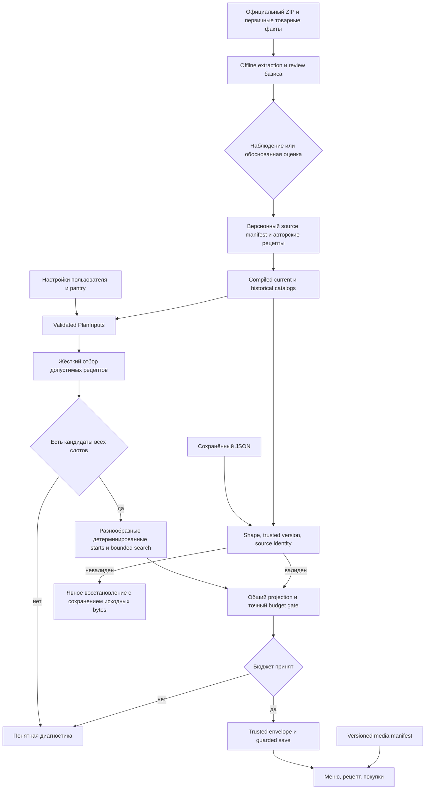

# Phase 03.1 — Разнообразный каталог привычных блюд — Research

**Researched** 2026-11-11

**Domain** Локальные пищевые данные, авторские рецептуры, детерминированный подбор, совместимость сохранённых меню

**Confidence** MEDIUM. Точные записи источников и код прочитаны. Предлагаемые рецептуры, время и региональные оценки требуют проверки при реализации.

<user_constraints>
## User Constraints (from CONTEXT.md)

Ниже дословно перенесены продуктовые решения и область исследования. Численные предложения в последующих разделах принадлежат разработчику. Источник открыт в этой сессии. [VERIFIED: .planning/phases/03.1-raznoobraznyy-katalog-privychnyh-blyud/03.1-CONTEXT.md:5-31]

<!-- DATA_48bc1a92_START -->
### Цель и границы

Расширить ограниченные52 растительных рецепта привычными блюдами с птицей, рыбой, мясом, яйцами, молочными продуктами и бобовыми; сохранить растительные варианты и все четыре слота. Обеспечить реальное использование разнообразия генератором. Весь P0 остаётся непринимаемым до CAT-01…05.

Полное решение и критерии: docs/decisions/varied-recipe-catalog-amendment.md, reference/PRD.md §16, .planning/REQUIREMENTS.md CAT-01…05.

### Зафиксировано

- После завершенияPhase3 и доPhase4. Не переписывать исторические summaries/источники предыдущего каталога.
- Общая цель50+ содержательно разных рецептов сохраняется; точный состав/число новых блюд и матрица покрытия — задача исследования/планирования.
- По решению пользователя10.11.2026 цены и КБЖУ в прототипе ориентировочные. Допустимы явно обозначенные оценки с документированным источником исходных величин, допущениями и raw/cooked/edible basis. СтабильныеID, обоснованные конверсии и явная обработка неизвестных данных обязательны. Если нужна региональная привязка новых оценок, целевой город Санкт-Петербург. Исторические источники сохраняют фактическую географию.
- Оригинальные/правомерно используемые инструкции, полные ингредиенты с учётом масла/соусов/гарнира, готовимая исходная порция. Не утверждать кухонную проверку без её проведения.
- Перепроверить generator ranking: новый ассортимент должен попадать в обычные варианты при допустимых настройках. Ограничения, бюджет и безопасность остаются жёсткими.
- Версионирование и восстановление сохранённых вариантов: без молчаливой потери, старый52media gate не распространяется на новый набор.
- Никаких runtime платныхAPI/LLM, новых подписок, публикации и scopeP1/P2.

### Начать с исследования

1. Составить матрицу блюд/слотов/основных продуктов и минимальные независимые сценарии разнообразия. Примеры возможных кандидатов (ещё не утверждённые рецепты): курица с гарниром и овощами, рыба с картофелем, мясное рагу, омлет, творожный завтрак, блюдо из чечевицы.
2. Подобрать подходящие пищевые записи и обоснованные справочные цены. Разрешены честно размеченные оценки с источником и базисом, поиск идеально точных нутриентов/цен не блокирует ассортимент. Проверить сопоставимость тушек, десятков, упаковок и съедобных профилей.
3. Проверить safety model и невозможность маркировать неизвестные аллергены/сертификацию как безопасные.
4. Только затем определить план новых профилей, рецептов, generator tests, миграции и изображений. Код текущей фазы03 сейчас не изменять ради нового каталога.

### Неизвестное

Список и количество новых рецептов, подходящие пищевые записи/обоснованные оценки, выход съедобной части, лицензии возможных внешних текстов и практическая кухонная проверка ещё не установлены. Исследование ведёт разработчик. Оценки допускаются с прозрачным базисом и маркировкой, подтверждение безопасности остаётся отдельным gate. Основание поправки10.11.2026 — docs/decisions/approximate-calculations-amendment.md, OPEN_QUESTIONSQ-14/Q-19, CAT-02.
<!-- DATA_48bc1a92_END -->

### Deferred Ideas (OUT OF SCOPE)

Отдельной секции Deferred Ideas в контексте нет. Граница задана дословной строкой «Никаких runtime платныхAPI/LLM, новых подписок, публикации и scopeP1/P2». [VERIFIED: .planning/phases/03.1-raznoobraznyy-katalog-privychnyh-blyud/03.1-CONTEXT.md:19-19]
</user_constraints>

## Summary

Предлагается добавить 30 авторских блюд к существующей базе, сохранив прежний релиз как отдельный доверенный снимок. Матрица ниже задаёт конкретные составы для восьми завтраков, восьми обедов, восьми ужинов и шести перекусов. Количество является проектным предложением разработчика. Общая обязательная граница продукта сформулирована как «каталога50+ содержательно разных рецептов» и включает все группы и четыре слота. [VERIFIED: .planning/REQUIREMENTS.md:137-141]

Основные зависимости уже присутствуют в коде. Самые важные изменения находятся в приёмке источников, стартовых состояниях поиска, маршрутизации каталога по версии и медиа. В текущем production gate зашиты один архив, старая дата приобретения цен и одинаковые разрешающие факты для растительных продуктов. Поиск начинается с минимальной стоимости и выполняет два раунда единичных замен. Это создаёт структурный риск, что расширенный ассортимент останется вне обычной недели. [VERIFIED: src/data/catalog.ts:49-88] [VERIFIED: src/domain/generatePlan.ts:138-139,203-224]

**Primary recommendation** Сначала сохранить исторический каталог и провести один смешанный четырёхслотовый tracer через общие расчёты и сохранение. Затем расширить тот же путь полным набором, добавить детерминированные разнообразные стартовые меню и выпустить версионный media manifest. Обоснованные оценки цен допускаются решением пользователя. Источник решения дословно разрешает «явно размеченные оценки с документированным обоснованием». [VERIFIED: docs/decisions/approximate-calculations-amendment.md:15-21]

## Architectural Responsibility Map

Проектное распределение ответственности, опирающееся на существующие чистые domain-функции, CatalogPort и ActivePlanPort. [VERIFIED: src/domain/catalog.ts:55-59] [VERIFIED: src/adapters/activePlan.ts:16-23]

| Capability | Primary Tier | Secondary Tier | Rationale |
|---|---|---|---|
| Подготовка пищевых записей и справочных оценок | Offline data/build | Локальные snapshots | Проверяемые записи приобретаются при разработке, затем попадают в bundle |
| Приёмка фактов и версии | Browser/domain adapters | Compiled data | Ввод проходит структурную и source-проверку до генерации |
| Отбор, стоимость, КБЖУ, запасы | Browser/domain | — | Переиспользовать общий точный расчёт |
| Восстановление меню | Browser/storage adapter | Compiled historical releases | Доверие устанавливается из кода, сохранённый JSON содержит входные данные |
| Фото и происхождение | Static assets | Offline ledger | Проверять существование, связь с рецептом, hash и визуальное соответствие |
| Сноска расчётов и ошибки | Browser/React | Domain diagnostics | Использовать существующие представления и состояния |

## Project Constraints (from AGENTS.md)

Директивы извлечены из открытого AGENTS.md. Применять их вместе с более поздней явной поправкой пользователя об оценках. [VERIFIED: AGENTS.md:1-513] [VERIFIED: docs/decisions/approximate-calculations-amendment.md:15-21]

- Работать внутри проекта, сохранять документы и чужие рабочие изменения, не коммитить секреты. Разрушительные операции требуют разрешения.
- Общаться по-русски. Рутинные технические решения принимать самостоятельно, проверять документацию и существующую реализацию, избегать лишних вопросов.
- Прочитать исходные материалы. Подробное frontend-ТЗ имеет приоритет для frontend scope и P0/P1/P2, конфликты документировать. GSD является основным workflow.
- Использовать относящиеся к задаче skills. Для бизнес-логики применять Superpowers TDD и debugging. Здесь прочитан mealplan-domain, его правила учитываются в рекомендациях.
- Сохранять React/TypeScript/Vite и локальные адаптеры, строгую типизацию, чистые функции расчётов, стабильные ID, проверку внешних данных и простую архитектуру.
- Не добавлять лишние зависимости. Платные сервисы, подписки и API требуют согласия. Генерация детерминированная.
- Жёстко соблюдать исключения, аллергии, время и бюджет. Неизвестное явно диагностировать. КБЖУ вычислять из структурированных исходных величин, порции пересчитывать один раз.
- Нормализовать совместимые единицы, не объединять несовместимые, вычитать pantry количественно один раз, различать полную стоимость, покрытие запасами и покупки.
- Интерфейс русский, RUB, mobile-first. Использовать общие токены и компоненты, доступные controls и осмысленные состояния.
- Писать unit-тесты расчётов, ограничений, замен и обновления покупок. Проверять нужные browser-flows, адаптивность 360/768/1280 и production build. Заявлять только выполненные проверки.
- Делать содержательные focused commits, обновлять прогресс и документацию. Перед завершением реализации нужны тесты, typecheck, build и рабочий пользовательский путь.
- UI UX Pro Max применяется к новым UI-паттернам, Vercel React Best Practices к React-изменениям, Web Design Guidelines к UI-review. Context7 нужен для незнакомых/version-sensitive API. Playwright применяется к реальным browser-проверкам.

<phase_requirements>
## Phase Requirements

Описания требований приведены дословно. [VERIFIED: .planning/REQUIREMENTS.md:137-141]

<!-- DATA_2e8ac701_START -->
| ID | Description | Research Support |
|---|---|---|
| CAT-01 | Пользователь выбирает из каталога50+ содержательно разных рецептов, включающего блюда с птицей, рыбой, мясом, яйцами, молочными продуктами и бобовыми, растительные варианты и все4слота; дубли названий не считаются разнообразием. | Матрица 30 кандидатов, registry различий метода и основного продукта |
| CAT-02 | Новые ингредиенты имеют структурированные пищевые профили и ориентировочные цены с обоснованным источником и базисом количества/единицы/сырого или готового/съедобного продукта. По решению пользователя10.11.2026 допустимы явно размеченные оценки с документированными допущениями, дата и фактический географический охват цены сохраняются в данных. При региональной привязке прототипа целевой город Санкт-Петербург. Неизвестное явно обрабатывается, пищевые ограничения проверяются отдельно. Ожидание идеально точных цен и нутриентов не блокирует ассортимент. Основание — docs/decisions/approximate-calculations-amendment.md. | Проверенные исходные USDA/retailer записи, source-specific manifests и оценочная policy |
| CAT-03 | Блюда имеют полные количества, исходные порции, исполнимые шаги и время; масло/соусы/гарнир учтены, КБЖУ и стоимость вычисляются, фото соответствует составу с честным происхождением. | Исходные массы, review шагов, cooking safety и независимый tracer |
| CAT-04 | Генератор действительно использует расширенный ассортимент при допустимых обычных настройках; независимые сценарии разнообразия, исключений, бюджета, времени и запасов проходят без ослабления жёстких ограничений и медицинских обещаний. | Новые стартовые меню, family diversity, тестовая матрица и bounded search |
| CAT-05 | Новый каталог согласован во всех расчётах/экранах/покупках, сохранённые варианты совместимы либо восстанавливаются явно без потери; новые рецепты имеют локальные изображения, общийmedia gate учитывает новуюверсию, unit/browser/type/lint/build подтверждают интеграцию до приёмкиMVP. | Historical trusted release, version-aware generation, legacy reload и media version registry |
<!-- DATA_2e8ac701_END -->
</phase_requirements>

## Standard Stack

Повторно использовать установленный стек. Фаза не требует установки внешних пакетов и обновления версий. В таблице записаны версии проекта, актуальность latest в registry здесь не заявляется. [VERIFIED: package.json:12-32]

<!-- DATA_5c21f608_START -->
| Library | Version as declared | Purpose |
|---|---|---|
| react / react-dom | `"19.3.1"` / `"19.3.1"` | Существующие экраны |
| react-router | `"8.5.0"` | Существующие переходы |
| vite / typescript | `"8.3.5"` / `"6.0.3"` | Сборка и строгая типизация |
| vitest | `"5.0.5"` | Domain/adapter/data tests |
| @playwright/test | `"1.64.1"` | Сквозная проверка |
| tailwindcss | `"3.4.19"` | Существующий UI |
<!-- DATA_5c21f608_END -->

Для offline extraction использовать имеющийся Python standard library с CSV/ZIP/Decimal/hashlib. Это предложение не вводит зависимости приложения. Исследовательская программа уже извлекла 20 записей и выполнила арифметический tracer. [VERIFIED: .tmp/phase031-food-probe.py:1-37] [VERIFIED: .tmp/phase031-tracer.py:1-42]

## Package Legitimacy Audit

Новые внешние пакеты не предлагаются. Gate установки не применялся. Существующие версии перечислены по package.json, их наличие в registry и publish dates этим исследованием повторно не удостоверены. [VERIFIED: package.json:12-32]

## Evidence Register and Existing Contracts

Ниже verbatim-фрагменты открытых определений. Они фиксируют допустимые значения для последующих рекомендаций и примеров.

<!-- DATA_f73a20e1_START -->
| Contract | Verbatim source | Implication |
|---|---|---|
| Базис и неизвестное | `readonly basis: 'edible'` / `readonly status: 'unknown'; readonly reason: string` | Хранить источник съедобной массы и явные unknown. [VERIFIED: src/domain/catalog.ts:13-18] |
| Цены | `readonly currency: 'RUB'` / `readonly estimate: true` | Все текущие цены уже оценочные, денежная формула остаётся общей. [VERIFIED: src/domain/catalog.ts:19-23] |
| Состояние и слоты | `readonly identity: string; readonly state: string; readonly category: string` / `'breakfast' \| 'lunch' \| 'dinner' \| 'snack'` | Новые состояния можно задавать без расширения union слотов. [VERIFIED: src/domain/catalog.ts:31-42] |
| Пищевая безопасность | `'restriction' \| 'allergen'` / `'known'` / `'conflicting'` | Не смешивать факт ингредиентного состава и аллергенную гарантию. [VERIFIED: src/domain/catalog.ts:24-30] |
| Историческая версия | `version: 'mealplan-2026-10-28-1'` | Сохранить снимок этой версии без изменения фактов. [VERIFIED: src/data/catalog.ts:37-37] |
| Схема меню | `export const PLAN_SCHEMA_VERSION = 1` | Смена версии каталога сама по себе не требует смены envelope schema. [VERIFIED: src/domain/plan.ts:8-20] |
| Persistent key и лимит | `ACTIVE_PLAN_KEY = 'mealplan:guest:active-plan:v1'` / `ACTIVE_PLAN_MAX_BYTES = 4_000_000` | Не менять ключ ради новой версии данных, измерить размер нового envelope. [VERIFIED: src/adapters/activePlan.ts:9-10] |
| Ошибки доверия | `'UNSUPPORTED_CATALOG_VERSION'` / `'UNTRUSTED_CATALOG_SNAPSHOT'` | Одинаковая строка версии не даёт доверия изменённым данным. [VERIFIED: src/adapters/trustedCatalogs.ts:23-27] |
| Pantry несовместимость | `'UNKNOWN_PANTRY_QUANTITY' \| 'INCOMPATIBLE_PANTRY_UNIT'` | Текущий projection уже умеет объяснить неизвестную массу и неподдержанную конверсию. [VERIFIED: src/domain/planProjection.ts:48-48,106-123] |
| Настройки | `'no-fish'` / `'gluten-free'` / `'lactose-free'` / `'vegetarian'` / `'halal'` | Не придумывать новые UI restrictions в этой фазе. [VERIFIED: src/domain/settings.ts:99-102] |
<!-- DATA_f73a20e1_END -->

Конкретные исходные manifests подключаются строками `import foodSnapshot from '../../data/sources/food.snapshot.json'`, `import priceSnapshot from '../../data/sources/prices.snapshot.json'`, `import safetySnapshot from '../../data/sources/safety.snapshot.json'`. Конструктор рецептов строит profile map только по первому snapshot и создаёт все количества в `'g'`, исходных порций `'2'`. Это нужно учесть при подключении новых продуктов. [VERIFIED: src/data/catalog.ts:1-3] [VERIFIED: src/data/recipes.ts:3-15]

## Food Data Research

### Бесплатный официальный путь

USDA публикует SR Legacy April 2018 в CSV и JSON. Документация определяет пищевые значения на 100 г съедобной части. Содержимое FDC распространяется CC0, официальный API Guide отдельно описывает ключ для API. Использовать downloadable archive и локальный импорт. [CITED: https://fdc.nal.usda.gov/download-datasets/] [CITED: https://www.ars.usda.gov/ARSUserFiles/80400525/Data/SR-Legacy/SR-Legacy_Doc.pdf] [CITED: https://fdc.nal.usda.gov/api-guide/]

Локальный ZIP повторно прочитан 11.11.2026. SHA256 равен `b80817294b8850530aaedf2e515c02593b1824f763a0ff356e5c2081643e6fd0`. Это повторное чтение архива, полученного ранее, дата нового скачивания не заявляется. Извлечены food, четыре nutrient rows и food_portion для 20 записей. Скрипт сохраняет оригинальные CSV строки, номера строк и ID нутриентных записей. [VERIFIED: .tmp/phase031-food-probe.py:8-33] [VERIFIED: docs/data/phase02-sources.md:10-20]

### Список новых профилей

Все нижеследующие значения — дословные строки USDA, порядок в числовой колонке ккал/Б/Ж/У на 100 г съедобного продукта указанного состояния. Значение относится к записи источника. Применение записи к обобщённому российскому продукту является справочной моделью, mapping нужно документировать. Предлагаемые product/profile IDs определит исполнитель, уже используемые generic ID сохраняются. [CITED: https://www.ars.usda.gov/ARSUserFiles/80400525/Data/SR-Legacy/SR-Legacy_Doc.pdf]

<!-- DATA_c3e612b8_START -->
| Продукт для нового каталога | FDC ID и дословное описание | Ккал/Б/Ж/У | Исходная строка food.csv |
|---|---|---|---|
| Куриное филе без кожи/кости | `171077` — `Chicken, broiler or fryers, breast, skinless, boneless, meat only, raw` | `120 / 22.5 / 2.62 / 0` | 3567 |
| Филе грудки индейки | `174515` — `Turkey, retail parts, breast, meat only, raw` | `114 / 23.34 / 2.33 / 0` | 7005 |
| Минтай, сырая съедобная рыба | `173725` — `Fish, pollock, Alaska, raw` | `76 / 17.17 / 0.82 / 0` | 6215 |
| Треска, сырая съедобная рыба | `171955` — `Fish, cod, Atlantic, raw` | `82 / 17.81 / 0.67 / 0` | 4445 |
| Фарш говяжий, расчётная жирность 10% | `174030` — `Beef, ground, 90% lean meat / 10% fat, raw` | `176 / 20 / 10 / 0` | 6520 |
| Свиная вырезка, постная мякоть | `168249` — `Pork, fresh, loin, tenderloin, separable lean only, raw` | `109 / 20.95 / 2.17 / 0` | 739 |
| Яичная масса без скорлупы | `171287` — `Egg, whole, raw, fresh` | `143 / 12.56 / 9.51 / 0.72` | 3777 |
| Молоко, representative 3.25% | `172217` — `Milk, whole, 3.25% milkfat, without added vitamin A and vitamin D` | `61 / 3.15 / 3.27 / 4.78` | 4707 |
| Йогурт натуральный без добавок | `171284` — `Yogurt, plain, whole milk` | `61 / 3.47 / 3.25 / 4.66` | 3774 |
| Сухая чечевица | `172420` — `Lentils, raw` | `352 / 24.63 / 1.06 / 63.35` | 4910 |
| Готовый консервированный нут без заливки | `173800` — `Chickpeas (garbanzo beans, bengal gram), mature seeds, canned, drained solids` | `139 / 7.05 / 2.77 / 22.53` | 6290 |
| Готовая консервированная красная фасоль без заливки | `174285` — `Beans, kidney, red, mature seeds, canned, drained solids` | `124 / 7.98 / 1.05 / 21.49` | 6775 |
| Подсолнечное масло, масса | `171025` — `Oil, sunflower, linoleic, (approx. 65%)` | `884 / 0 / 100 / 0` | 3515 |
| Овсяные хлопья, сухие | `173904` — `Cereals, oats, regular and quick, not fortified, dry` | `379 / 13.15 / 6.52 / 67.7` | 6394 |
| Макароны, сухие | `168927` — `Pasta, dry, unenriched` | `371 / 13.04 / 1.51 / 74.67` | 1417 |
| Лук, съедобная масса | `170000` — `Onions, raw` | `40 / 1.1 / 0.1 / 9.34` | 2490 |
| Яблоко с кожицей, съедобная часть | `171688` — `Apples, raw, with skin (Includes foods for USDA's Food Distribution Program)` | `52 / 0.26 / 0.17 / 13.81` | 4178 |
| Огурец с кожицей | `168409` — `Cucumber, with peel, raw` | `15 / 0.65 / 0.11 / 3.63` | 899 |
| Хлеб цельнозерновой, готовый | `172688` — `Bread, whole-wheat, commercially prepared` | `252 / 12.45 / 3.5 / 42.71` | 5178 |
<!-- DATA_c3e612b8_END -->

Четыре исходных nutrient IDs дословно `'1008'`, `'1003'`, `'1004'`, `'1005'` уже используются текущим mapping. Источник каждой строки таблицы открыт из официального архива, записи и четыре исходных amount сохранены в исследовательском извлечении. [VERIFIED: src/data/catalog.ts:21-22,75-80] [VERIFIED: .tmp/phase031-food-probe.json] [VERIFIED: USDA SR archive, food.csv:739-7005]

Дополнительно проверена запись `173430` — `Butter, without salt`, `717 / 0.85 / 81.11 / 0.06`. В предложенной матрице сливочное масло не требуется, его можно оставить за пределами первого релиза. [VERIFIED: USDA SR archive, food.csv:5920; .tmp/phase031-food-probe.json]

Для российского творога найден первичный retailer SKU51256. Страница показывает на 100 г `117` ккал, `16.5` Б, `5` Ж, `1.5` У, упаковку `200 г`, состав нормализованное пастеризованное молоко и закваска. Использовать отдельный label-derived профиль творога5%. Включить только числовой фрагмент и атрибуцию. CC0 USDA к этой странице не применять. [CITED: https://vkusvill.ru/goods/tvorog-5-200-g-51256/]

Предлагаемый минимальный набор составляет 19 USDA-профилей из таблицы плюс творог. Существующие овощи, крупы, мука, сахар и соль переиспользуются. Для разнообразия основных групп нужны курица, индейка, минтай/треска, говядина/свинина, яйца, творог/молоко/йогурт и чечевица/нут/фасоль. Количество — предложение, отдельные вторые виды рыбы или мяса можно исключить при сохранении содержательного покрытия матрицы.

### Raw / cooked / edible и единицы

Рекомендованный базис всех рецептур — отмеренные съедобные входы. Сырые мясо/яйца/овощи, сухие крупы/макароны/чечевица, готовые йогурт/хлеб и консервированные бобовые после отделения заливки получают разные явно записанные состояния. Текущий конструктор жёстко присваивает `state: 'raw'` всем продуктам, это место нужно заменить source-specific mapping. [VERIFIED: src/data/catalog.ts:24-26]

- Мясо и рыба в рецептах задаются массой мякоти без костей/кожи. Для замороженной рыбы указывать массу после размораживания и удаления глазури. Цена такой массы может быть отдельной явно описанной оценкой. Наблюдаемая цена тушки и масса съедобного филе имеют разные базисы, это отдельно зафиксировано решением каталога. [VERIFIED: docs/decisions/varied-recipe-catalog-amendment.md:39-43]
- Яйца вводить в граммах содержимого без скорлупы. Старый `egg` имеет `allowedUnits: ['pcs']`. Добавить ввод массы, сохранив поддержку прежних черновиков со штуками. Для generic pantry в штуках использовать существующую диагностику несовместимости, не списывать неизвестную массу. [VERIFIED: src/adapters/products.ts:9-15] [VERIFIED: src/domain/planProjection.ts:106-123]
- USDA portion строки `88374`, `fdc_id:171287`, `amount:1`, `modifier:large`, `gram_weight:50` подтверждают конкретную representative порцию. Соседние строки дают `medium:44`, `small:38`, `extra large:56`, `jumbo:63`. Это основание для подписанного профиля large или пояснения примерной массы, отдельная российская размерная категория здесь не установлена. [VERIFIED: USDA SR archive, food_portion.csv, rows stored in .tmp/phase031-food-probe.json]
- Если исполнитель захочет ввод в штуках для нового профиля, ограничить conversion конкретной размерной идентичностью и evidence этой portion. Вариант с граммами уже позволяет выпустить ассортимент и сохраняет честную обработку старого pantry.
- Масло и молоко взвешивать в граммах. Найденные USDA household rows задают для масла `tbsp:13.6`, `tsp:4.5`, для молока `cup:244`, `tbsp:15`. Эти записи описывают свои household measures. Текущий конвертер требует evidence с совпадением product/profile для перехода между измерениями. [VERIFIED: .tmp/phase031-food-probe.json] [VERIFIED: src/domain/quantities.ts:81-92]
- При цене на литр использовать явно оценочную цену на массу со своей записью допущений либо найти массу упаковки. Равенство мл и г в расчёты не вводить. Численные source-specific conversions добавлять только с проверяемым базисом.
- Для нута и фасоли использовать готовый drained-weight профиль. Цена содержимого банки должна иметь указанную массу без заливки либо самостоятельную обоснованную оценку на drained массу. Сухой и консервированный продукт разделять по product ID, иначе pantry ошибочно объединит их.
- Крупы и чечевицу задавать сухой массой. Технологическую воду писать в шагах. Модель суммирует входные нутриенты и не выдаёт эти данные за анализ 100 г приготовленного блюда. Исходная модель уже явно исключает cooked yield и nutrient retention. [VERIFIED: src/data/recipes.ts:17-20] [VERIFIED: docs/data/phase02-sources.md:18-23]
- Для новых рецептов, где часть масла/соуса или отвар удаляются, описать оценочную модель потерь отдельно. Первый набор проще построить на тушении и сохранении всех посчитанных компонентов в подаче. Это уменьшает число необходимых коэффициентов.

## Price Estimates Policy

### Что удалось установить

Первичная страница магазина МясоСторе указала Санкт-Петербург, куриное филе без кости, замороженное, `609 Руб/кг`, статус отсутствия в наличии. Ранее поисковый индекс показывал 580. Использовать наблюдение609 с датой11.11.2026, не переносить старый snippet и не обещать текущую доступность. Прямой HTML сохранён локально, hash `7a64f1e1dfca007e50b464b848ecd5a4b8889a2cbb5cb156b60efa3fd9203422`. [CITED: https://myasostore.ru/catalog/kuritsa/kuritsa-grudka-file-zam/] [VERIFIED: .tmp/phase031-source-probe.json]

Страница творога показала `142` RUB за `200 г`, арифметически710 RUB/kg. Адрес доставки не выбран, поэтому наблюдение не является подтверждённой ценой конкретного магазина Санкт-Петербурга. Региональную оценку можно построить на этом ориентире с явным target scope. Страница филе индейки первичного магазина показывает850 RUB/kg. [CITED: https://vkusvill.ru/goods/tvorog-5-200-g-51256/] [CITED: https://myasostore.ru/catalog/indeyka/indeyka-grudka/]

Страница ВкусВилл для весового филе минтая показывает772 RUB/kg и глазурь до5%. Это полезный ориентир стоимости филе. Точный выход после размораживания из такого верхнего предела не установлен. [CITED: https://vkusvill.ru/goods/mintay-file-bez-kozhi-109313/]

Официальный раздел Петростата найден, но первичное чтение страницы завершилось timeout, запрос PDF —502, прямой TLS-запрос Python также timeout. По этим попыткам числовых наблюдений не получено. Вторичные пересказы не включены в ценовые факты исследования. Работу каталога продолжать с честными оценками. [VERIFIED: .tmp/phase031-source-probe.json] [CITED: https://78.rosstat.gov.ru/folder/27867]

### Формат минимальной новой policy

Рекомендовано сохранить существующий runtime PriceProfile. В source manifest добавить тип происхождения, фактическую географию исходного наблюдения, целевой оценочный регион, дату оценки, исходную величину/единицу и собственное правило оценки. В runtime reference должна попасть единица, которой реально пользуется формула. `estimate: true` уже обязателен. [VERIFIED: src/domain/catalog.ts:19-23]

Разделять наблюдение источника и выбранную оценку. Пример проектируемой записи для курицы — наблюдение609 RUB/kg у петербургского магазина, выбранная representative оценка610 RUB/kg съедобного бескостного филе с пояснением округления и базиса. Это оценочная policy разработчика. Она не утверждает, что магазин продаёт отмеренную съедобную массу по610. [ASSUMED]

Для товаров без точного SKU допустима собственная диапазонная estimate-запись с перечислением исходных ориентиров и описанием продуктового соответствия. Перед импортом чисел исполнитель должен приложить хотя бы один релевантный первичный числовой ориентир или прозрачный расчёт из уже подтверждённых исходных величин. Продолжать приобретение таких записей небольшими партиями в задаче данных. Исследование не задаёт обязательного количества магазинов, сертификатов или идеально локальных цен.

Ниже цены используются исключительно для арифметического tracer. Для `egg`280 RUB/kg, чечевицы250, масла220, лука60, йогурта260, яблока220, хлеба200 в этой сессии первичные числовые ориентиры не приобретены. Эти суммы нельзя переносить в production как подтверждённые факты. Они служат заменяемыми fixture estimates. [ASSUMED]

Runtime source reference собственной estimate-записи должен ссылаться на собственную policy, с явным авторским происхождением. Первичный URL, величина и допущения остаются в source manifest. Существующее логическое пространство `https://mealplan.invalid/original-recipes` уже применяется к собственному контенту, это позволяет держать атрибуцию отдельно от утверждений внешнего источника. [VERIFIED: src/data/recipes.ts:13-15]

Новый source gate должен проверять сохранённый результат оценки, базис, обязательные поля, числовые строки и hash evidence. Проверку старой даты `!/^2026-10-28/.test(price.accessedAt)` оставить в исторической приёмке. Общую новую проверку строить по manifest версии. [VERIFIED: src/data/catalog.ts:68-88]

## Candidate Recipe Matrix

Проектное предложение разработчика — 30 кандидатов. Все количества ниже на две исходные порции. Значения граммовые, по съедобным входам. Вода является технологической средой и уточняется в полных шагах. Масло обозначает взвешенное подсолнечное масло. Время — предварительная авторская оценка, кухонная проверка не проведена. Весь этот раздел имеет статус [ASSUMED] до review рецептур при реализации.

Число и баланс предлагаются для управляемой партии данных. Они сохраняют место растениям и дают несколько самостоятельных способов приготовления каждой новой группы. Они не являются квотой, согласованной пользователем.

| № | Слот | Кандидат и содержательное отличие | Исходный состав на2, г | Мин |
|---|---|---|---|---|
| B1 | Завтрак | Омлет с томатами и хлебом, сковорода | яйцо200, томат200, хлеб120, масло10, соль2 | 15 |
| B2 | Завтрак | Молочная овсянка с яблоком | овсянка120, молоко360, яблоко200, сахар12, соль1 | 15 |
| B3 | Завтрак | Сырники на сковороде | творог400, яйцо50, мука60, сахар20, масло10 | 25 |
| B4 | Завтрак | Творожно-яблочная запеканка, духовка | творог400, яйцо100, манка40, яблоко200, сахар16, масло6 | 40 |
| B5 | Завтрак | Гречка с яйцом и тушёной морковью | гречка140, яйцо150, морковь180, лук60, масло12, соль2 | 25 |
| B6 | Завтрак | Овсяноблин с йогуртом и яблоком | овсянка100, яйцо100, молоко120, йогурт100, яблоко160, масло8 | 20 |
| B7 | Завтрак | Растительные оладьи из нута с томатом | нут300 drained, мука50, томат200, масло12, соль2 | 20 |
| B8 | Завтрак | Тёплая овсяная каша с яблоком на воде | овсянка140, яблоко240, сахар12, соль1 | 15 |
| L1 | Обед | Куриное филе с рисом и морковью, тушение | курица300, рис140, морковь200, лук80, масло14, соль3 | 30 |
| L2 | Обед | Куриный суп с макаронами и овощами | курица260, макароны100, картофель200, морковь120, лук80, масло8, соль3 | 30 |
| L3 | Обед | Тефтели из индейки с гречкой и томатным соусом | индейка300, гречка140, томат260, лук80, масло12, соль3 | 30 |
| L4 | Обед | Индейка с картофелем и капустой, сотейник | индейка300, картофель360, капуста240, морковь120, масло12, соль3 | 30 |
| L5 | Обед | Минтай с картофелем и морковью, пар/тушение | минтай320, картофель400, морковь200, лук60, масло12, соль3 | 30 |
| L6 | Обед | Рыбный суп с рисом и овощами | треска280, рис100, картофель240, морковь140, лук80, масло8, соль3 | 30 |
| L7 | Обед | Макароны с говяжьим фаршем в томатном соусе | говядина280, макароны160, томат300, лук80, масло10, соль3 | 30 |
| L8 | Обед | Густой чечевичный суп с овощами | чечевица160 сухая, картофель240, морковь160, томат200, лук80, масло12, соль3 | 30 |
| D1 | Ужин | Минтай в йогуртовом соусе с гречкой | минтай320, гречка140, йогурт160, морковь200, масло10, соль3 | 30 |
| D2 | Ужин | Свиная вырезка с картофелем и капустой, тушение | свинина300, картофель360, капуста300, лук80, масло12, соль3 | 30 |
| D3 | Ужин | Ленивые голубцы с говядиной | говядина280, рис120, капуста320, томат240, лук80, масло10, соль3 | 35 |
| D4 | Ужин | Индейка с макаронами и тушёными томатами | индейка300, макароны160, томат280, морковь160, масло12, соль3 | 30 |
| D5 | Ужин | Нут с томатами и рисом, сотейник | нут320 drained, рис140, томат300, лук80, масло14, соль3 | 25 |
| D6 | Ужин | Тёплое рагу из фасоли с картофелем | фасоль320 drained, картофель360, морковь160, лук80, масло12, соль3 | 30 |
| D7 | Ужин | Чечевица с капустой и томатами | чечевица140 сухая, томат300, капуста200, лук80, масло12, соль3 | 30 |
| D8 | Ужин | Картофельная фриттата с томатами | яйцо240, картофель360, томат240, лук60, масло12, соль3 | 30 |
| S1 | Перекус | Натуральный йогурт с яблоком | йогурт300, яблоко200 | 5 |
| S2 | Перекус | Несладкий творог с огурцом и хлебом | творог240, огурец200, хлеб80, соль1 | 5 |
| S3 | Перекус | Паста из нута с огурцом на хлебе | нут240 drained, огурец160, хлеб80, масло8, соль1 | 10 |
| S4 | Перекус | Порционный паровой яичный пудинг | яйцо120, молоко160, сахар12 | 20 |
| S5 | Перекус | Запечённое яблоко с овсяной крошкой | яблоко320, овсянка60, сахар12, масло6 | 25 |
| S6 | Перекус | Салат из фасоли, томатов и капусты | фасоль240 drained, томат180, капуста120, масло8, соль1 | 10 |

При авторском review проверить сочность, достаточную воду, порядок нагрева, массу на порцию и метод. Для супа задать измеренную воду и размер подачи. Сырники и запеканка отличаются методом и связующим. Повтор курицы с другим гарниром требует самостоятельного содержательного метода/соуса. Автоматически сравнивать нормализованные составы на одну порцию, затем отдельно читать инструкции. Исходный корпус уже проверяет fingerprints, что можно расширить. [VERIFIED: docs/data/phase02-sources.md, раздел «Корпус и проверка»]

Для курицы/индейки в шагах использовать подтверждённую готовность термометром74°C, для фарша говядины71°C, рыбного филе63°C либо признаки из официального chart. Яичные блюда71°C. Для свиной вырезки chart указывает63°C и отдых3мин. Эти значения являются guidance указанного источника, применимость к конкретным шагам проверяется при авторском review. [CITED: https://www.foodsafety.gov/food-safety-charts/safe-minimum-internal-temperatures]

## Architecture Patterns

### System Architecture Diagram

Проектируемый поток. Он сохраняет существующие точки приёмки и общий projection. [VERIFIED: src/adapters/generation.ts:50-60] [VERIFIED: src/adapters/activePlan.ts:23-54]



### Component Responsibilities

Имена новых файлов ниже являются предложениями. Существующие точки найдены и открыты в этой сессии.

| Existing seam | Изменение при реализации |
|---|---|
| Конструктор и source gate текущего каталога | Выделить неизменяемый historical release. Current facade собирает старые и новые факты, проверенные по manifest версии. [VERIFIED: src/data/catalog.ts:15-98] |
| Авторский helper рецептов | Оставить исторические рецепты неизменными. Для новой партии принимать общий profile registry и явные состояния, количества и evidence. [VERIFIED: src/data/recipes.ts:5-20] |
| Product search | Добавить новые точные названия и разрешённые единицы, сохранить existing IDs и старые draft values. [VERIFIED: src/adapters/products.ts:6-25] |
| Production source snapshots | Добавить новый manifest партии, не переписывать исходный архив/старые цену/географию. [VERIFIED: src/data/catalog.ts:1-3,49-88] |
| Trusted catalog registry | Зарегистрировать historical и current compiled snapshots, использовать строгий identity comparator. [VERIFIED: src/adapters/trustedCatalogs.ts:15-33] |
| Generation adapter | Выбирать compiled CatalogPort по запрошенной доверенной версии, затем сохранять полную sameSnapshot проверку. [VERIFIED: src/adapters/generation.ts:21-60] |
| Shared domain projection | Переиспользовать для новых ингредиентов без отдельных экранных расчётов. [VERIFIED: src/domain/planProjection.ts:89-149] |
| Media registry/audit | Поддержать несколько версий и точные множества ID вместо глобального52. [VERIFIED: src/data/recipeMedia.ts:1-65] [VERIFIED: scripts/check-recipe-media.mjs:8-52] |

### Pattern 1 — Source-specific acceptance

Сохранить существующий structural validator. Source acceptance нового release должен связывать каждый runtime profile с проверенной строкой manifest и её базисом. Для USDA сравнивать source строки и hash извлечения, для label-derived профиля — сохранённые поля этикетки/страницы и mapping, для собственной оценки — исходные наблюдения и правило получения оценки. Не требовать USDA CSV от творога, не подставлять ему CC0.

Сейчас source gate буквально требует одинаковые `[{ key: 'no-fish', suitable: true }, { key: 'vegetarian', suitable: true }]` и `['halal', 'gluten-free', 'lactose-free']` у каждого продукта. Эту проверку нужно оставить внутри historical release и заменить у нового release на индивидуально проверенные safety facts. [VERIFIED: src/data/catalog.ts:82-86]

Для нового мяса документировать отрицательный vegetarian факт, для рыбы также отрицательный no-fish. Для однокомпонентных продуктов формировать подтверждаемые identity facts. Неизвестную сертификацию и отсутствие следов не превращать в suitable=true. Наличие unknown сертификации не исключает обычный рецепт без соответствующего запроса, текущий алгоритм требует факты именно для выбранных ограничений. [VERIFIED: src/domain/generatePlan.ts:108-135]

### Pattern 2 — Diversity as a bounded soft objective

Сегодня score сравнивает раннее использование запасов, затем заданную норму, variety и стоимость. Для medium считается только повтор того же ID в том же слоте соседних дней. Для max используется число ID. Cheapest baseline и два раунда single-slot substitutions могут изменить максимум две позиции относительно стартового меню, а бюджет вычислений может закончиться ещё раньше. Последний вывод следует из структуры циклов. [VERIFIED: src/domain/generatePlan.ts:42-74,203-224]

Рекомендовано сохранить жёсткий admission и окончательный budget check. Перед beam-поиском создать несколько детерминированных полных starts из уже допущенных рецептов. Минимально нужны cheapest fallback и seed-rotated balanced start с round-robin по семьям основных продуктов. Каждый start оценивать общим projection. При превышении бюджета использовать детерминированные удешевляющие замены, все переходы включать в прежний общий work/deadline budget.

Для medium/max добавить к soft score покрытие разных основных групп и нормализованных recipe families, затем повторы и стоимость. Набор групп выводить из фактически допустимых кандидатов. При vegetarian/no-fish/исключении продукта недоступная группа не должна давать штраф, требующий нарушения ограничения. Для minimum сохранить допустимость повторов, но выбирать содержательный mixed start, когда это позволяет бюджет. Конкретные weights/лексикографический порядок закрепить независимыми тестами.

Метаданные family/group рекомендуется хранить в compiled sidecar keyed by catalog version и recipe ID. Его значения сверять с ingredient identity при review. Это избегает изменения старых persisted recipeSnapshot. Общий генератор должен сохранять работоспособность synthetic catalog fixtures без sidecar. Конкретная схема sidecar — рутинное решение исполнителя, предложенные численные coverage thresholds должны оставаться test policy, без превращения в медицинскую норму. [ASSUMED]

Не расширять budget/time tolerance ради смешанного меню. Не переносить вычисления на runtime LLM. Не повышать search ceiling без измерения latency. Текущие значения дословно `beamWidth: 32`, `maxEvaluations: 512`, `evaluationCeiling: 20000`, `maxTransitions: 200000`, `batchSize: 128`, `exhaustiveSize: 256`. Adapter ограничен30000ms и проверяет deadline после дорогого шага. [VERIFIED: src/domain/generatePlan.ts:16-16] [VERIFIED: src/adapters/generation.ts:22-27,60-76]

### Pattern 3 — Historical compatibility with version-aware generation

Реестр доверия сейчас создаётся как `createTrustedCatalogRegistry([bundledCatalog])`. При смене bundled версии старый снимок выпадет из реестра. Сохранить старый compiled release и зарегистрировать оба, не считать JSON из localStorage источником доверия. [VERIFIED: src/adapters/trustedCatalogs.ts:11-33]

Отдельный integration gap состоит в append/recreate. Controller вызывает `run(base.plan.inputs, origin, 'append', base, revision)` и аналогичный replace. Generation adapter вызывает `catalog.load()` injected current port, затем сравнивает полный снимок. Добавление historical release только в registry позволит загрузить меню, но append/recreate старой версии столкнутся с `'CATALOG_SNAPSHOT_MISMATCH'`. [VERIFIED: src/features/generation/controller.ts:197-205] [VERIFIED: src/adapters/generation.ts:52-59]

Рекомендуется небольшой dispatcher GenerationPort, выбирающий только заранее compiled source-approved port по requested catalogVersion. После выбора сохраняется существующая полная sameSnapshot проверка. Новые wizard-запросы используют current version. Дополнительные варианты старого набора строятся на historical version. Новый набор с новым ассортиментом создаётся обычным пользовательским действием нового планирования. Одна оболочка остаётся одной версией, version/recipe snapshots внутри неё не подменяются.

Сохранить старый storage key, sourceSnapshots, guards от конкурентной записи, cancel и recovery. Измерить serialized bytes максимального допустимого набора. Текущая защита сравнивает raw storage bytes непосредственно перед setItem и ограничивает размер4млн. [VERIFIED: src/adapters/activePlan.ts:9-10,65-91]

### Pattern 4 — Versioned media registry

Текущий resolver возвращает изображение только при равенстве единственной `mediaCatalogVersion = 'mealplan-2026-10-28-1'`. Full audit дополнительно требует `rows.length !== 52` и сравнивает физический наборPNG с expected IDs. [VERIFIED: src/data/recipeMedia.ts:1-65] [VERIFIED: scripts/check-recipe-media.mjs:8-18,48-52]

Сохранить historical associations. Добавить current manifest, переиспользующий старые52 association без изменения фактов их происхождения, плюс собственные локальные изображения новых блюд. Audit по выбранной версии сравнивает manifest ID с factual catalog ID. Общий физический audit использует объединение путей всех поддержанных версий, rejects лишние/отсутствующие файлы, hash mismatch и дубликаты новых фотографий. Source generation version изображения и supported catalog versions должны быть раздельны.

В новых изображениях показывать только продукты рецепта, учитывать соусы/масло/гарнир. Зафиксировать provider, оригинальный артефакт, prompt, дату, условия и visual review. Изображение, созданное ImageGen, получает честную отметку generated. На этапе реализации использовать имеющийся инструмент генерации и skill imagegen, новые runtime API не нужны. Если генерация прервётся, сохранить фактический resume ledger и продолжить до полного набора.

## Don't Hand-Roll

| Problem | Use Instead | Основание |
|---|---|---|
| Новая арифметика в экранах | evaluateIngredient и projectPlan | Одна формула и однократный pantry allocation уже существуют. [VERIFIED: src/domain/catalog.ts:63-83] [VERIFIED: src/domain/planProjection.ts:89-149] |
| Самостоятельный сериализатор рациональных чисел | Существующие encode/decode и validateActiveBundle | Trust boundary уже пересчитывает производные totals. [VERIFIED: src/adapters/activePlan.ts:22-54,83-83] |
| Пересчёт generic яйца в50г | Граммовая съедобная масса или точно scoped USDA portion | Источник содержит разные размеры яйца. [VERIFIED: .tmp/phase031-food-probe.json] |
| Парсер чужих рецептов/фотографий | Собственные инструкции и локально созданные картинки | Авторский источник уже поддержан моделью. [VERIFIED: src/data/recipes.ts:13-20] |
| Самодельная медицинская норма | Существующий explicit target и disclosure | Задача требует разнообразный каталог, пользовательская поправка сохраняет справочный характер расчёта. [VERIFIED: reference/PRD.md:404-416] |

## Runtime State Inventory

Это миграция версии локальных данных. Инвентаризация ограничена проектом и фактически прочитанными поверхностями.

| Category | Items Found | Action Required |
|---|---|---|
| Stored data | Активный guest envelope содержит catalogVersion, полный catalog и recipeSnapshot. Старые drafts содержат productId и единицы. [VERIFIED: src/domain/plan.ts:8-30] [VERIFIED: src/adapters/activePlan.ts:9-10] | Сохранять historical release, читать прежние bytes без repricing и overwrite. Покрыть реальные fixtures. Не переводить старые generic pcs в новую массу молча |
| Live service config | В исследованных adapters источником данных являются imports и injected CatalogPort, внешняя service config для каталога не обнаружена. [VERIFIED: src/data/catalog.ts:1-8] [VERIFIED: src/adapters/generation.ts:17-21] | Миграция внешнего сервиса не требуется в исследованном пути. Полный machine/service inventory не проводился |
| OS-registered state | Поиск каталога в исследованных исходниках опирается на bundle/browser storage. OS registrations для этой версии не исследовались. [ASSUMED] | Не вводить действия с Task Scheduler/system settings. При появлении реального installer пересмотреть область |
| Secrets/env vars | Рекомендованный downloadable/offline путь не требует API key. API Guide отдельно требует ключ для API. [CITED: https://fdc.nal.usda.gov/api-guide/] | Использовать download, не добавлять secrets и auth proxy |
| Build artifacts | Bundle включает factual snapshots и media paths, media audit проверяет физическиеPNG. [VERIFIED: src/data/catalog.ts:1-8] [VERIFIED: scripts/check-recipe-media.mjs:13-18] | Пересобрать bundle, проверить union supported assets и serialized-size. Установки/global packages не менять |

## Common Pitfalls

### Новая еда блокируется старым source gate

**Failure** Все новые animal profiles получают source manifest error до начала подбора.

**Cause** Валидатор требует прежний архив/дату и только два одинаковых разрешающих safety facts.

**Prevention** Разделить historical acceptance и source-specific current acceptance, добавить mutation tests для каждой категории источника. [VERIFIED: src/data/catalog.ts:49-88]

### Новый каталог существует, смешанного меню нет

**Failure** Обычная неделя продолжает состоять из дешёвых старых блюд.

**Cause** Cheapest start, ограниченный neighbourhood и medium-повторы только соседних дней.

**Prevention** Полные diverse starts, coverage/family soft objectives и независимые тесты реальных результатов. [VERIFIED: src/domain/generatePlan.ts:71-74,203-224]

### Старое меню читается, кнопка нового варианта падает

**Failure** Reload проходит, append получает mismatch.

**Cause** Historical доверие и injected latest CatalogPort решают разные задачи.

**Prevention** Version-aware compiled ports и отдельный browser regression старого меню. [VERIFIED: src/features/generation/controller.ts:197-205] [VERIFIED: src/adapters/generation.ts:52-59]

### Яйца/литры/банки создают фиктивную экономию pantry

**Failure** Вычитается неподтверждённая масса, либо одна банка считается сухой фасолью.

**Prevention** Точные product identities, граммы съедобного продукта, отдельные drained profiles, scoped conversions и существующий INCOMPATIBLE_PANTRY_UNIT. [VERIFIED: src/domain/quantities.ts:81-92] [VERIFIED: src/domain/planProjection.ts:106-123]

### Название и фото скрывают недосчитанные ингредиенты

**Failure** На фото есть подлива/гарнир, в составе нет их массы.

**Prevention** Recipe/media review по общей матрице. Проверять весь состав и каждый посчитанный ингредиент, писать оригинальные шаги. Полнота масла/соусов/гарнира является обязательной. [VERIFIED: reference/PRD.md:406-408]

### Оценка выдаётся за точное наблюдение

**Failure** Собственная цена для edible fillet подписана как средняя цена города, неизвестные БЖУ становятся0.

**Prevention** Manifest хранит исходное наблюдение, собственную оценку и основания отдельно. Runtime unknown остаётся диагностируемым, пользователь видит действующую краткую сноску. [VERIFIED: docs/decisions/approximate-calculations-amendment.md:9-21]

## Code Examples

### Переиспользование точных расчётов

Паттерн уже используется в source-based evaluation и projection, пример принимает готовые аргументы без новых discrete values. [VERIFIED: src/domain/catalog.ts:63-83] [VERIFIED: src/domain/planProjection.ts:89-100]

```typescript
const scale = divide(selectedServings, recipe.baseServings);
const scaledIngredient = {
  ...ingredient,
  quantity: {
    ...ingredient.quantity,
    amount: multiply(ingredient.quantity.amount, scale),
  },
};
const result = evaluateIngredient(food, scaledIngredient);
```

### Первый смешанный tracer

Использовать B1/L1/D7/S1 на один день и двух человек. Сначала это явный fixed-selection domain tracer, затем проверить те же новые профили через production generation. Фиксированный выбор сам по себе не доказывает CAT-04. Составы заданы в матрице, source values взяты из открытого USDA archive и прежних manifests.

Исследовательский Decimal-подсчёт выполнен отдельным скриптом, production generation нового каталога ещё не запускалась. Приблизительные fixture цены перечислены в Price Estimates Policy. Значения ниже пригодны как независимый исходный oracle после замены оценок на принятые snapshot prices. [VERIFIED: .tmp/phase031-tracer.py:1-42] [ASSUMED]

| Блюдо | Ккал/Б/Ж/У на1 порцию | Оценка ингредиентов на2, RUB |
|---|---|---|
| B1 | 356.4 / 20.91 / 16.81 / 30.236 | 136.2516355555555556 |
| L1 | 554.38 / 40.111 / 11.672 / 69.281 | 211.0730335802469094 |
| D7 | 367.44 / 20.281 / 7.182 / 59.716 | 132.5617033333333334 |
| S1 | 143.5 / 5.465 / 5.045 / 20.80 | 122 |

Сумма на человека за день1421.72ккал /86.767Б /40.709Ж /180.033У. Это арифметика предложенных порций. Она не является утверждением о соответствии пользовательской норме. Полная стоимость601.8863724691357984 RUB. Для запаса куриного филе200г покрытие122RUB, покупки479.8863724691357984RUB. Проверить точное равенство ingredient = covered + purchase, остаток курицы к покупке100г и отсутствие повторного списания при повторном использовании курицы. [VERIFIED: .tmp/phase031-tracer.json] [ASSUMED]

На production интеграции сравнить независимые expected literals с evaluateIngredient → projectPlan → save/load → menu/recipe/shopping. Добавить x0.5/x2 servings, pantry неизвестной массы и несовместимых единиц, budget ровно по границе и на одну точную дробь ниже. Итоговые literals закреплять после принятия фактического source manifest, не вычислять expected через ту же проверяемую функцию.

## Validation Architecture

Nyquist и security включены. В конфиге дословно `"nyquist_validation": true` и `"security_enforcement": true`. [VERIFIED: .planning/config.json:24-48]

### Test Framework

| Property | Value |
|---|---|
| Framework | Vitest5.0.5, Playwright1.64.1. Версии проекта. [VERIFIED: package.json:23-24] |
| Config | Vite test config использует `environment: 'node'`, `include: ['src/**/*.test.ts']`. [VERIFIED: vite.config.ts:31-31] |
| Quick data run | `npm run test:unit -- --run src/data/catalog.test.ts src/data/sources.test.ts` |
| Quick generator run | `npm run test:unit -- --run src/domain/generatePlan.test.ts src/adapters/generation.test.ts` |
| Quick trust run | `npm run test:unit -- --run src/adapters/activePlan.test.ts src/features/generation/controller.test.ts` |
| Full suite | `npm run test:unit -- --run`, затем typecheck/lint/build |
| Browser | `npm run test:e2e -- e2e/catalog-expansion.spec.ts --project=chromium` — предлагаемый новый файл |

Команды соответствуют существующим scripts `"test:unit": "vitest"`, `"test:e2e": "playwright test"`, `"typecheck": "tsc -p tsconfig.json"`, `"lint": "eslint ."`, `"build": "vite build --target safari15"`. Browser fixture запускает локальный dev server4173 и проекты chromium/firefox/webkit. [VERIFIED: package.json:6-11] [VERIFIED: playwright.config.ts:3-23]

### Phase Requirements → Test Map

Новые сценарии дописать в существующие test-файлы, кроме одного сквозного browser файла. Это предложение расширения покрытий, результаты прогонов здесь не заявляются.

| Req ID | Behavior | Type | Automated Command | Exists / Gap |
|---|---|---|---|---|
| CAT-01 | Groups/slots, отсутствие aliases-дублей, 50+ общий корпус | Data | quick data run | Файлы есть, assertions расширить |
| CAT-02 | Точные FDC/label strings, basis/state, estimate assumptions, hash tamper, unknown | Unit/data | quick data run + `src/adapters/catalog.test.ts` | Расширить |
| CAT-03 | Нормализованные составы, servings/time/steps, совпадение media с составом | Unit + manual review | quick data run + `src/data/recipeMedia.test.ts` | Автотесты расширить, смысл шага и фото проверить вручную |
| CAT-04 | Default week, medium/max, реально выбранные группы, воспроизводимость | Integration | quick generator run | Расширить actual catalog tests |
| CAT-04 | Vegetarian, plant-only через исключения, no-fish, allergen unknown, бюджет,15/30min, pantry | Unit/integration | quick generator run + `src/domain/planProjection.test.ts` | Расширить, независимые fixtures |
| CAT-05 | Legacy reload/select/append/recreate, current roundtrip, corrupt bytes | Adapter/controller | quick trust run | Расширить |
| CAT-05 | Меню→рецепт→покупки→reload, disclosure, images, mobile overflow | Browser | Новый catalog-expansion browser test | Wave0 gap |
| CAT-05 | Media manifest exact union, wrong/missing/extra files, old associations | Unit/CLI | `node scripts/check-recipe-media.mjs --all` после обновления версионности | Текущий CLI есть, gate расширить |

### Независимые сценарии генератора

Предложение fixture policy, численные пороги — разработчика. Проверки должны исследовать реальные variants и их состав, а не только присутствие рецепта в каталоге. [ASSUMED]

1. Обычная неделя без исключений, default3000RUB/2чел/7дней/30мин. Успех либо существующая честная bounded-search диагностика. При успехе проверить budget и содержательное смешанное использование новых блюд. Не менять defaults ради прохождения теста.
2. Отдельная обычная неделя при заранее явно заданном достаточном fixture budget, например6000RUB. Семь фиксированных seeds. На одном допустимом семидневном плане ожидать несколько основных групп, включая хотя бы одну птицу, рыбу, мясо, бобовые, яйцо/молочку за неделю. Сначала проверить фактическую реализуемость суммы по новым snapshot prices. Полный coverage не является обещанием для любой суммы или нормы.
3. Medium сравнить с max по ID/families и повторам. Не требовать7 разных блюд на каждый слот при отключённых кандидатах. Одинаковые inputs/options/seed дают те же fingerprints, append выдаёт только semantic new result.
4. Vegetarian не содержит птицу/рыбу/мясо. Дополнительный plant-only fixture исключает яйца/молочные product IDs. Это тест каталога, новый UI режим не вводится.
5. No-fish блокирует обе рыбы, отрицательный safety факт проверяется независимо от текстового названия.
6. Явные exclusionIds блокируют ингредиенты в любых блюдах. Allergen request без подтверждённого suitable факта не получает ложного success. В UI текущая модель не предлагает отдельный новый экран аллергенов в этой фазе.
7. Бюджет на точной границе, ниже нижней доказанной границы и bounded search без доказательства различаются. Новый ассортимент не превращает search exhaustion в доказательство невозможности.
8. Ограничения15/30мин, истекающие запасы в первых днях, количественное одноразовое покрытие и unknown/incompatible pantry.
9. Adversarial corpus с десятками дешёвых вариантов одного family и несколькими пригодными mixed recipes. При достаточном бюджете разнообразные starts должны доставить mixed candidates внутрь вычислительного бюджета.

### Sampling Rate and Wave 0 Gaps

- После каждой группы данных — quick data run и независимый review соответствия базиса.
- После изменения поиска — targeted generator и существующие cancellation/deadline regressions.
- После compatibility changes — targeted trust tests и real historical fixture.
- На wave — полный unit/type/lint/build. Для quick commands измерить фактическую длительность, целевой ориентир до30сек.
- На phase gate — browser flows трёх движков,360/768/1280 и media exact audit, визуальная проверка новых изображений. Сохранить найденные платформенные ограничения с фактическими evidence.
- Wave0 нужен один browser regression для нового каталога, real legacy persisted fixture и несколько независимых expected literal projections. Базовый test framework уже имеется. [VERIFIED: vite.config.ts:1-4,31-31] [VERIFIED: playwright.config.ts:1-23]

Исследование не запускало480unit/960browser. Production код и каталог не менялись. Выполнены только source extraction, проверка hash, environment probes и отдельная арифметика fixture. Приёмка Phase03 уже записана как `status: passed`, `score: 59/59 must-haves verified`, UAT `status: complete`. Новую CAT-приёмку это не заменяет. [VERIFIED: .planning/phases/03-sravnenie-variantov-i-prosmotr-retseptov/03-VERIFICATION.md:1-6] [VERIFIED: .planning/phases/03-sravnenie-variantov-i-prosmotr-retseptov/03-UAT.md:1-8]

## Security Domain

Проверка security включена. Актуальный официальный ASVS —5.0.0, опубликован30.05.2025. В5.0 V2 называется Validation and Business Logic, V5 — File Handling. Шаблон GSD использует старые номера категорий, поэтому ниже для читаемости явно указывается ASVS4 taxonomy, затем релевантные области5.0. [VERIFIED: .planning/config.json:48-51] [CITED: https://asvs.owasp.org/] [CITED: https://github.com/OWASP/ASVS/blob/master/5.0/docs_en/OWASP_Application_Security_Verification_Standard_5.0.0_en.xml]

| Category | Applies | Standard control |
|---|---|---|
| ASVS4 V2 Authentication | Новая authentication-функция вне scope | Использовать существующий offline guest путь |
| ASVS4 V3 Session Management | Новые sessions вне scope | Catalog version не является session identity |
| ASVS4 V4 Access Control | Да, локальная граница доверия данных | Compiled registry, никакой регистрации persisted snapshot как trusted |
| ASVS4 V5 Input Validation | Да | Bounded shape validation, decimal/Rational parsers, exact manifest comparison |
| ASVS4 V6 Cryptography | Да, integrity evidence | Существующий WebCrypto SHA256, никаких собственных crypto-примитивов |
| ASVS5 V1 Encoding/Sanitization и V2 Validation | Да | Данные источника являются данными, вывод текстом через существующие компоненты, bounded parser |
| ASVS5 V5 File Handling | Да, offline assets | Allowlisted local paths, physical file union, header/hash checks |

Проектный набор мер основан на уже действующих local trust и media boundaries. [VERIFIED: src/adapters/catalog.ts:79-93] [VERIFIED: src/adapters/trustedCatalogs.ts:11-33] [VERIFIED: scripts/check-recipe-media.mjs:20-42]

| Threat | STRIDE | Mitigation |
|---|---|---|
| Изменённые нутриенты с прежней version | Tampering | Exact compiled snapshot comparison и mutation regression |
| Подмена цены/единицы/географии в source manifest | Tampering | Source-specific evidence, derivation, hash и basis comparison |
| Загрузка огромного JSON | Denial of service | Сохранить parser/node/byte ceilings, замерить размер нового корпуса |
| Поздний callback перезаписывает другое меню | Tampering | Существующие revision/isCurrent/raw-bytes guards |
| Медиа path traversal или URL вместо локального path | Tampering | Trusted ID/path mapping и realpath containment |
| Документация с embedded instructions | Spoofing | Извлекать только фактические сведения, игнорировать внешние инструкции |

Пищевые safety facts требуют отдельного review по конкретному ингредиенту и выбранному ограничению. Обычный ассортимент может быть выпущен без недоказанных сертификатов. Сертифицированные режимы продолжают честно сообщать о нехватке данных, если выбранное ограничение не подтверждено. [VERIFIED: src/domain/generatePlan.ts:108-135]

## State of the Art

| Existing approach | Required phase approach | Reason |
|---|---|---|
| Единственный растительный source corpus | Несколько compiled immutable releases и source-specific acceptance | Текущий gate жёстко связан с первым corpus. [VERIFIED: src/data/catalog.ts:49-88] |
| Cheapest baseline + локальные замены | Полные diverse starts внутри bounded search | От одного старта нельзя получить множество новых слотов за два единичных раунда. [VERIFIED: src/domain/generatePlan.ts:203-224] |
| Одна media version/52 | Versioned associations и exact current/union physical sets | Обе константы явно присутствуют в коде. [VERIFIED: src/data/recipeMedia.ts:1-3,63-65] [VERIFIED: scripts/check-recipe-media.mjs:48-52] |
| Справочные исходные nutrient inputs | Тот же deterministic calculation с честной оценкой | Пользователь разрешил приблизительность при документированном базисе. [VERIFIED: reference/PRD.md:414-416] |

Новые framework API для этого пути не нужны. Context7 в данном исследовании не вызывался, потому что рекомендации используют прочитанные существующие функции и data sources.

## Environment Availability

| Dependency | Required By | Available | Version / observation | Fallback |
|---|---|---|---|---|
| Node | Existing build/tests | Да | Probe `v24.12.0` | — |
| npm | Existing scripts | Да | Probe `11.6.2` | — |
| Python | Offline extraction | Да | Probe `Python 3.12.10` | Node filesystem/CSV pipeline при необходимости |
| USDA source ZIP | Nutrient extraction | Да | Hash сверён,20 полных записей прочитаны | Повторный официальный download |
| Петростат primary pages | Дополнительные ценовые ориентиры | Попытка чтения неуспешна | Timeout/502/TLS handshake timeout | Размеченные estimates на первичных товарных ориентирах |
| Retail primary pages | Food label/price observations | Web tool прочитал, часть directHTTP недоступна | Творог/курица/индейка/минтай | Сохранять минимальные extracted observations с честным способом доступа |
| Image generation tool | New media | Доступен в runtime tool catalog | Фактическая генерация в research не выполнялась | Продолжить предусмотренный existing media workflow |

Версии получены командами в этой сессии. ZIP и source errors воспроизводятся исследовательскими скриптами. Блокирующей отсутствующей зависимости не выявлено. Завершение числовых price estimates является работой реализации данных. [VERIFIED: .tmp/phase031-food-probe.py:8-33] [VERIFIED: .tmp/phase031-source-probe.json]

## Assumptions Log

| # | Claim / proposal | Section | Risk if Wrong / handling |
|---|---|---|---|
| A1 | 30 кандидатов, их веса и время являются проектируемыми авторскими рецептурами | Candidate Recipe Matrix | Нужен review исполнимости и порций, корректировать до фиксации рецепта |
| A2 | Representative USDA generic профиль пригоден как ориентир для конкретного выбранного российского продукта | Food Data Research | Документировать отличие сорта/жирности/обработки, при существенном расхождении взять label-derived профиль |
| A3 | Округлённая курица610 и временные fixture цены280/250/220/60/260/220/200 обоснованны как исследовательская арифметика | Price Estimates / Tracer | Только fixture до документирования primary inputs, production импортировать принятые оценки |
| A4 | Family sidecar и предложенные coverage thresholds достаточно описывают everyday diversity | Architecture / Validation | Рутинная обратимая policy разработчика, проверить на seeds и adversarial corpus, не считать locked user quota |
| A5 | OS-registered state не участвует в обновлении каталога | Runtime State Inventory | Полный OS audit не выполнялся, не добавлять необоснованных системных операций |

Assumptions не являются пользовательскими locked decisions. Матрица и ranking policy находятся в делегированной разработчику области исследования/планирования. При реализации их проверяют данными и тестами. Факты без источника нельзя переименовывать в verified ради прохождения gate.

## Open Questions

1. **Числовые цены оставшихся новых ингредиентов.** Найдены пригодные первичные ориентиры для части белковых продуктов, полный manifest новых оценок ещё не приобретён. В первом плане данных добавить компактное acquisition/estimate задание с датой, quantity basis, observed scope и целевым Санкт-Петербургом. Идеально точная локальная корзина не является зависимостью.
2. **Переносимость generic нутриентов.** USDA values проверены. Финальный mapping конкретного молока/йогурта/фарша/хлеба требует сохранённого объяснения representative estimate. Творог уже имеет отдельный первичный label candidate. Исполнитель может уточнить profile без изменения общих формул.
3. **Рецептуры и время.** Кухонное приготовление не выполнялось. Для приёмки требуются полные оригинальные шаги, ингредиентный/порционный review, безопасная готовность и честная маркировка авторской оценки времени.
4. **Фактическая diversity latency.** Рекомендация diverse starts следует из прочитанного поиска. Оптимальное число starts и достигнутые группы надо измерить на полном новом корпусе в прежнем30s budget.
5. **Новые изображения.** Изображения30 кандидатов ещё не созданы, provenance и соответствие составу проверяются по existing media workflow при выполнении фазы.

Эти вопросы не требуют платного сервиса, ключей или предварительного ручного выбора пользователя. Они дают конкретные задачи исполнителю. Продуктовая неоднозначность, блокирующая планирование, не выявлена.

## Suggested Implementation Sequence

Проектное предложение для planner, без создания отдельной системы планирования.

1. Сохранить compiled historical release, сделать versioned source acceptance и trusted-port dispatcher. Сразу добавить legacy reload/select/append/recreate regressions.
2. Приобрести минимальные source records и estimates для B1/L1/D7/S1. Реализовать четыре рецепта, зафиксировать source-specific states и basis. Провести fixed-selection tracer через общие projection/save/load и реальные экраны.
3. Довести данные до предложенной матрицы30 либо скорректированной содержательно эквивалентной матрицы. Протоколировать отличия рецептов, масло/соусы/гарнир и собственные тексты. Для каждой записи приобрести первичный базис оценки.
4. Добавить bounded diverse starts/family coverage. Пройти независимые positive/negative generation scenarios с исходными defaults и отдельным достаточным test budget.
5. Выполнить новые изображения пакетами, versioned media manifest и exact audits, сохраняя старое provenance. Отдельно проверить старые contextual recipe routes.
6. Пройти CAT-01…05 интеграцию, unit/type/lint/build, browser flows и responsive/media review. После фактической проверки обновить GSD acceptance и продолжить Phase04.

## Sources

### Primary source material read in session

- AGENTS.md, Phase03.1 CONTEXT, REQUIREMENTS CAT-01…05, PRD§16–17, оба decision amendments, Quick261110-m4g summary и commit034ef06, актуальные Phase03 VERIFICATION/UAT и transition629d05a. Ключевые discrete definitions процитированы выше. [VERIFIED: reference/PRD.md:400-416] [VERIFIED: .planning/REQUIREMENTS.md:137-141]
- Каталог, snapshots, recipes, foodSources tracer, structural/source validators, quantities, generator, projection, trustedCatalogs, activePlan, generation/controller, recipeView, products, media resolver/audit и соответствующие тесты. Конкретные source ranges приведены возле утверждений.
- USDA archive CSV и локальное извлечение20 записей. Скрипт и evidence находятся в .tmp, source rows и nutrient amounts сохранены. [VERIFIED: .tmp/phase031-food-probe.py:8-33]
- Подробное frontend-ТЗ и остальные исходные документы просмотрены через существующие извлечения reference-review, дополнительно сверены продуктовые PRD sections. Приоритет frontend-ТЗ и более поздних пользовательских amendments сохраняется.

### Official web sources — MEDIUM by classify-confidence seam

- USDA download datasets, SR documentation, API licensing. [CITED: https://fdc.nal.usda.gov/download-datasets/] [CITED: https://fdc.nal.usda.gov/data-documentation/] [CITED: https://www.ars.usda.gov/ARSUserFiles/80400525/Data/SR-Legacy/SR-Legacy_Doc.pdf] [CITED: https://fdc.nal.usda.gov/api-guide/]
- Первичные страницы продуктов ВкусВилл и МясоСторе. [CITED: https://vkusvill.ru/goods/tvorog-5-200-g-51256/] [CITED: https://myasostore.ru/catalog/kuritsa/kuritsa-grudka-file-zam/] [CITED: https://myasostore.ru/catalog/indeyka/indeyka-grudka/] [CITED: https://vkusvill.ru/goods/mintay-file-bez-kozhi-109313/]
- FoodSafety.gov safe minimum temperature chart, last reviewed21.11.2024 по странице. [CITED: https://www.foodsafety.gov/food-safety-charts/safe-minimum-internal-temperatures]
- OWASP ASVS official overview и5.0 source. [CITED: https://asvs.owasp.org/] [CITED: https://github.com/OWASP/ASVS/blob/master/5.0/docs_en/OWASP_Application_Security_Verification_Standard_5.0.0_en.xml]

### Research seam and provenance notes

Research-plan input подготовлен, seam выбрал websearch для трёх вопросов. `classify-confidence --provider websearch --verified` вернул дословно `"confidence": "MEDIUM"`. По официальным прочитанным web-страницам использованы CITED tags. Три digest сохранены в research-store. Первичные локальные определения и фактически выполненные hash/CSV probes имеют VERIFIED tags с прямыми evidence. LOW/ASSUMED proposals перечислены отдельно. Codebase не является поддержанным provider-id в classifier, его возвращённый LOW для неизвестного provider не используется как утверждение о качестве прочитанного определения. [VERIFIED: C:/Users/Lyonya/.codex/gsd-core/bin/lib/research-provider.cjs:19-72]

Graphify status сообщил `"disabled": true`, semantic graph не использовался. Новые framework/API lookups и package installs не понадобились. Canonical source facts проверялись по opened definitions и первичным страницам, отрицательные выводы не строились на неуспешных запросах.

## Metadata

| Area | Confidence | Rationale |
|---|---|---|
| Standard Stack | MEDIUM | Existing manifest read, latest registry release не заявлялась |
| Source facts | MEDIUM overall | Точные исходные CSV/label values проверены, representative mapping и остальные оценки завершаются исполнителем |
| Architecture | MEDIUM | Конкретные source/trust/search/media seams прочитаны, новый путь ещё не реализован |
| Pitfalls | MEDIUM | Выведены из действующих branches и invariants |
| Proposed recipes/prices/coverage policy | LOW until implementation review | Авторские предложения и явно названные estimate assumptions |

**Research date** 2026-11-11

**Recheck** Ценовые страницы перед фиксацией нового snapshot. Архитектуру перепроверить при изменении затронутых исходников. Стабильный SR Legacy archive закреплять hash.

**Actual research verification** ZIP SHA256,20 source-record extractions, independent four-meal Decimal calculation, runtime version probes и focused diff check. Production regression suites и kitchen testing не выполнялись.
