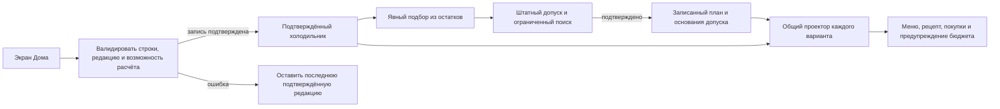

# Фаза 5 — Исследование домашних запасов и меню из остатков

**Дата** 22.11.2026
**Область** Гостевое хранилище, согласованный расчёт, ограниченный подбор.
**Уверенность** Высокая для текущих контрактов. Предлагаемый формат и производительность подлежат проверке при реализации.

<user_constraints>

## User Constraints (from CONTEXT.md)

### Locked Decisions

## Решения для реализации

### Холодильник и мастер

- **D-01:** На экране «Дома» использовать поиск по действующему каталогу продуктов и шесть популярных чипов. Результат поиска выбирается перед нажатием «Добавить». Чип добавляет сразу. Повторный выбор существующей позиции открывает её для правки. Одна запись на идентификатор продукта. После добавления без количества строка остаётся валидной. Изменить количество и единицу можно явным сохранением, отметку и удаление — отдельными действиями. Показывать загрузку, пустой список, ошибку чтения или записи и безопасный повтор.
- **D-02:** Сохранённый холодильник и черновик мастера имеют самостоятельные жизненные циклы. При первом использовании без записи холодильника использовать известные строки последнего подтверждённого меню как исходную подсказку для холодильника, если есть такой снимок. Само чтение его не переписывает. После первой явной правки сохранённый холодильник, включая пустой список, становится источником для запуска из «Дома» и быстрого старта. При новом сеансе настройки без пользовательских правок шага «Продукты дома» холодильник служит начальным предложением. Уже введённые строки черновика сохраняются, их применение в мастере относится к создаваемому меню. Пропуск и незавершённое редактирование мастера не меняют сохранённый холодильник или пищевые ограничения. Подписи поясняют, откуда взяты продукты для запуска.
- **D-03:** Использовать текущие устойчивые ID и нормализацию, без округления введённого количества перед расчётом. Пустое количество явно отображается, может влиять только на мягкое предпочтение. Несовместимое или неподтверждённое количество не уменьшает потребность. Масса филе без кожи и костей и яичной массы без скорлупы требует явного выбора. Нулевые, отрицательные, нечисловые значения и известное количество без допустимой единицы отклоняются с пояснением. Совместимые единицы нормализуются прежними правилами, неподтверждённых переводов между массой, объёмом и штуками нет.

### Пересчёт и лимит

- **D-04:** Решение C-03. После успешного изменения запасов пересчитать покрытие, покупки и бюджет имеющегося меню. Состав блюд, порции, даты, выбранный вариант и остальные варианты сохраняются. Баннер «Пересчитать меню и список?» показывает, что покупки уже обновлены. «Позже» закрывает предложение сменить блюда. «Пересчитать» предлагает новый подбор с актуальными запасами и при действующем меню использует подтверждение замены набора из предыдущей фазы. Ошибка или отмена подбора сохраняет прежние блюда и актуальный расчёт покупок.
- **D-05:** Каждый вариант получает независимую проекцию того же количества запасов. Внутри одного варианта известный запас расходуется в расчёте один раз в текущем порядке дат и слотов. КБЖУ и полная стоимость состава неизменны при изменении только запасов. Если уменьшение запаса выводит существующее меню за лимит, показывать актуальный итог и размер превышения с предложением нового подбора. Это изменение внешнего условия у ранее принятого меню. Генератор и операции добавления, замены и увеличения порций сохраняют точный бюджетный допуск. Подбор альтернатив и ручные правки работают с актуальной базой запасов; планирование должно проверить и явно описать запись в этом сценарии, включая уже превышающие лимит неактивные варианты.
- **D-06:** Все связанные экраны используют один согласованный расчёт. Замеченное изменение актуальной редакции запасов отклоняет просроченный результат подбора или правки. Фаза 4 хранит сохранённые варианты и явные пустые координаты, а каталог остаётся закреплённым за планом. Старые записи не переписываются при чтении. Исследование выбирает способ хранения, guard и восстановление при отказе одной записи, с проверками reload, повторных действий, ошибок и ранее сохранённых версий.

### Меню из остатков

- **D-07:** «Составить меню из остатков» на экране «Дома» запускает штатный подбор с актуальным подтверждённым холодильником, последними применёнными настройками либо действующим валидным черновиком/начальными настройками по прежней политике быстрого старта. Сохраняются период, бюджет, запреты, выбранное время и история последнего меню до успешной записи. При отсутствии запасов показывается пояснение и путь к обычному подбору. Скоро портящиеся продукты при возможности получают приоритет первых одного или двух дней, без обязательной доли покрытия. Распределение в проекции не списывает фактические запасы.
- **D-08:** Первый сквозной сценарий использует рабочий экран «Дома» и настоящий сохранённый план. Правка известного количества меняет покупки и сохраняется после перезагрузки. Основной проверочный пример: требуется 500 г, 200 г дома, купить 300 г. Затем проверить «Позже», новый подбор, превышение бюджета после уменьшения запаса, повтор блюда и варианты, неизвестную и несовместимую единицу, отсутствие старого плана, отказы и сохранность ручных изменений фазы 4. Проверить клавиатуру и ширины 360/390/430/768/1280 px.

Это рабочие решения, принятые автономно на основании ТЗ. Способ хранения, компоненты и порядок задач уточняются исследованием и планом.

### Deferred Ideas

Фактическое списание при готовке, партии, даты годности, перенос купленного в запасы, свои продукты, проценты покрытия в рекомендациях и общие семейные аккаунты выходят за объём фазы. Ручные покупки и отметки относятся к фазе 6, PDF — к фазе 7.

</user_constraints>

## Резюме

Хранить холодильник отдельной авторитетной записью и строить единую текущую проекцию всех вариантов через действующий `projectPlan`. Сохранённый план фиксирует состав и основания допуска. Мутация холодильника записывает только холодильник. Смена состава или варианта записывает только план. При уменьшении запасов выводить фактическое превышение, не признавая ранее проверенный план повреждённым. Это рекомендация по реализации D-04–D-06, а не свойство текущего кода.

Текущий `validateActiveBundle` применяет `PLAN_OVER_BUDGET` отдельно к каждому варианту, и тот же gate используется на чтении, записи, приёме генератора и ручной правке. Простая замена сохранённого `pantrySnapshot` распространит отказ одного варианта на весь набор. Ослабление gate для всех записей нарушит старый контракт, включая тест подменённого неактивного варианта. [VERIFIED: src/adapters/activePlan.ts:26–51,59–93; src/features/generation/controller.ts:195–222,285–304; src/adapters/activePlan.test.ts:192–211]

## Architectural Responsibility Map

| Возможность | Владелец | Граница |
| --- | --- | --- |
| Поиск, правка строки, баннер и действия | Клиентский интерфейс | Валидация полей, доступные состояния и фокус. |
| Нормализация, расчёт, допуск к бюджету | Чистый домен TypeScript | Один проектор, общий каталог, точные числа. |
| Подтверждённый снимок запасов и атомарная запись значения | Локальный адаптер | Контроль версии, размера, сериализации и наблюдаемых конфликтов. |
| Совместное применение редакций меню и холодильника | Контроллер приложения | Захватывает согласованные входы, публикует один видимый результат. |
| Подбор остатков | Существующий порт генерации | Использует подтверждённые входы и отменяемый ограниченный поиск. |

<phase_requirements>

## Phase Requirements

| ID | Требование | Опора исследования |
| --- | --- | --- |
| GEN-08 | Подбор из остатков с приоритетом первых 1–2 дней | Запуск из холодильника, ранняя оценка, допустимый дорогой и недопустимый примеры. |
| HOME-01 | Найти, добавить, изменить количество и отметку, удалить | Один редактор и отдельный гостевой адаптер. |
| HOME-02 | Показать расчёт фактического покрытия | `projectPlan` и независимый пример 500/200/300, совместимость единиц. |
| HOME-03 | Обновить покупки и обработать «Пересчитать / Позже» | Раздельные проекции допуска и текущего просмотра, согласованные редакции. |

Источник идентификаторов и требований — [VERIFIED: .planning/REQUIREMENTS.md:55,77–79]; сценарии — [VERIFIED: reference/PRD.md:165–171; .tmp/reference-review/ТЗ_для_фронтенда_—_Планировщик_питания.txt:539–564].

</phase_requirements>

## Project Constraints (from AGENTS.md)

- Русский интерфейс, P0 по подробному фронтенд-ТЗ. Сохранять открытые вопросы и provenance решений, мобильные ширины 360/390/430/768/1280.
- Гостевой адаптер и доменная логика вне React. Повторно использовать компоненты, каталог и проектор, строгий TypeScript, проверенные единицы/данные. Не использовать неявные оценки, не ослаблять ограничения или расчёт бюджета.
- Не добавлять платные сервисы, аккаунты, зависимости и не менять пользовательские документы, системные настройки и непредметные файлы.
- TDD, настоящие браузерные пути, TypeScript/ESLint/сборка. Проверять старые сохранения, писательские ошибки и отмену. Фиксировать только выполненные тесты. Playwright для сквозных, визуальных и адаптивных проверок. Context7 применять при появлении нового зависимого API.
- Область проверки — существующий проект. Graphify вернул `"disabled": true`; исследование опирается на рабочие исходники. [VERIFIED: AGENTS.md; .agents/skills/mealplan-domain/SKILL.md; локальный ответ graphify status]

## Standard Stack

Переиспользовать установленные версии. Нового пакета и интеграции не требуется. Источник версии исполнения — манифест проекта, а не текущий реестр.

| Слой | Фактическая версия или команда |
| --- | --- |
| React / React Router / TypeScript | `"react": "19.3.1"`, `"react-router": "8.5.0"`, `"typescript": "6.0.3"` [VERIFIED: package.json:14–26]. |
| Сборка и стили | `"vite": "8.3.5"`, `"tailwindcss": "3.4.19"`, `"build": "vite build --target safari15"` [VERIFIED: package.json:7–26]. |
| Тесты | `"vitest": "5.0.5"`, `"@playwright/test": "1.64.1"`, `"test:e2e": "playwright test"`, `"test:unit": "vitest"` [VERIFIED: package.json:9–21]. |

## Architecture Patterns

### 1. Локальная запись и единый источник

Рекомендация: новый компактный pantry envelope под отдельным ключом. В нём версия, непрозрачный токен редакции и валидированные строки формата ввода. Не сохранять вторую копию производных количеств/КБЖУ. В порядке чтения различить: pending; запись отсутствует; подтверждённая запись с любым числом строк, прежде всего ноль; повреждение/недоступность. «Нет записи» разрешает подсказку из проверенного меню. Ошибка чтения не разрешает пустой запас и не заменяет прежние байты. Новую запись создавать только явной операцией пользователя. Строка с неопределённым количеством хранится и не даёт количественного покрытия.

Использовать существующий каталог названий и допустимых единиц, точную нормализацию и ограничение числовой длины. Структурно валидный современный ввод можно хранить компактным текстом и переводить в вычислительную форму одним общим преобразованием. Общие исторические веса курицы/яиц при импорте сохранить как требующие уточнения или подсказку, без автоматического признания съедобного веса. В качестве исходника брать подтверждённый снимок плана, а не черновик. Если в таком снимке встречается устаревшая масса, первоначальный экран предупреждает; простое открытие экрана не заменяет прежний подтверждённый расчёт. При первой явной записи новая живая проекция соблюдает правила уточнения независимо от происхождения строки.

Существующий каталог поиска определяет шесть популярных ID `'egg', 'chicken', 'tomato', 'cottage-cheese', 'rice', 'potato'` и двух специализированных продуктов `'pantry-chicken-fillet'`, `'pantry-egg-mass'`; узкие профили `'usda-171077-raw'`, `'usda-171287-raw'` задаются отдельно. Числа округлять для показа после расчёта. Проверять конечность и положительность в интерфейсной политике, а вычислять из исходной строки через точный парсер. [VERIFIED: src/adapters/products.ts:7–32; src/domain/pantry.ts:4–16; src/domain/settings.ts:105–118; src/domain/appliedSettings.ts:98–105,116–124; src/domain/quantities.ts:15–42]

Фаза вводит максимум по фактическому числу уникальных допустимых ID, лимит UTF-8 и версионную проверку перед JSON parse. Переиспользовать паттерн нынешнего адаптера: reread сравнивает исходные байты непосредственно перед записью. Первая запись проверяет прочитанный null. Смена другой вкладкой блокирует устаревшую команду, требует перечитать данные и по возможности инвалидирует уже показанные результаты операций. Сравнение двух чтений в localStorage не является обещанием межвкладочного CAS. [VERIFIED: src/adapters/activePlan.ts:10–25,61–94; src/adapters/guestDraft.ts:18–49; .planning/phases/04-izmenenie-blyud-i-portsiy/04-SECURITY.md, T-04-10]

### 2. Две проверяемые базы одного плана

**Сохранённый допуск.** Оставить чтение исторических конвертов неизменным. Они должны проходить полную структуру, каталог, ограничения и бюджет на оригинальной базе. Текущие определения: `export const PLAN_SCHEMA_VERSION = 1` и `export const EDITED_PLAN_SCHEMA_VERSION = 2`. Внутренний формат 2 проверяет `'id,instances,emptySlots'`, формат 1 — `'id,instances'`. Один набор ограничен `value.variants.length > 12`, место и `recipeSnapshot` сверяются с каталогом. Существующий внешний ключ `'mealplan:guest:active-plan:v1'`, лимит `4_000_000`. Оптимально оставить внутренние типы плана и добавить строгую метаобёртку хранения отдельной версии только для нужных записей. Её поля не часть ответа генератора. [VERIFIED: src/domain/plan.ts:9–11,37–49,182–209,247–265; src/adapters/activePlan.ts:10–11,66–72]

**Живое представление.** В контроллере сохранять подтверждённый envelope для dispatch, сравнения редакций и записи. Отдельный расчетный вход получает его метаданные и эффективный снимок запасов. Один видимый набор проекций используется экранами, меню вариантов и альтернативами. Для каждого варианта независимо вызвать `projectPlan`, не мутируя каталог, меню и холодильник. Эти проекции можно кэшировать до смены плана или эффективного запаса. Действующий проектор использует один остаток на вариант, записи с неизвестным количеством и несовместимостью имеют `'UNKNOWN_PANTRY_QUANTITY'` и `'INCOMPATIBLE_PANTRY_UNIT'`. Он уже вычисляет бюджет с `'exact-limit-exceeded'`, `'display-rounding-exceeded'` и `'within-budget'` без отказа самой проекции при превышении. Показывать превышение как внешнее изменение стоимости, в том числе случай «меньше копейки» или отказ округлённой суммы. Старый способ приёмки суммы на генерации сохраняется. [VERIFIED: src/domain/planProjection.ts:59–78,107–150,153–177; src/features/shopping/ShoppingPage.tsx:17–33]

**Ручная правка при превышении другого варианта.** Вариант B мог подорожать от изменения запасов, при этом допустимая правка A не требует его удалить, пересчитать исходную базу B или заблокировать весь набор. Выбор варианта меняет только активный ID и остаётся доступен для просмотра актуального предупреждения. Для add/replace/increase пересчитывать изменяемый вариант по живой базе и строго проверять обе стороны бюджетного допуска; для remove/decrease при внешнем превышении разрешать лишь уменьшение, не повышающее ни точную, ни округлённую закупку, с повторной проверкой его прежнего сохранённого допуска. Если снижение всё ещё выше лимита, оставить сообщение о превышении. Спорный случай перераспределения запаса проверять на конечном результате, а не по признаку операции.

**Сохранение изменённого варианта.** Если изменённый состав проходит на исходной основе, сохранять без дополнительной доказательной базы. Если он допустим только на текущих запасах, приложить к конкретному ID варианта валидированный снимок, использованный при допуске. Недопустимое по текущим запасам добавление, увеличение или замена в эту ветку не попадает. При загрузке и записи повторно проверять все варианты на их собственной сохранённой базе (исходной или прилагаемой) и повторно вычислять итоги. Любая произвольная сверхлимитная запись на этой базе остаётся несовместимой. Ограничить карту максимум 12 известными ID, один снимок на ID, привязать неиспользованные/чужие ID к ошибке и нормализовать товарные записи. Для доказательства с пользовательской записью разрешать только проверенные IDs, точные положительные количества, совместимый базис; не импортировать произвольные снимки. Сохранять прежнее ограничение 4 млн байт и проверить максимально большой реально сформированный набор (12 вариантов, 7 дней, много строк, кириллица). При превышении лимита сохранять прежние байты и показать ошибку. Дедуплицировать одинаковые снимки только если фактический cap12-тест требует этого. Старый доверенный формат не должен получать общую лазейку наподобие `allowOverBudget` на чтении. У локальной записи нет криптографического доказательства прошлой реальности запаса. Граница гарантирует целостность и допуск относительно валидных данных, а не аутентичность действий человека.

На работу с полной выдачей влияет текущий код: `sameSnapshot(result.plan.inputs, op.inputs)` и `candidate.bundle.plan.schemaVersion !== PLAN_SCHEMA_VERSION` защищают приём ответа, а `appendVariant` и `recreateSet` вызывают `run(base.plan.inputs, ...)`. Для append подставлять текущую базу **в зафиксированный запрос**, сравнивать ответ именно с ним, а в объединённом плане сохранять прежние варианты и сохранить новому его основание допуска, если оно отличается. Проверка уникальности остаётся по координатам и порциям, каталог, даты и остальные настройки прежнего набора остаются закреплёнными. `recreateSet` и кнопка из холодильника запускают новый набор по согласованным входам и прежнему подтверждению. [VERIFIED: src/features/generation/controller.ts:186–239; src/domain/generatePlan.ts:23–30; src/domain/mealEdits.ts:54–85,88–123,138–164]

Контрольное ожидание для планировщика: лимит 500 ₽, A и B были приняты при 450 и 490 ₽. После удаления запаса B стоит 540 ₽, A — 460 ₽. Допустимая правка A до 480 ₽ сохраняется и переживает reload, B остаётся видимым с превышением 40 ₽. Добавление или замена, дающая A 501 ₽, отклоняется без записи; удаление в B, дающее 520 ₽ при сохранении прежнего доказательства допуска, оставляет предупреждение и сохраняется, если точный и отображаемый итоги уменьшились. Отдельный тест подставляет новый совместимый запас, при котором правка проходит живой допуск, а первоначальная база даёт отказ. При подмене/утрате новой базы семантическая проверка соответствующего варианта должна снова отказать.

### 3. Редакция, происхождение и подсказки

- Захватывать редакцию плана и эффективного запаса для открытия списка замен, расчёта, генерации, попытки записи и retry. После подтверждения склада инвалидировать отложенные команды с прежней базой, сбрасывать связанную оптимистическую проекцию и публиковать расчёт подтверждённых блюд по новому запасу. Проверять актуальность источника сразу перед записью плана. Действующая граница порта формулируется `isCurrent: () => boolean`, контроллер сериализует записи, источник хранит `inspectedRaw`. Не разрывать принятие уже совершившейся записи на границе дедлайна, покрытое фазой 4. [VERIFIED: src/adapters/activePlan.ts:16–21,59–94; src/features/generation/controller.ts:149–176,244–254,269–304; src/features/generation/controller.test.ts:276–308]
- Свежему запуску из холодильника и быстрому старту передавать подтверждённый текущий запас как отдельный `pantrySnapshot`, не переписывая `appliedSettings.raw`, которое сверяется с rebuilt. Не использовать `rows.length` как проверку наличия холодильника. Явно записанное пустое значение побеждает историческую подсказку. Сохранённый грязный черновик оставлять у мастера. Для чистого сеанса показывать подготовленные строки отдельно, при первом явном изменении материализовать самостоятельный черновик. Имеющийся шаг без строк, который мог быть явно очищен, консервативно сохранять как авторский при неизвестном происхождении; для новых сеансов различить untouched/edited явной метаданной черновика, не изменив действующий `AppliedSettings.raw` в сохранённых планах.
- Если мастер явно применил иной запас к создаваемому меню, сохранить в метаобёртке токен подтверждённого холодильника, при котором создано меню. Пока редакция та же, у этого меню действует сознательно выбранный снимок мастера. Как только редакция меняется, все варианты получают живой запас на текущей редакции. Выбор «Позже» связан с редакцией данного холодильника и набором меню. Закрытие предложения может оставаться в состоянии сеанса, но при повторном открытии не менять вычисление. Новая подтверждённая правка снова разрешает предложение.
- Установить приоритет чтения явно: (а) отсутствие холодильника — оригинальный снимок; (б) подтверждённый запас и сознательно применённый снимок мастера при том же токене — снимок мастера; (в) иной подтверждённый токен или явный пустой — холодильник; (г) неизвестный/повреждённый запас — последнее подтверждённое значение с пометкой, повтор чтения, блок правок и подбора, зависящих от неактуального источника. Панель и покупки не объявляют подозрительно устаревший итог актуальным. Фаза 4 уже держит `visiblePlanSnapshot` и охраняемый переход страницы рецепта. Эту границу использовать для публикации, не вводя параллельные UI-итоги. [VERIFIED: src/domain/plan.ts:161–173; src/domain/appliedSettings.ts:126–139; src/app/App.tsx:207–280; src/features/generation/controller.ts:149–176]

### 4. Подбор с реальным приоритетом остатков

Обычный солвер уже ранжирует первое использование `expiresSoon` по `inputs.dates.slice(0, 2)` и cap `minimum(divide(used, available.amount), decimal('1'))`. Неизвестное количество даёт предпочтение по наличию доступного блюда. Не копировать эту эвристику на фронтенд. Сохранить сортировку обычного режима и исторические семена. Если при ограниченном поиске реально достижимые кандидаты с ранним расходом не рассматриваются, добавить только для явно выбранного запуска компактные старты из уже допущенных блюд, распределённые по первым **допустимым** слотам: сначала дешёвый старт, затем детерминированные ранние подстановки. Сохранить лимиты поиска, тайм-аут, отмену между пакетами. В проверке выбора использовать только результаты точной проекции и жёсткого бюджета. `targetCount` проверяется 1–3, повторные ID исключает отпечаток, `maxEvaluations: 512`, `batchSize: 128`; не расширять при необходимости вручную проставленного результата. [VERIFIED: src/domain/generatePlan.ts:20,48–74,89–101,157–216; src/adapters/generation.ts:44–49,75–91]

Независимая оценка: маленький каталог с 3 днями и 4 слотами/день, по одному фиксированному кандидату в трёх типах и двумя допустимыми в одном. Один содержит 100 г истекающей моркови на семейный слот, остаток 200 г. Держать цену ингредиентов одинаковой в паре вариантов и вручную проставить дополнительный продукт так, чтобы обе полные комбинации допускались. Сравнить два плана с одинаковыми 200 г потребления: день 1+2 даёт раннюю долю 1, день 2+3 — 0,5. Отдельными тестами исключить ранний рецепт по пищевому ограничению или времени, и создать сценарий, где подстановка в ранний день нарушает бюджет из-за действующего альтернативного сочетания. Убедиться, что при переносе только ради раннего запаса не ослабляются проверка категории, лимит и источник. Проверка на текущем выпуске через настоящий интерфейс фиксирует дату фактического использования, не обещает глобальный оптимум ограниченного поиска.

## Don't Hand-Roll

| Задача | Использовать | Причина |
| --- | --- | --- |
| Единицы и точные числа | Текущие `parseDraftQuantity`, `normalizeQuantity`, `convertQuantity` | Вход, совместимость и рациональная арифметика уже едины. |
| Агрегация и цена | `projectPlan`, `checkPurchaseBudget`, текущий presentation | Идентичные расчёты требуется показать на трёх экранах. |
| Допуск | `createRecipeEligibility`, trusted catalog и текущий порт генерации | Сохраняется прежняя проверка безопасности и версии. |
| Взаимодействие | Текущие поля, combobox, подтверждение и фокус | Существуют локальные паттерны мастера и фазы 4. |

[VERIFIED: src/domain/quantities.ts:31–48; src/domain/planProjection.ts:59–78,107–150; src/domain/mealEdits.ts:124–150; src/adapters/generation.ts:65–75; src/app/App.tsx:235–247]

## Common Pitfalls

1. Подставить новую базу непосредственно в persisted envelope и перевести весь набор в ошибку из-за скрытого B. Решение — проверка допустимости сохранения на подтверждённой базе, живой бюджет в проекции.
2. Перезаписывать две записи на каждую правку холодильника. Согласованность достигается одной записью запаса и чистой проекцией; проверка prospective данных выполняется до записи, UI признаёт изменение после успешного сохранения.
3. Засчитывать тот же продукт дважды при нескольких блюдах или вариантах. Границы остатков уже заданы проектором. Другой вариант — независимый сценарий использования тех же запасов.
4. Не обновлять меню до согласия «Пересчитать» или применять уже отклонённый pre-revision результат. Расчёт покупок не ждёт решения о новых блюдах, отмена и retry имеют захваченный контекст.
5. Считать пустой холодильник отсутствующим или сгладить ошибку загрузки пустым массивом. Это вернёт удалённые запасы после reload.
6. Применить веса старой общей курицы/яиц без уточнения или подписать неизвестное количество нулём. Это неожиданно меняет проверенный бюджет и фактическое покрытие.
7. Использовать фиксированный seed генератора ради точного 500/200/300. Для целевого случая поддерживаемый план задаётся детерминированной проверенной библиотечной комбинацией, а независимый дополнительный E2E запускает обычную генерацию.

## Runtime State Inventory

| Категория | Где находится | Действие фазы |
| --- | --- | --- |
| Записанное меню | Внешняя оболочка `{ schemaVersion: 1, plan: ... }` и ключ `'mealplan:guest:active-plan:v1'`, внутренние версии 1/2. | Сохранить строгий read; новая обёртка только для подтверждённых новых случаев. Автоматически байты не переписывать. [VERIFIED: src/adapters/activePlan.ts:10–11,59–94; src/domain/plan.ts:37–49] |
| Черновик | `'mealplan:guest:draft:v1'`, записывается `JSON.stringify({ schemaVersion: 1, draft })`. | Совместимость и независимый ввод. [VERIFIED: src/adapters/guestDraft.ts:3,18–49] |
| Локальные условия | Вход в storage происходит только при операции адаптера. | Проверить исключения доступа, квоты, ограничение сырых байтов, reload и конфликт. [VERIFIED: src/adapters/activePlan.ts:59–94; src/adapters/guestDraft.ts:17–45] |
| Секреты, ОС и внешний сервис | Для рекомендуемой реализации изменений нет. | Использовать действующий локальный браузерный runtime. |
| Сборка | Запускается `vite build --target safari15`. | Собрать после фазы, проверить браузерными сценариями. [VERIFIED: package.json:7–12] |

## Validation Architecture

| Требование | RED → GREEN | Проверка |
| --- | --- | --- |
| HOME-01/02/03 | Рабочий сценарий: сохранённый адаптером план → «Дома» → сохранить 200 г из 500 г → покупки 300 г → reload. Подтверждённые байты состава не меняются. | Playwright smoke на Chromium, два экрана и перезагрузка. |
| HOME-01 | CRUD, результат поиска и кнопка добавления, чип, неизвестное количество, конкурирующая запись/ошибка, сохранение ранее записанного пустого холодильника и проверка строк. | Unit хранилища, браузер клавиатурой на 360–1280 px. |
| HOME-02 | Совместимые/несовместимые единицы, разные профили, неизвестный вес, крайняя точность, соседние дни, варианты, частичное и полное покрытие. | Unit проектора и независимая числовая проверка чтения меню/рецепта/покупок. |
| HOME-03 | «Позже» меняет только предложение. При превышении B вариант A редактируется. Удаление и снижение порций, сохранение/перезагрузка, stale apply/retry, 5 выпусков, v1/v2 и новая обёртка, cap12/UTF-8. | Unit контроллера и адаптера, Playwright со staging задержки перед вызовом реального порта. |
| GEN-08 | Задача 3 дня и два сравнимых распределения с независимой ранней долей. Дополнительный бюджетный отказ, real route → генерация → покупки и те же строки холодильника после reload. | Unit солвера, Playwright тест штатного старта. |

**Точный первый сценарий.** Использовать доверенный текущий каталог, реальную загрузку адаптера и в нём заранее записанный стандартный план с двумя обедами `'familiar-chicken-rice-carrot'` на 2 и 1 порцию, ужином `'familiar-pollock-yogurt-buckwheat'` на 2 порции. У каждого исходного рецепта `baseServings: decimal('2')`, `carrot: 200` г. Получаем 200+100+200=500 г. Остальные места выбираются без моркови или явно пусты в поддержанном формате 2. Проверить в браузере до правки 500 г, после покупки ровно 300 г и «из запасов» ровно 200 г. Скачать исходные метки рецепта не требуется, факты включены в проект. Не подменять сами purchase/plan/pantry ports или проекцию. Тест с внедрением отказа оборачивает настоящий порт и проверяет, что ошибка не изменила сохранённый итог. [VERIFIED: src/data/familiarRecipes.ts:8–16,22–23,127–128; src/domain/plan.ts:178–209; e2e/generation-fixtures.ts:6,20–119]

**Порядок исполняемых срезов.** (1) Числовой браузерный сценарий с рабочим хранилищем, уточнение количества и общий расчёт. (2) Полный CRUD, восстановление и правило мастера/пустого склада. (3) Бюджетная деградация, редактирование сохранений/варианты при актуальном запасе, старые версии, ошибки гонок. (4) Подбор из остатков и C-03 с подтверждением, ошибкой и «Позже». (5) Фазовый QA на всех движках, режимы и полный набор. Первый RED дойти до отсутствующего рабочего действия в обычном приложении; далее добавить тесты, падающие по соответствующей причине.

Быстрый CI-командный контракт — существующие `npm run test:unit -- --run <файл>` и `npm run test:e2e -- <файл> --grep <сценарий> --project=chromium --workers=1`. Имена новых тестов план утверждает после Wave 0. Общая граница — unit, Playwright в Chromium/Firefox/WebKit, typecheck, lint, build; для экономии производительности большие браузерные и unit прогоны последовательно. Конфигурация браузеров содержит `name: 'chromium'`, `name: 'firefox'`, `name: 'webkit'`, `127.0.0.1:4173`; независимые прогоны могут использовать выделенный свободный порт без изменения чужого процесса. [VERIFIED: package.json:7–12; playwright.config.ts:1–25]

## Security Domain

Проект настроен на `"security_enforcement": true`, `"security_asvs_level": 1`, `"security_block_on": "high"`. Фаза локальная и гостевая, контролей новых аккаунтов, токенов, сессий и криптографии не вводится. [VERIFIED: .planning/config.json, блок workflow]

| Область и риск | Контроль |
| --- | --- |
| Tampering: сырые записи холодильника/плана, подменённая доказательная база | Строгая версия и закрытая схема, размер UTF-8 до парсинга, ограниченные точные числа, известные IDs, нормализация и единственность, сохранение испорченных исходных байтов. Каталог/ограничения неизменно проверять. |
| Tampering: устаревший запрос, две редакции, поздний retry | Токен редакции склада, плановый revision и сравнение сырых значений перед изменением. Отмена при наблюдаемом конфликте. Не обещать атомарный межвкладочный CAS. |
| Tampering: бюджетное исключение для чужого варианта | Режим текущего просмотра не допускает запись лишних блюд. Доказательство базы конкретного изменяемого варианта проверяется по фактам, а вход генератора остаётся строгим. |
| Denial of service: неизвестные/чрезмерные числа, 12 вариантов, неограниченный подбор | Существующие границы exact/байтов, ограниченный набор SKU, пересчитывать только при смене редакции, отменяемые пакеты и тайм-аут. |
| Публикация и цепочка поставок | Не вводить новые пакеты/внешние API, тестировать изолированно с текущими зависимостями. |

## Открытые технические проверки

- Проверить фактический размер локальной обёртки на максимальном плане. Новый формат не должен приводить к частичной записи запасов и плана. Первое изменение размера обёртки подвергается RED-тесту на слишком большую запись.
- Фактическую отзывчивость пересчёта всех вариантов на 12×7 и первого списка замен замерить после реализации. Рекомендованное кэширование не считается доказательством производительности.
- Политика reduce/removal после внешнего превышения — предлагаемое уточнение D-05. Независимыми числами проверить, что ни точный, ни рублёвый итог не растут и сохранённый допуск этого варианта воспроизводится.

## Источники

Первичные источники задачи — фронтенд-ТЗ и PRD, карты требований, контекст и доменные исходники с построчными ссылками выше. Исследование не требует нового внешнего API или пакета. Браузерный и аппаратный результат в данном исследовании не утверждается.
